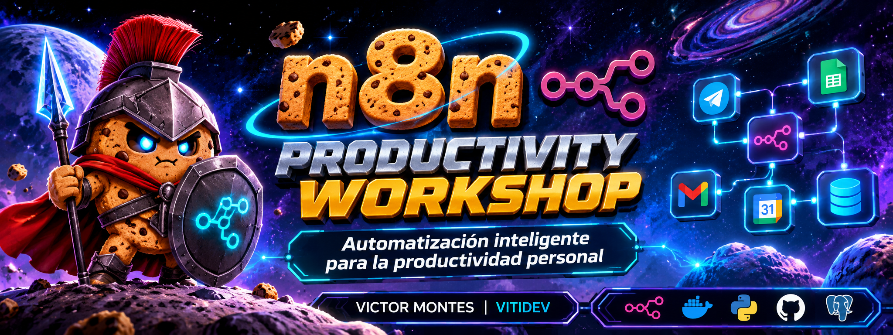
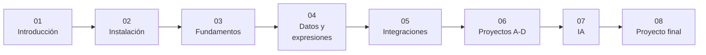
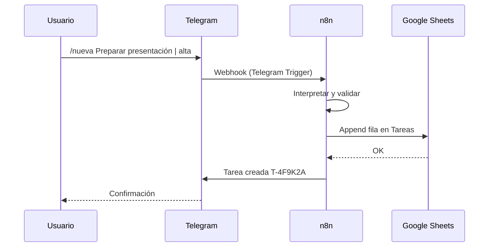
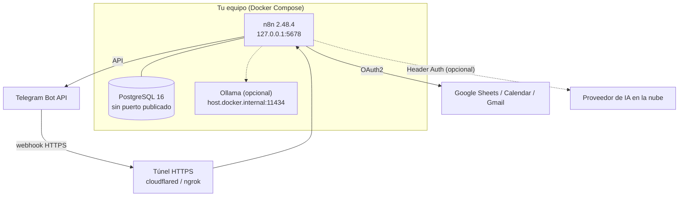

<p align="center">
  
</p>

<h1 align="center">n8n Productivity Workshop</h1>

<p align="center">
  Taller práctico y de código abierto para aprender a automatizar la productividad personal con n8n:<br>
  tareas, agenda, correo, hábitos e IA, desde cero hasta un sistema completo.
</p>

<p align="center">
  <a href="LICENSE"></a>
  <a href="LICENSE-DOCS"></a>
  <a href="https://github.com/VITIDEV06/n8n-productivity-workshop/commits"></a>
  <a href="https://github.com/VITIDEV06/n8n-productivity-workshop/graphs/contributors"></a>
  <a href="https://github.com/VITIDEV06/n8n-productivity-workshop/issues"></a>
  <a href="https://github.com/VITIDEV06/n8n-productivity-workshop/stargazers"></a>
  <a href="https://www.repostatus.org/#active"></a>
</p>

---

## Tecnologías

<p align="center">
  
  
  
  
  
</p>
<p align="center">
  
  
  
  
  
</p>
<p align="center">
  
</p>

| Tecnología | Uso en el taller |
| --- | --- |
| n8n 2.48.4 | Motor de automatización (editor visual, ejecución de workflows) |
| Docker Compose y PostgreSQL 16 | Instalación local reproducible y persistente |
| JavaScript | Nodos Code y expresiones |
| Telegram Bot API | Interfaz de chat de los asistentes |
| Google Sheets, Calendar y Gmail | Almacenamiento de datos, agenda y correo |
| API compatible con OpenAI (Ollama, Groq, Gemini, OpenRouter, OpenAI) | Clasificación y resumen de notas (opcional) |
| Python | Validador de workflows `scripts/validate-workflows.py` |
| GitHub Actions | Validación automática en cada *push* y *pull request* |

## Tabla de contenidos

1. [Presentación del taller](#presentación-del-taller)
2. [Objetivos de aprendizaje](#objetivos-de-aprendizaje)
3. [Público objetivo](#público-objetivo)
4. [Requisitos previos](#requisitos-previos)
5. [Instalación de n8n](#instalación-de-n8n)
6. [Inicio rápido](#inicio-rápido)
7. [Mapa de módulos](#mapa-de-módulos)
8. [Catálogo de automatizaciones](#catálogo-de-automatizaciones)
9. [Proyectos prácticos](#proyectos-prácticos)
10. [Importación de workflows](#importación-de-workflows)
11. [Credenciales](#credenciales)
12. [Variables de entorno](#variables-de-entorno)
13. [Diagramas](#diagramas)
14. [Arquitectura](#arquitectura)
15. [Seguridad](#seguridad)
16. [Solución de problemas](#solución-de-problemas)
17. [Preguntas frecuentes](#preguntas-frecuentes)
18. [Contribuir](#contribuir)
19. [Licencia](#licencia)
20. [Autor y contacto](#autor-y-contacto)

---

## Presentación del taller

**n8n Productivity Workshop** es un curso práctico en español para construir, paso a paso, automatizaciones reales de productividad personal con [n8n](https://n8n.io/), una herramienta de automatización de flujos de trabajo que puede ejecutarse en tu propio equipo.

El recorrido empieza con un «Hola mundo» y termina con un **Personal Productivity Hub**: un asistente de Telegram que gestiona tareas, hábitos y agenda, envía resúmenes programados, clasifica notas con IA y avisa de sus propios errores.

El repositorio incluye:

| Contenido | Cantidad | Ubicación |
| --- | --- | --- |
| Módulos con teoría, demostración, ejercicio guiado, reto y solución | 8 | [modules/](modules/) |
| Workflows importables | 27 | [workflows/](workflows/), [exercises/](exercises/) |
| Proyectos completos documentados en 15 apartados | 6 | [workflows/](workflows/README.md) |
| Ejercicios por niveles con soluciones | 9 + retos de módulo | [exercises/](exercises/README.md) |
| Guías de integración | 5 | [guides/](guides/) |
| Plantillas, datos de ejemplo y prompts | 17 archivos | [templates/](templates/) |

> [!NOTE]
> Proyecto educativo independiente. **No está afiliado, patrocinado ni respaldado por n8n GmbH.** n8n es una marca de sus respectivos titulares.

## Objetivos de aprendizaje

Al completar el taller serás capaz de:

- Instalar y mantener n8n con Docker Compose, PostgreSQL y copias de seguridad.
- Diseñar workflows con triggers manuales, programados, webhooks y de servicios externos.
- Usar lógica condicional, bucles, combinación de ramas, código JavaScript y manejo de errores.
- Transformar datos con expresiones y fechas con Luxon.
- Conectar Telegram, Google Sheets, Google Calendar, Gmail y APIs REST con credenciales seguras.
- Integrar modelos de lenguaje validando su salida como dato no confiable.
- Organizar un sistema grande en sub-workflows con un contrato de datos y un workflow de errores.
- Aplicar buenas prácticas de seguridad y privacidad en automatizaciones personales.

## Público objetivo

| Perfil | Qué encontrará |
| --- | --- |
| Personas sin experiencia en automatización | Un recorrido guiado desde cero, sin necesidad de programar en los primeros módulos. |
| Estudiantes y profesionales que quieren organizarse mejor | Proyectos listos para adaptar a su día a día. |
| Desarrolladores que empiezan con n8n | Patrones de arquitectura, validación y pruebas de workflows. |
| Docentes y formadores | Material reutilizable bajo CC BY 4.0, con ejercicios y soluciones. |

## Requisitos previos

| Requisito | Detalle |
| --- | --- |
| Equipo | Windows 10/11, macOS o Linux con 4 GB de RAM libres |
| Docker | Docker Desktop o Docker Engine con Compose v2 |
| Git | Para clonar el repositorio (o descarga el ZIP) |
| Cuentas | Google (Sheets, Calendar, Gmail) y Telegram, a partir del módulo 05 |
| Opcional | Ollama o una API key de un proveedor de IA (módulo 07); `cloudflared` o `ngrok` para recibir mensajes de Telegram |
| Conocimientos | Uso básico del ordenador y de la terminal. JavaScript ayuda, pero no es imprescindible |

## Instalación de n8n

La instalación recomendada usa Docker Compose con PostgreSQL y la versión de n8n fijada en **2.48.4**, la versión con la que se ha probado el taller.

```bash
git clone https://github.com/VITIDEV06/n8n-productivity-workshop.git
cd n8n-productivity-workshop
cp .env.example .env
```

Edita `.env` y cambia al menos `N8N_ENCRYPTION_KEY`, `POSTGRES_PASSWORD` y la zona horaria. Para generar una clave:

```bash
openssl rand -hex 32
```

Arranca los servicios:

```bash
docker compose up -d
```

Abre <http://localhost:5678> y crea tu cuenta de propietario. Guía completa, actualización y copias de seguridad: [docs/installation.md](docs/installation.md) y [módulo 02](modules/02-installation-and-setup/README.md).

> [!IMPORTANT]
> Guarda `N8N_ENCRYPTION_KEY` en un gestor de contraseñas. Sin ella no podrás descifrar las credenciales guardadas en n8n.

## Inicio rápido

1. Instala n8n como se indica arriba.
2. En n8n: **Create workflow** > menú `...` > **Import from File...** > [workflows/01-getting-started/01-hello-world.json](workflows/01-getting-started/01-hello-world.json).
3. Pulsa **Execute workflow**.
4. Abre el nodo **Construir mensaje**: verás tu primer resultado.
5. Continúa con el [módulo 01](modules/01-introduction/README.md).

Para importar todos los workflows de una vez desde la terminal:

```bash
docker compose cp workflows n8n:/tmp/workflows
docker compose exec n8n n8n import:workflow --separate --input=/tmp/workflows/01-getting-started
```

## Mapa de módulos



| Módulo | Contenido | Nivel | Duración |
| --- | --- | --- | --- |
| [01 — Introducción](modules/01-introduction/README.md) | Qué es la automatización, qué es n8n, primer workflow | Beginner | 45 min |
| [02 — Instalación y configuración](modules/02-installation-and-setup/README.md) | Docker Compose, persistencia, variables, actualización, copias de seguridad | Beginner | 60 min |
| [03 — Fundamentos de automatización](modules/03-automation-fundamentals/README.md) | Triggers, HTTP Request, IF, Switch, Merge, Set, Code, Loop, errores, depuración | Beginner | 2 h |
| [04 — Datos y expresiones](modules/04-data-and-expressions/README.md) | Items, JSON, expresiones, Luxon, validación | Beginner / Intermediate | 90 min |
| [05 — Integraciones](modules/05-integrations/README.md) | Telegram, Google Sheets, Calendar, Gmail, APIs REST, IA; OAuth2 frente a Service Account | Intermediate | 2 h |
| [06 — Proyectos prácticos](modules/06-practical-projects/README.md) | Proyectos A, B, C y D | Intermediate | 4 a 6 h |
| [07 — Automatización con IA](modules/07-ai-automation/README.md) | Prompts, salida estructurada, validación, costos; Proyecto E | Advanced | 2 h |
| [08 — Proyecto final](modules/08-final-project/README.md) | Personal Productivity Hub con sub-workflows | Advanced | 4 a 6 h |

Ruta completa con los ejercicios intercalados: [exercises/README.md](exercises/README.md).

## Catálogo de automatizaciones

| Workflow | Qué hace | Servicios | Credenciales |
| --- | --- | --- | --- |
| [01 Hola mundo](workflows/01-getting-started/01-hello-world.json) | Primer workflow: Edit Fields y Code | Ninguno | No |
| [02 Schedule Trigger](workflows/01-getting-started/02-schedule-trigger.json) | Ejecución programada y fechas | Ninguno | No |
| [03 Webhook](workflows/01-getting-started/03-webhook-basics.json) | Recibe un POST, valida y responde | Ninguno | No |
| [04 HTTP Request](workflows/01-getting-started/04-http-request-api.json) | Consulta una API pública y resume | JSONPlaceholder | No |
| [05 Lógica](workflows/01-getting-started/05-logic-switch-merge-loop.json) | Switch, Merge y Loop Over Items | Ninguno | No |
| [06 Errores](workflows/01-getting-started/06-error-handling.json) | Reintentos, salida de error, Stop and Error | JSONPlaceholder | No |
| [07 Prueba de Google Sheets](workflows/01-getting-started/07-google-sheets-connection-test.json) | Comprueba la conexión con tu hoja | Google Sheets | Sí |
| [08 Error workflow](workflows/01-getting-started/08-error-workflow.json) | Registra fallos de otros workflows | Ninguno | No |
| [09 Datos y expresiones](workflows/01-getting-started/09-data-expressions.json) | JSON anidado, arrays, Luxon, validación | Ninguno | No |
| [A. Task Manager](workflows/02-task-manager/README.md) | Tareas desde Telegram | Telegram, Sheets | Sí |
| [B. Daily Assistant](workflows/03-daily-assistant/README.md) | Resumen diario de agenda y tareas | Calendar, Sheets, Telegram | Sí |
| [C. Email Organizer](workflows/04-email-organizer/README.md) | Clasifica y etiqueta correos | Gmail, Sheets | Sí (el clasificador de prueba, no) |
| [D. Habit Tracker](workflows/05-habit-tracker/README.md) | Registro y estadísticas de hábitos | Telegram, Sheets | Sí |
| [E. AI Knowledge Assistant](workflows/06-ai-knowledge-assistant/README.md) | Clasifica y resume notas con IA | IA (opcional), Sheets | Sí |
| [Personal Productivity Hub](workflows/07-final-productivity-system/README.md) | Sistema completo de 7 workflows | Todos | Sí |

Catálogo detallado: [workflows/README.md](workflows/README.md).

### Estado de verificación

Cada workflow indica hasta qué nivel se ha comprobado. Los niveles no son intercambiables: una validación estática **no** demuestra que un workflow funcione.

| Nivel | Qué significa | Resultado |
| --- | --- | --- |
| 1. Validación estática | El JSON pasa `scripts/validate-workflows.py` (estructura, conexiones, referencias entre nodos, secretos) y el validador de parámetros de `@n8n/workflow-sdk` de n8n 2.48.4 | **27 de 27** workflows |
| 2. Importación comprobada | Importado sin errores con `n8n import:workflow` en n8n 2.48.4 | **27 de 27** workflows |
| 3. Ejecución comprobada | Ejecutado con `n8n execute` en n8n 2.48.4. Los workflows con servicios externos se ejecutaron sustituyendo esos nodos por nodos Code con datos ficticios (**integraciones simuladas**): se comprueba la lógica, no la conexión real | **25 de 27** workflows, 66 escenarios de prueba superados (detalle abajo) |
| 4. Integración real comprobada | Probado contra Telegram, Google o un proveedor de IA reales | **Ninguno**: requiere credenciales personales que este repositorio no contiene |

Detalle del nivel 3:

| Grupo | Workflows | Cómo se ejecutó |
| --- | --- | --- |
| Sin servicios externos o con APIs públicas | 01, 02, 04, 05, 06, 09, clasificador de correo de prueba y las 4 soluciones de ejercicios (12) | `n8n execute` sin modificaciones (04, 06 y las soluciones I2 y A2 llaman de verdad a JSONPlaceholder) |
| Webhook | 03 | Publicado en n8n 2.48.4 y probado con peticiones `curl` reales: respuesta 200 con datos válidos y 400 con datos inválidos |
| Con Telegram, Google o IA | Proyectos A, B, C, D, E y los 7 del proyecto final (13) | Integraciones **simuladas** con nodos Code y datos ficticios; se comprueba la lógica, no la conexión |
| No ejecutados | 07 (prueba de Google Sheets) y 08 (Error workflow) | 07 solo tiene sentido con tu credencial; 08 necesita que falle otro workflow publicado. Su lógica equivale a la de Hub 7, que sí se ejecutó |

Por workflow: cada README de proyecto y [workflows/README.md](workflows/README.md).

## Proyectos prácticos

| Proyecto | Problema que resuelve | Dificultad | Documentación |
| --- | --- | --- | --- |
| **A. Personal Task Manager** | Apuntar tareas desde el móvil sin abrir otra aplicación | Intermediate | [README](workflows/02-task-manager/README.md) |
| **B. Daily Productivity Assistant** | Empezar el día sabiendo qué eventos, huecos y tareas tienes | Intermediate | [README](workflows/03-daily-assistant/README.md) |
| **C. Smart Email Organizer** | Bandeja de entrada desordenada | Intermediate | [README](workflows/04-email-organizer/README.md) |
| **D. Habit Tracker** | Medir la constancia de tus hábitos | Intermediate | [README](workflows/05-habit-tracker/README.md) |
| **E. AI Knowledge Assistant** | Notas sueltas sin organizar | Advanced | [README](workflows/06-ai-knowledge-assistant/README.md) |
| **Final. Personal Productivity Hub** | Todo lo anterior en un único asistente | Advanced | [README](workflows/07-final-productivity-system/README.md) |

Cada proyecto documenta: nombre, objetivo, dificultad, tecnologías, diagrama, requisitos, credenciales, importación, configuración nodo por nodo, datos de prueba, ejecución paso a paso, resultado esperado, errores frecuentes, mejoras y seguridad.

## Importación de workflows

**Desde el editor:** crea un workflow vacío > menú `...` > **Import from File...** > elige el `.json`.

**Desde la terminal** (todos los de una carpeta):

```bash
docker compose cp workflows n8n:/tmp/workflows
docker compose exec n8n n8n import:workflow --separate --input=/tmp/workflows/02-task-manager
```

Después de importar:

1. Abre el nodo **Configuración** y sustituye los valores `REEMPLAZAR_...` (ID de hoja, `chat_id`, etc.).
2. Asigna una credencial en cada nodo marcado con aviso.
3. Lee las notas adhesivas del lienzo.
4. Ejecuta con **Execute workflow** antes de **publicar**.

Para el proyecto final el orden de importación importa: ver [sus instrucciones](workflows/07-final-productivity-system/README.md#8-instrucciones-de-importación).

## Credenciales

Los workflows **no incluyen credenciales**. Créalas en tu instancia (*Overview* > *Credentials* > *Create*):

| Credencial en n8n | Para | Guía |
| --- | --- | --- |
| Telegram API | Bots de los proyectos A, B, D y final | [telegram-setup.md](guides/telegram-setup.md) |
| Google Sheets OAuth2 API | Todos los proyectos | [google-sheets-setup.md](guides/google-sheets-setup.md) |
| Google Calendar OAuth2 API | Proyecto B y final | [google-calendar-setup.md](guides/google-calendar-setup.md) |
| Gmail OAuth2 API | Proyecto C | [gmail-setup.md](guides/gmail-setup.md) |
| Header Auth | Proveedor de IA (opcional) | [ai-provider-setup.md](guides/ai-provider-setup.md) |

OAuth2 es la opción recomendada para Google. Service Account solo sirve para Google Sheets (no para Calendar, y para Gmail exige delegación de dominio). Más detalles en [docs/credentials.md](docs/credentials.md).

## Variables de entorno

Definidas en `.env` (copia de [.env.example](.env.example)). El archivo `.env` está excluido de Git.

| Variable | Valor por defecto | Descripción |
| --- | --- | --- |
| `N8N_VERSION` | `2.48.4` | Versión de la imagen de n8n |
| `N8N_HOST` / `N8N_PORT` / `N8N_PROTOCOL` | `localhost` / `5678` / `http` | Dirección del editor |
| `WEBHOOK_URL` | `http://localhost:5678/` | URL pública para webhooks; cámbiala por la del túnel HTTPS para Telegram |
| `N8N_PROXY_HOPS` | `0` | Pon `1` cuando n8n esté detrás de un túnel o proxy |
| `GENERIC_TIMEZONE` / `TZ` | `America/Mexico_City` | Zona horaria de los triggers programados y de `$now` |
| `N8N_ENCRYPTION_KEY` | Obligatoria | Clave de cifrado de credenciales |
| `POSTGRES_DB` / `POSTGRES_USER` | `n8n` | Base de datos |
| `POSTGRES_PASSWORD` | Obligatoria | Contraseña de PostgreSQL |
| `N8N_DIAGNOSTICS_ENABLED` | `false` | Telemetría desactivada |
| `EXECUTIONS_DATA_PRUNE` / `EXECUTIONS_DATA_MAX_AGE` | `true` / `336` | Borrado de ejecuciones con más de 14 días |

Los workflows **no leen variables de entorno**: n8n 2.x bloquea `$env` en los nodos por defecto. Los IDs no secretos van en el nodo **Configuración** de cada workflow.

## Diagramas

El repositorio no incluye capturas de pantalla de la interfaz de n8n, porque cambian con cada versión. En su lugar, todos los flujos están documentados con diagramas Mermaid, que GitHub muestra directamente y que se mantienen junto al código. Cada proyecto incluye el diagrama de su workflow; los módulos incluyen diagramas conceptuales.

Recorrido de un mensaje en el Proyecto A:



## Arquitectura



| Decisión | Motivo |
| --- | --- |
| n8n solo escucha en `127.0.0.1` | Nadie en tu red puede abrir el editor |
| PostgreSQL sin puerto publicado | Solo n8n accede a la base de datos |
| Túnel HTTPS temporal | Telegram exige HTTPS; el túnel se abre solo cuando lo necesitas |
| Nodo `Configuración` en cada workflow | Un único lugar para IDs; compatible con el bloqueo de `$env` de n8n 2.x |
| Sub-workflows con contrato `{ chatId, respuesta }` | Módulos independientes y fáciles de probar |
| IA vía HTTP Request y modo simulado | Funciona con cualquier proveedor compatible con OpenAI, o sin ninguno |

Estructura del repositorio:

```text
n8n-productivity-workshop/
├── assets/                  Banner del proyecto
├── docs/                    Documentación de referencia
├── exercises/               Ejercicios por nivel y soluciones importables
├── guides/                  Guías de cada integración
├── modules/                 Los 8 módulos del taller
├── scripts/                 validate-workflows.py
├── templates/               Plantillas de hojas, datos de ejemplo, prompts, entorno
├── workflows/               Workflows de primeros pasos, proyectos A-E y final
├── .github/                 Plantillas de issues y PR, GitHub Action
├── docker-compose.yml
├── .env.example
├── LICENSE                  MIT (código)
└── LICENSE-DOCS             CC BY 4.0 (documentación)
```

## Seguridad

- El repositorio **no contiene** tokens, API keys, contraseñas, credenciales ni datos personales reales. Todos los datos de ejemplo son ficticios.
- Los workflows exportados no incluyen credenciales; `scripts/validate-workflows.py` y la GitHub Action buscan patrones de secretos en cada cambio.
- Restringe los bots a tu `chat_id` (proyecto final: `chatIdAutorizado`).
- No expongas n8n a Internet sin HTTPS, autenticación y actualizaciones. Usa el túnel solo mientras lo necesites.
- Los datos que envíes a un proveedor de IA en la nube salen de tu equipo.

Guía completa: [docs/security.md](docs/security.md). Para informar de una vulnerabilidad: [SECURITY.md](SECURITY.md).

## Solución de problemas

| Problema | Solución rápida |
| --- | --- |
| `docker compose up` falla por variables | Crea `.env` desde `.env.example` y rellena las obligatorias |
| Nodos con aviso tras importar | Asigna las credenciales |
| El Schedule Trigger no se ejecuta | Publica el workflow |
| El bot de Telegram no responde | Túnel HTTPS activo, `WEBHOOK_URL` correcta y un solo workflow publicado por bot |
| Google deja de funcionar tras 7 días | App OAuth en modo *Testing*: reconecta la credencial |
| `access to env vars denied` | Usa el nodo **Configuración**, no `$env` |

Guía completa: [docs/troubleshooting.md](docs/troubleshooting.md).

## Preguntas frecuentes

**¿Necesito saber programar?** No para empezar. El JavaScript aparece a partir del módulo 04 y está explicado.

**¿Tiene costo?** El taller y n8n autoalojado son gratuitos. La IA es opcional y puede usarse en local con Ollama.

**¿Funciona con n8n Cloud?** Sí. Importa los workflows y omite la instalación y el túnel.

**¿Funciona con n8n 1.x?** No se garantiza. El taller está probado en n8n 2.48.4.

Más preguntas: [docs/faq.md](docs/faq.md). Glosario: [docs/glossary.md](docs/glossary.md).

## Contribuir

Las contribuciones son bienvenidas: correcciones, mejoras de redacción, nuevos ejercicios o workflows.

1. Lee [CONTRIBUTING.md](CONTRIBUTING.md) y el [código de conducta](CODE_OF_CONDUCT.md).
2. Crea una rama, haz tus cambios y ejecuta `python scripts/validate-workflows.py --strict`.
3. Abre un *pull request* usando la plantilla.

Registro de cambios: [CHANGELOG.md](CHANGELOG.md).

## Licencia

Este repositorio usa dos licencias:

| Contenido | Licencia | Archivo |
| --- | --- | --- |
| Código: workflows JSON, scripts, configuración | MIT | [LICENSE](LICENSE) |
| Documentación: módulos, guías, docs, ejercicios, plantillas de texto, imágenes propias | Creative Commons Attribution 4.0 International (CC BY 4.0) | [LICENSE-DOCS](LICENSE-DOCS) |

**n8n no forma parte de este repositorio** ni se distribuye con él. n8n se publica bajo su propia licencia, la [Sustainable Use License](https://docs.n8n.io/sustainable-use-license/), y algunas funciones bajo la n8n Enterprise License. Las licencias de este repositorio se aplican únicamente al contenido original del taller.

### Marcas y logotipos

n8n, Telegram, Google Sheets, Google Calendar, Gmail, Docker, PostgreSQL, Python, GitHub, Ollama y el resto de nombres y logotipos citados son marcas de sus respectivos titulares. Se mencionan solo para identificar las tecnologías utilizadas. El banner del proyecto incluye representaciones de algunos de esos logotipos con fines identificativos; no están cubiertos por la licencia CC BY 4.0 y su uso no implica relación ni respaldo por parte de sus titulares.

## Autor y contacto

**Victor Montes** — VITIDEV

[](https://github.com/VITIDEV06)

- Dudas y propuestas: [issues del repositorio](https://github.com/VITIDEV06/n8n-productivity-workshop/issues).
- Vulnerabilidades: según [SECURITY.md](SECURITY.md), nunca en una issue pública.

Si el taller te resulta útil, puedes darle una estrella al repositorio y compartirlo citando la autoría, como indica la licencia CC BY 4.0.
