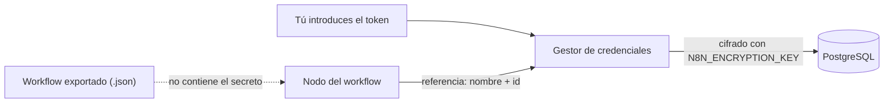

# Credenciales

## Cómo guarda n8n las credenciales

- El secreto vive cifrado en la base de datos.
- Los nodos guardan una referencia `{ "id": "...", "name": "..." }`.
- Los workflows de este repositorio **no incluyen** esas referencias: al importarlos, cada nodo que necesita credencial aparece con un aviso.

## Credenciales que usa el taller

| Credencial en n8n | Tipo | Usada por | Guía |
| --- | --- | --- | --- |
| Telegram API | Token de bot | Proyectos A, B, D, Final | [telegram-setup.md](../guides/telegram-setup.md) |
| Google Sheets OAuth2 API **o** Google Service Account API | OAuth2 / Service Account | Proyectos A, C, D, E, Final | [google-sheets-setup.md](../guides/google-sheets-setup.md) |
| Google Calendar OAuth2 API | OAuth2 | Proyecto B, Final | [google-calendar-setup.md](../guides/google-calendar-setup.md) |
| Gmail OAuth2 API | OAuth2 | Proyecto C | [gmail-setup.md](../guides/gmail-setup.md) |
| Header Auth | Encabezado HTTP | Proyecto E, Final (opcional) | [ai-provider-setup.md](../guides/ai-provider-setup.md) |

## Asignar credenciales después de importar

1. Abre el workflow importado.
2. Abre cada nodo con un triángulo de advertencia.
3. En **Credential to connect with**, elige tu credencial o pulsa **Create new credential**.
4. Repite en todos los nodos del mismo servicio. Si ya existe una sola credencial de ese tipo, n8n suele asignarla automáticamente al abrir el nodo.
5. Guarda el workflow.

## Nodo `Configuración`: valores que no son secretos

Los IDs de hojas, calendarios y chats **no son secretos**, pero son personales. Los workflows del taller los agrupan en un nodo **Edit Fields** llamado `Configuración`:

| Campo | Ejemplo | Dónde obtenerlo |
| --- | --- | --- |
| `spreadsheetId` | `1AbC...xyz` | URL de la hoja de Google Sheets |
| `chatId` | `123456789` | Salida del Telegram Trigger (`message.chat.id`) |
| `calendarId` | `primary` | Configuración de Google Calendar |
| `apiBaseUrl` | `http://host.docker.internal:11434/v1` | Documentación del proveedor de IA |
| `model` | `llama3.2` | Documentación del proveedor de IA |

Así no tienes que buscar valores repartidos por todo el workflow.

## Por qué no usar variables de entorno en los workflows

En n8n 2.x, `N8N_BLOCK_ENV_ACCESS_IN_NODE` es `true` por defecto y las expresiones `{{ $env.MI_VARIABLE }}` no pueden leer variables de entorno. Activar ese acceso permitiría que cualquier workflow leyera **todos** los secretos del contenedor. El taller mantiene el bloqueo y usa:

- **Credenciales** para secretos.
- **Nodo `Configuración`** para valores personales no secretos.

## Rotar o revocar una credencial

| Servicio | Revocar en el origen |
| --- | --- |
| Telegram | BotFather > `/revoke` |
| Google OAuth | <https://myaccount.google.com/permissions> |
| Google Service Account | Google Cloud > IAM > Service Accounts > Keys > eliminar clave |
| Proveedor de IA | Panel del proveedor > API keys |

Después, edita la credencial en n8n con el nuevo valor. Los workflows no necesitan cambios porque apuntan a la credencial, no al secreto.
