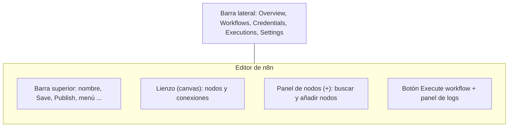

# Primeros pasos en el editor

Esta guía asume que n8n ya está funcionando en <http://localhost:5678> ([instalación](installation.md)).

## Índice

- [Partes del editor](#partes-del-editor)
- [Crear tu primer workflow a mano](#crear-tu-primer-workflow-a-mano)
- [Importar un workflow del taller](#importar-un-workflow-del-taller)
- [Ejecutar y revisar resultados](#ejecutar-y-revisar-resultados)
- [Guardar, publicar y despublicar](#guardar-publicar-y-despublicar)
- [Exportar un workflow](#exportar-un-workflow)
- [Atajos útiles](#atajos-útiles)

## Partes del editor



| Zona | Para qué sirve |
| --- | --- |
| **Overview** | Lista de workflows, credenciales y ejecuciones. |
| **Lienzo** | Donde construyes el workflow arrastrando y conectando nodos. |
| **Panel de nodo** | Se abre con doble clic. A la izquierda la entrada (*INPUT*), en el centro los parámetros, a la derecha la salida (*OUTPUT*). |
| **Execute workflow** | Ejecuta el workflow manualmente y muestra los datos en cada nodo. |
| **Executions** | Historial de ejecuciones, con sus datos y errores. |

> [!NOTE]
> La interfaz de n8n evoluciona entre versiones. Los nombres de botones de esta guía corresponden a n8n 2.48. Si algo no coincide exactamente, busca la opción equivalente en el menú `...` del workflow.

## Crear tu primer workflow a mano

1. **Overview > Create workflow**.
2. Pulsa **Add first step** y elige **Trigger manually** (*Manual Trigger*).
3. Pulsa el `+` a la derecha del trigger y busca **Edit Fields (Set)**.
4. En **Fields to Set**, añade:
   - `saludo` (String): `Hola desde n8n`
   - `fecha` (String): `{{ $now.toFormat('yyyy-MM-dd HH:mm') }}`
5. Cierra el panel y pulsa **Execute workflow**.
6. Abre el nodo Edit Fields: en *OUTPUT* verás un item con `saludo` y `fecha`.

Acabas de construir el workflow `01-hello-world` del taller. Compáralo con el archivo [workflows/01-getting-started/01-hello-world.json](../workflows/01-getting-started/01-hello-world.json).

## Importar un workflow del taller

Hay dos formas. Ambas crean una **copia** en tu instancia; el archivo original no cambia.

**Desde archivo:**

1. Crea un workflow vacío (**Create workflow**).
2. Menú `...` (arriba a la derecha) > **Import from File...**
3. Elige el `.json` del taller.

**Desde URL o portapapeles:**

1. Abre el archivo JSON en GitHub y pulsa **Raw**. Copia todo el contenido.
2. En un workflow vacío, haz clic en el lienzo y pega con `Ctrl + V` (`Cmd + V` en macOS).

**Desde la línea de comandos (todos a la vez):**

```bash
docker compose cp workflows n8n:/tmp/workflows
docker compose exec n8n sh -c 'for f in $(find /tmp/workflows -name "*.json"); do n8n import:workflow --input="$f"; done'
```

Después de importar:

1. Abre los nodos con un triángulo de advertencia: necesitan credenciales.
2. Abre el nodo `Configuración` y sustituye los valores `REEMPLAZAR_...`.
3. Guarda con `Ctrl + S`.

## Ejecutar y revisar resultados

| Acción | Resultado |
| --- | --- |
| **Execute workflow** | Ejecuta desde el trigger manual o espera un evento del trigger. |
| **Execute step** (dentro de un nodo) | Ejecuta solo ese nodo con los datos de entrada disponibles. |
| **Pin data** (icono de chincheta en la salida) | Fija la salida de un nodo para no repetir llamadas externas mientras pruebas. |
| Pestaña **Executions** | Revisa ejecuciones pasadas, incluidas las de producción. |

Los nodos ejecutados muestran un indicador con el número de items que produjeron. Un nodo en rojo indica error: ábrelo para ver el mensaje.

## Guardar, publicar y despublicar

Desde n8n 2.0 los workflows se **publican** en lugar de "activarse":

| Estado | Comportamiento |
| --- | --- |
| Guardado (borrador) | Solo se ejecuta cuando pulsas *Execute workflow*. |
| **Publicado** | Los triggers (Schedule, Webhook, Telegram, Gmail) funcionan solos. |

- **Publish**: hace que la versión actual entre en producción.
- Los cambios posteriores no afectan a producción hasta que vuelves a publicar.
- **Unpublish**: detiene los triggers de producción.

> [!TIP]
> Publica solo cuando hayas probado el workflow manualmente. Un Schedule Trigger publicado con errores generará una ejecución fallida en cada intervalo.

## Exportar un workflow

1. Menú `...` > **Download**.
2. Se descarga un `.json` sin los secretos de las credenciales.
3. Antes de compartirlo: elimina datos fijados (*pinData*) con información real y revisa los valores del nodo `Configuración`.

Desde la CLI:

```bash
docker compose exec n8n n8n export:workflow --all --pretty --separate --output=/home/node/.n8n/exports/
```

## Atajos útiles

| Atajo | Acción |
| --- | --- |
| `Ctrl + S` | Guardar |
| `Ctrl + Enter` | Ejecutar workflow |
| `Tab` | Abrir el panel para añadir nodos |
| `D` | Desactivar o activar el nodo seleccionado |
| `P` | Fijar (*pin*) los datos del nodo seleccionado |
| `Shift + S` | Añadir una nota adhesiva (*Sticky Note*) |
| `1` | Ajustar el zoom para ver todo el workflow |
| `F2` | Renombrar el nodo seleccionado |

Siguiente paso: [Fundamentos de n8n](n8n-fundamentals.md) o directamente el [Módulo 01](../modules/01-introduction/README.md).
