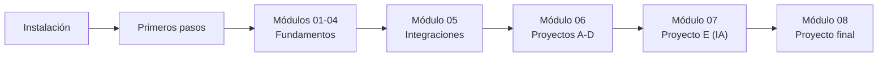

# Documentación del taller

Índice de la documentación de referencia. Los **módulos** (`modules/`) son el recorrido pedagógico paso a paso; esta carpeta (`docs/`) contiene material de consulta al que volver cuando lo necesites.

## Ruta de aprendizaje

## Documentos de referencia

| Documento | Contenido |
| --- | --- |
| [installation.md](installation.md) | Instalación con Docker Compose, variables de entorno, actualización y copias de seguridad. |
| [first-steps.md](first-steps.md) | Recorrido por el editor de n8n e importación de workflows. |
| [n8n-fundamentals.md](n8n-fundamentals.md) | Conceptos: workflows, nodos, items, ejecuciones, publicación. |
| [credentials.md](credentials.md) | Cómo funcionan las credenciales y cómo configurarlas tras importar un workflow. |
| [expressions.md](expressions.md) | Referencia rápida de expresiones, variables y funciones de fecha. |
| [security.md](security.md) | Seguridad de credenciales, webhooks, instancias públicas y datos personales. |
| [troubleshooting.md](troubleshooting.md) | Solución de problemas frecuentes. |
| [glossary.md](glossary.md) | Glosario de términos. |
| [faq.md](faq.md) | Preguntas frecuentes. |

## Guías de integración

| Guía | Servicio |
| --- | --- |
| [telegram-setup.md](../guides/telegram-setup.md) | Bot de Telegram, token, `chat_id` y túnel HTTPS. |
| [google-sheets-setup.md](../guides/google-sheets-setup.md) | Hoja del taller, OAuth2 y Service Account. |
| [google-calendar-setup.md](../guides/google-calendar-setup.md) | Lectura de eventos con OAuth2. |
| [gmail-setup.md](../guides/gmail-setup.md) | Lectura y etiquetado de correos. |
| [ai-provider-setup.md](../guides/ai-provider-setup.md) | Ollama y proveedores compatibles con la API de OpenAI. |
