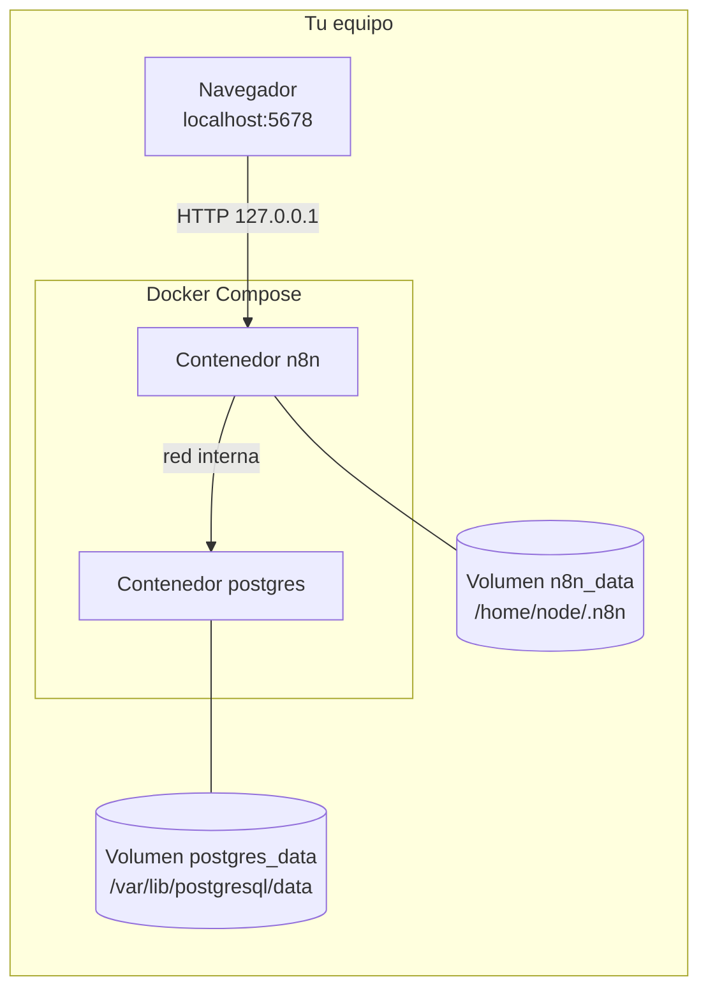

# Instalación de n8n

Esta guía instala n8n en tu equipo con **Docker Compose** y **PostgreSQL**, que es la configuración usada en todo el taller. Al final tendrás n8n funcionando en `http://localhost:5678`.

> [!NOTE]
> El taller se desarrolló con **n8n 2.48.4** (rama 2.x). Si usas otra versión, los nodos pueden mostrar opciones ligeramente distintas. Consulta la sección [Compatibilidad de versiones](#compatibilidad-de-versiones).

## Índice

- [Opciones de instalación](#opciones-de-instalación)
- [Requisitos](#requisitos)
- [Instalación con Docker Compose](#instalación-con-docker-compose)
- [Primer acceso](#primer-acceso)
- [Persistencia de datos](#persistencia-de-datos)
- [Variables de entorno](#variables-de-entorno)
- [Actualizar n8n](#actualizar-n8n)
- [Copias de seguridad](#copias-de-seguridad)
- [Alternativa sin Docker: npm](#alternativa-sin-docker-npm)
- [Local frente a despliegue público](#local-frente-a-despliegue-público)
- [Compatibilidad de versiones](#compatibilidad-de-versiones)

## Opciones de instalación

| Opción | Costo | Cuándo usarla |
| --- | --- | --- |
| **Docker Compose (recomendada)** | Gratis | Aprender en tu equipo con una configuración reproducible. |
| npm (`npx n8n`) | Gratis | Pruebas rápidas sin Docker. Requiere Node.js 24 o superior para n8n 2.48. |
| n8n Cloud | De pago, con periodo de prueba | No quieres instalar nada. Consulta precios vigentes en <https://n8n.io/pricing/>. |

El taller usa la versión *self-hosted* de n8n, distribuida bajo la [Sustainable Use License](https://docs.n8n.io/sustainable-use-license/). Esta licencia permite el uso personal y el uso interno en empresas, pero **no es una licencia MIT ni open source en sentido estricto**. Léela si piensas ofrecer n8n como servicio a terceros.

## Requisitos

| Requisito | Versión mínima | Comprobación |
| --- | --- | --- |
| Docker Engine o Docker Desktop | Una versión con Compose v2 | `docker --version` |
| Docker Compose v2 | Incluido en Docker Desktop | `docker compose version` |
| Git | Cualquiera reciente | `git --version` |
| RAM libre | 2 GB recomendados | |
| Espacio en disco | 3 GB (imágenes + datos) | |

Instaladores oficiales de Docker: <https://docs.docker.com/get-started/get-docker/>.

> [!TIP]
> En Windows, Docker Desktop usa WSL 2. Si la instalación te pide habilitarlo, sigue las instrucciones del propio instalador y reinicia.

## Instalación con Docker Compose

### 1. Clonar el repositorio

```bash
git clone https://github.com/VITIDEV06/n8n-productivity-workshop.git
cd n8n-productivity-workshop
```

### 2. Crear el archivo `.env`

```bash
cp .env.example .env
```

En Windows PowerShell:

```powershell
Copy-Item .env.example .env
```

### 3. Generar secretos

Necesitas dos valores aleatorios: la clave de cifrado de n8n y la contraseña de PostgreSQL.

```bash
# Linux, macOS o Git Bash
openssl rand -hex 32
```

```powershell
# Windows PowerShell
-join ((1..32) | ForEach-Object { '{0:x2}' -f (Get-Random -Maximum 256) })
```

Ejecuta el comando dos veces y pega cada resultado en `.env`:

```dotenv
N8N_ENCRYPTION_KEY=<primer valor generado>
POSTGRES_PASSWORD=<segundo valor generado>
```

Ajusta también tu zona horaria:

```dotenv
GENERIC_TIMEZONE=America/Bogota
TZ=America/Bogota
```

> [!WARNING]
> Guarda `N8N_ENCRYPTION_KEY` en un gestor de contraseñas. Si la pierdes, n8n no podrá descifrar las credenciales guardadas y tendrás que volver a crearlas.

### 4. Arrancar los servicios

```bash
docker compose up -d
```

Comprueba el estado:

```bash
docker compose ps
docker compose logs -f n8n
```

Cuando el log muestre `Editor is now accessible via: http://localhost:5678`, pulsa `Ctrl + C` para salir de los logs (los contenedores siguen en marcha).

### 5. Detener y reiniciar

```bash
docker compose stop      # detiene sin borrar nada
docker compose start     # vuelve a arrancar
docker compose down      # elimina contenedores; los volúmenes y tus datos se conservan
```

> [!CAUTION]
> `docker compose down -v` borra también los volúmenes: perderás workflows, credenciales y ejecuciones.

## Primer acceso

1. Abre <http://localhost:5678>.
2. Crea la cuenta de propietario (*owner*). Es una cuenta **local** de tu instancia; no se envía a n8n.
3. Puedes omitir el cuestionario inicial.
4. Opcional: n8n ofrece registrar una licencia comunitaria gratuita que desbloquea algunas funciones (historial de workflows, carpetas, depuración). No es necesaria para el taller.

## Persistencia de datos



| Volumen | Contenido |
| --- | --- |
| `postgres_data` | Workflows, credenciales cifradas, ejecuciones, usuarios. |
| `n8n_data` | Configuración local de n8n, archivos binarios y datos auxiliares. |

Los datos sobreviven a `docker compose down` y a las actualizaciones de imagen.

## Variables de entorno

Todas se definen en `.env` y se pasan al contenedor desde [`docker-compose.yml`](../docker-compose.yml).

| Variable | Valor del taller | Para qué sirve |
| --- | --- | --- |
| `N8N_VERSION` | `2.48.4` | Versión de la imagen `n8nio/n8n`. |
| `N8N_HOST` / `N8N_PORT` / `N8N_PROTOCOL` | `localhost` / `5678` / `http` | Dirección del editor. |
| `WEBHOOK_URL` | `http://localhost:5678/` | URL pública que n8n usa para construir los webhooks. Cámbiala al usar un túnel. |
| `N8N_PROXY_HOPS` | `0` | Pon `1` si hay un proxy o túnel delante de n8n. |
| `GENERIC_TIMEZONE` / `TZ` | Tu zona horaria | Hora de los Schedule Trigger y de las fechas. |
| `N8N_ENCRYPTION_KEY` | Aleatoria | Cifra las credenciales en la base de datos. |
| `POSTGRES_*` | Ver `.env.example` | Conexión a PostgreSQL. |
| `N8N_DIAGNOSTICS_ENABLED` | `false` | Desactiva la telemetría anónima. |
| `EXECUTIONS_DATA_PRUNE` / `EXECUTIONS_DATA_MAX_AGE` | `true` / `336` | Borra ejecuciones de más de 14 días. |

Referencia oficial completa: <https://docs.n8n.io/hosting/configuration/environment-variables/>.

> [!NOTE]
> Desde n8n 2.0, `N8N_BLOCK_ENV_ACCESS_IN_NODE` es `true` por defecto: los nodos Code y las expresiones **no pueden leer variables de entorno**. Por eso los workflows del taller guardan su configuración en un nodo `Configuración` y los secretos en el gestor de credenciales.

## Actualizar n8n

1. Lee las notas de la versión: <https://docs.n8n.io/release-notes/>.
2. Haz una copia de seguridad (sección siguiente).
3. Cambia `N8N_VERSION` en `.env`.
4. Descarga la imagen y recrea el contenedor:

```bash
docker compose pull n8n
docker compose up -d
```

5. Revisa los logs: `docker compose logs -f n8n`. Las migraciones de base de datos se aplican automáticamente.

> [!WARNING]
> No saltes varias versiones mayores de golpe (por ejemplo de 1.x a 2.x) sin leer la guía de cambios incompatibles: <https://docs.n8n.io/2-0-breaking-changes/>.

## Copias de seguridad

### Exportar workflows y credenciales con la CLI de n8n

```bash
docker compose exec n8n n8n export:workflow --backup --output=/home/node/.n8n/backups/workflows/
docker compose exec n8n n8n export:credentials --backup --output=/home/node/.n8n/backups/credentials/
docker compose cp n8n:/home/node/.n8n/backups ./backups
```

Las credenciales se exportan **cifradas** con tu `N8N_ENCRYPTION_KEY`. Para restaurarlas necesitas la misma clave. La carpeta `backups/` ya está en `.gitignore`.

### Volcado completo de PostgreSQL

```bash
docker compose exec -T postgres sh -c 'pg_dump -U "$POSTGRES_USER" -d "$POSTGRES_DB"' > n8n-backup.sql
```

Restaurar en una instalación vacía:

```bash
docker compose exec -T postgres sh -c 'psql -U "$POSTGRES_USER" -d "$POSTGRES_DB"' < n8n-backup.sql
```

> [!CAUTION]
> Los volcados contienen tus datos y credenciales cifradas. Guárdalos fuera del repositorio y, si los subes a la nube, cífralos.

## Alternativa sin Docker: npm

Útil para una prueba rápida. Usa SQLite en lugar de PostgreSQL y guarda los datos en `~/.n8n`.

```bash
node --version        # debe ser 24 o superior para n8n 2.48
npx n8n@2.48.4
```

Para una instalación global: `npm install -g n8n@2.48.4` y después `n8n start`.

## Local frente a despliegue público

| Aspecto | Local (este taller) | Despliegue público |
| --- | --- | --- |
| Acceso | Solo `127.0.0.1` | Internet |
| HTTPS | No necesario | **Obligatorio** (proxy inverso con certificado) |
| Webhooks de Telegram | Requieren túnel HTTPS temporal | Funcionan con el dominio propio |
| Puerto 5678 | Publicado solo en localhost | Nunca expuesto directamente; solo el proxy |
| Copias de seguridad | Manuales | Automatizadas y cifradas |
| Actualizaciones | Cuando quieras | Planificadas y con pruebas |

El archivo `docker-compose.yml` del taller **no es una configuración de producción**. Para un servidor público revisa [docs/security.md](security.md) y la guía oficial: <https://docs.n8n.io/hosting/>.

## Compatibilidad de versiones

| Versión de n8n | Estado |
| --- | --- |
| 2.48.4 | Versión de referencia. Workflows importados y nodos sin credenciales ejecutados con esta versión (ver [Estado de verificación](../README.md#estado-de-verificación)). |
| 2.x posteriores | Previsiblemente compatibles. Si un nodo muestra el aviso de versión antigua, los workflows siguen funcionando. |
| 1.x | No soportada. Los workflows usan versiones de nodo y comportamientos de la rama 2.x. |

Siguiente paso: [Primeros pasos en el editor](first-steps.md).
