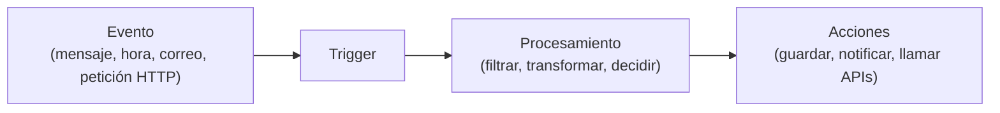
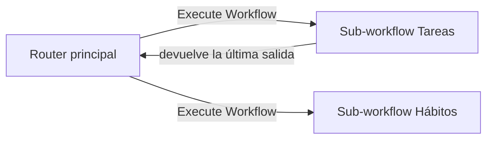

# Fundamentos de n8n

Referencia conceptual. Para aprender estos conceptos con ejercicios, sigue los módulos [01](../modules/01-introduction/README.md), [03](../modules/03-automation-fundamentals/README.md) y [04](../modules/04-data-and-expressions/README.md).

## Índice

- [Qué es n8n](#qué-es-n8n)
- [Workflow](#workflow)
- [Nodos: triggers y acciones](#nodos-triggers-y-acciones)
- [Items: la unidad de datos](#items-la-unidad-de-datos)
- [Conexiones y ramas](#conexiones-y-ramas)
- [Ejecuciones](#ejecuciones)
- [Credenciales](#credenciales)
- [Publicación](#publicación)
- [Sub-workflows](#sub-workflows)
- [Manejo de errores](#manejo-de-errores)
- [Licencia de n8n](#licencia-de-n8n)

## Qué es n8n

n8n es una plataforma de automatización de flujos de trabajo basada en nodos. Permite conectar aplicaciones y APIs mediante un editor visual y, cuando hace falta, código JavaScript. Se puede usar en la nube de n8n o instalarse en tu propio equipo o servidor (*self-hosted*).



## Workflow

Un **workflow** es un conjunto de nodos conectados que se ejecuta de izquierda a derecha. Se guarda como un documento JSON con esta estructura básica:

```json
{
  "name": "Mi workflow",
  "nodes": [ { "id": "...", "name": "...", "type": "n8n-nodes-base.manualTrigger", "typeVersion": 1, "position": [0, 0], "parameters": {} } ],
  "connections": { "Nombre del nodo origen": { "main": [ [ { "node": "Nombre del nodo destino", "type": "main", "index": 0 } ] ] } },
  "settings": { "executionOrder": "v1" }
}
```

- Las conexiones se definen **por nombre de nodo**. Si renombras un nodo en el editor, n8n actualiza conexiones y expresiones automáticamente; si editas el JSON a mano, debes hacerlo tú.
- `executionOrder: "v1"` ejecuta cada rama completa antes de pasar a la siguiente, de arriba abajo.

## Nodos: triggers y acciones

| Tipo | Qué hace | Ejemplos del taller |
| --- | --- | --- |
| **Trigger** | Inicia el workflow. Todo workflow automático tiene al menos uno. | Manual Trigger, Schedule Trigger, Webhook, Telegram Trigger, Gmail Trigger, Error Trigger |
| **Acción de aplicación** | Lee o escribe en un servicio externo. | Google Sheets, Google Calendar, Gmail, Telegram |
| **Nodo core** | Lógica y transformación de datos. | Edit Fields (Set), IF, Switch, Merge, Code, Loop Over Items, HTTP Request |

## Items: la unidad de datos

Los nodos se pasan **listas de items**. Cada item es un objeto con una clave `json`:

```json
[
  { "json": { "titulo": "Estudiar n8n", "prioridad": "alta" } },
  { "json": { "titulo": "Comprar café", "prioridad": "baja" } }
]
```

Regla clave: **la mayoría de nodos se ejecutan una vez por cada item de entrada**. Si un nodo Google Sheets *Append* recibe 2 items, añade 2 filas.

En el editor ves solo el contenido de `json`. En el nodo Code trabajas con la estructura completa.

## Conexiones y ramas

- Un nodo puede tener varias salidas (IF tiene `true` y `false`; Switch tiene una por regla).
- Varias conexiones pueden llegar a la misma entrada: el nodo se ejecuta una vez por cada rama que le envía datos.
- El nodo **Merge** espera a varias entradas para combinarlas.

## Ejecuciones

| Modo | Origen | Dónde se ve |
| --- | --- | --- |
| Manual | Botón *Execute workflow* | En el lienzo y en *Executions* |
| Producción | Trigger de un workflow publicado | En *Executions* |

Cada ejecución guarda los datos de entrada y salida de cada nodo, lo que permite depurar después. El taller borra ejecuciones de más de 14 días (`EXECUTIONS_DATA_MAX_AGE`).

## Credenciales

Las credenciales se guardan cifradas y separadas de los workflows. Un nodo solo guarda una referencia (nombre e ID) a la credencial. Ver [credentials.md](credentials.md).

## Publicación

Desde n8n 2.0 un workflow se **publica** para que sus triggers funcionen en producción. Editar un workflow publicado no cambia la versión en producción hasta que vuelves a publicar.

## Sub-workflows

Un workflow puede llamar a otro con el nodo **Execute Workflow** (*Execute Sub-workflow*). El workflow llamado empieza con **Execute Workflow Trigger** (*When Executed by Another Workflow*). El proyecto final usa este patrón para separar responsabilidades.



En n8n 2.x el workflow padre recibe **la salida final** del sub-workflow.

## Manejo de errores

| Mecanismo | Alcance |
| --- | --- |
| *Settings > On Error* de un nodo | `Stop Workflow` (por defecto), `Continue` o `Continue (using error output)` |
| *Settings > Retry On Fail* | Reintenta el nodo N veces con espera entre intentos |
| **Error Trigger** + *Workflow settings > Error workflow* | Ejecuta otro workflow cuando un workflow publicado falla |
| **Stop and Error** | Provoca un error a propósito con un mensaje personalizado |

## Licencia de n8n

n8n se distribuye bajo la **Sustainable Use License** y la **n8n Enterprise License**, no bajo MIT. La licencia MIT de este repositorio se aplica solo a los archivos originales del taller. Más información: <https://docs.n8n.io/sustainable-use-license/>.
