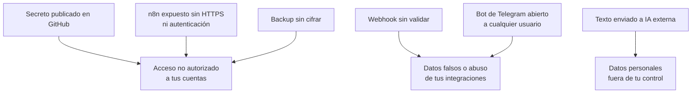

# Seguridad y buenas prácticas

Automatizar tareas personales significa dar a n8n acceso a tu correo, calendario y mensajería. Esta guía explica cómo hacerlo sin poner en riesgo tus datos.

## Índice

- [Modelo de amenazas del taller](#modelo-de-amenazas-del-taller)
- [Credenciales](#credenciales)
- [Variables de entorno y clave de cifrado](#variables-de-entorno-y-clave-de-cifrado)
- [Token de Telegram](#token-de-telegram)
- [OAuth de Google](#oauth-de-google)
- [API keys de proveedores de IA](#api-keys-de-proveedores-de-ia)
- [Webhooks](#webhooks)
- [Instancias públicas y HTTPS](#instancias-públicas-y-https)
- [Copias de seguridad](#copias-de-seguridad)
- [Gestión de permisos](#gestión-de-permisos)
- [Datos personales](#datos-personales)
- [Lista de comprobación](#lista-de-comprobación)

## Modelo de amenazas del taller

## Credenciales

- **Guarda los secretos solo en el gestor de credenciales de n8n** (*Overview > Credentials*). n8n los cifra con `N8N_ENCRYPTION_KEY`.
- **Nunca** pegues un token en un nodo Code, en un nodo Edit Fields, en una URL o en una expresión.
- Al exportar un workflow, n8n incluye el **nombre** y el **ID interno** de las credenciales, nunca el secreto. Aun así, los workflows de este repositorio eliminan esas referencias para no revelar información de tu instancia.
- Crea credenciales separadas para el taller. No reutilices las de proyectos reales.

## Variables de entorno y clave de cifrado

| Regla | Motivo |
| --- | --- |
| `.env` nunca se sube a Git | Contiene la clave de cifrado y la contraseña de la base de datos. |
| `N8N_ENCRYPTION_KEY` aleatoria y larga | Con ella se pueden descifrar todas tus credenciales. |
| Guarda la clave en un gestor de contraseñas | Sin ella no puedes restaurar credenciales desde un backup. |
| No uses `N8N_BLOCK_ENV_ACCESS_IN_NODE=false` | Permitiría a cualquier workflow leer los secretos del entorno. |

## Token de Telegram

- El token da control total sobre el bot. Trátalo como una contraseña.
- Si se filtra: abre [@BotFather](https://t.me/BotFather), envía `/revoke`, elige el bot y actualiza la credencial en n8n.
- **Restringe quién puede usar tu bot.** Por defecto cualquier persona que encuentre el bot puede escribirle. Usa la opción *Restrict to Chat IDs* del Telegram Trigger con tu propio `chat_id`.
- Telegram solo permite **un webhook por bot**. No uses el mismo bot en dos instancias de n8n.

## OAuth de Google

- Concede solo los permisos (*scopes*) necesarios. El nodo de n8n solicita los scopes de cada servicio; no actives APIs que no vayas a usar.
- Las apps OAuth en modo *Testing* solo funcionan con los usuarios de prueba que añadas. Mantén la app en ese modo para uso personal.
- Revoca el acceso cuando termines el taller: <https://myaccount.google.com/permissions>.
- Una **Service Account** con la hoja compartida tiene acceso solo a esa hoja. Es más restrictiva que OAuth para Google Sheets.
- El archivo JSON de una Service Account es un secreto. El patrón `service-account*.json` está en `.gitignore`.

## API keys de proveedores de IA

- **Configura un límite de gasto** en el panel del proveedor antes de usar la clave.
- Crea una clave específica para el taller y revócala al terminar.
- Los proveedores en la nube reciben el texto que les envías. No envíes correos, contraseñas ni datos de terceros.
- Si quieres privacidad total, usa un modelo local con **Ollama** (ver [guides/ai-provider-setup.md](../guides/ai-provider-setup.md)).

## Webhooks

- La URL de un webhook es, en la práctica, una contraseña: quien la conozca puede activar el workflow.
- Usa rutas no triviales (por ejemplo `knowledge-7f3a9c`), no `test` ni `webhook`.
- En webhooks públicos activa **Authentication** (*Header Auth* o *Basic Auth*) en el nodo Webhook.
- Valida siempre el cuerpo de la petición antes de usarlo (tipos, longitud, campos obligatorios). Los workflows del taller lo hacen en un nodo `Validar ...`.
- Responde con mensajes genéricos; no devuelvas errores internos ni datos de otras ejecuciones.

## Instancias públicas y HTTPS

El `docker-compose.yml` del taller publica n8n **solo en 127.0.0.1**. Si necesitas acceso desde Internet:

| Necesidad | Opción recomendada |
| --- | --- |
| Probar Telegram unas horas | Túnel temporal HTTPS (Cloudflare Tunnel o ngrok). Ver [guides/telegram-setup.md](../guides/telegram-setup.md). |
| Servidor permanente | Proxy inverso (Caddy, Traefik o Nginx) con certificado TLS, firewall que solo abra 443 y n8n sin puerto publicado. |

Reglas para una instancia pública:

1. HTTPS obligatorio. Sin él, la cookie de sesión y las credenciales viajan en claro.
2. Configura `WEBHOOK_URL` con la URL `https://` pública y `N8N_PROXY_HOPS=1`.
3. Usa una contraseña fuerte para la cuenta de propietario y activa la autenticación en dos pasos (*Settings > Personal*).
4. Mantén n8n actualizado.
5. No publiques el puerto de PostgreSQL.

Guía oficial: <https://docs.n8n.io/hosting/securing/overview/>.

## Copias de seguridad

- Los backups de PostgreSQL contienen credenciales **cifradas** y todos tus datos de ejecución.
- Guárdalos fuera del repositorio (`backups/` está en `.gitignore`).
- Cífralos si los subes a la nube y conserva la `N8N_ENCRYPTION_KEY` por separado.
- Prueba a restaurar un backup al menos una vez: un backup no probado no es un backup.

## Gestión de permisos

| Servicio | Permiso mínimo recomendado |
| --- | --- |
| Google Sheets | Service Account con acceso de *Editor* solo a la hoja del taller, u OAuth con tu cuenta. |
| Google Calendar | OAuth2 de solo lectura en la práctica: los workflows solo consultan eventos. |
| Gmail | OAuth2. Los workflows leen y etiquetan; no envían ni borran correos. |
| Telegram | Bot restringido a tu `chat_id`. |
| IA | Clave con límite de gasto. |

## Datos personales

- Practica con los datos ficticios de [templates/sample-data/](../templates/sample-data/).
- Las ejecuciones guardan los datos procesados. El taller configura un borrado automático a los 14 días (`EXECUTIONS_DATA_MAX_AGE=336`).
- Antes de compartir una captura o un log, oculta correos, nombres, IDs de chat y contenido de mensajes.
- Antes de exportar un workflow para compartirlo, elimina `pinData` si contiene datos reales.

## Lista de comprobación

- [ ] `.env` existe solo en tu equipo y no aparece en `git status`.
- [ ] `N8N_ENCRYPTION_KEY` es aleatoria y está guardada en un lugar seguro.
- [ ] El bot de Telegram está restringido a tu `chat_id`.
- [ ] La app OAuth de Google está en modo *Testing* con solo tu cuenta como usuario de prueba.
- [ ] El proveedor de IA tiene un límite de gasto.
- [ ] Los webhooks públicos tienen autenticación.
- [ ] n8n no está expuesto a Internet sin HTTPS.
- [ ] `python scripts/validate-workflows.py` no detecta secretos antes de cada commit.
