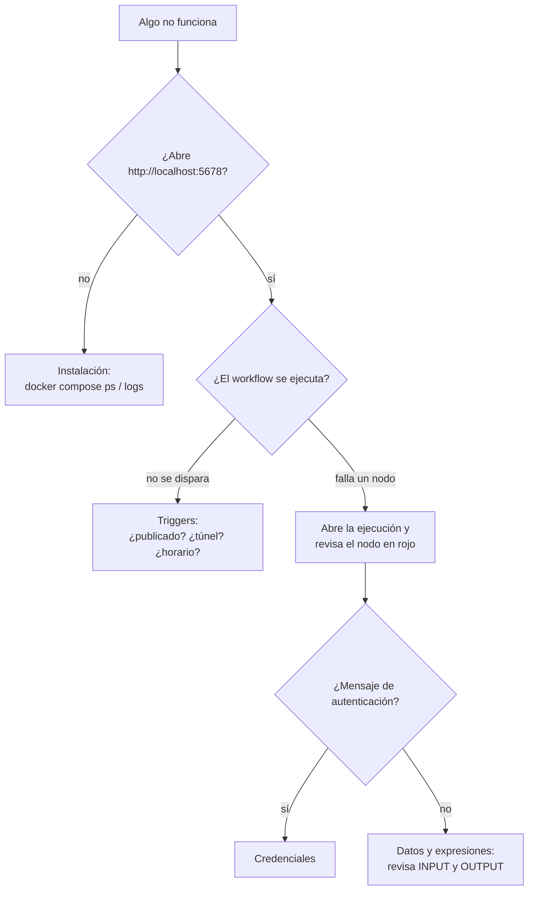

# Solución de problemas

Problemas frecuentes agrupados por área. Cada guía de integración y cada proyecto tienen además su propia tabla de *Errores frecuentes*.

## Diagnóstico rápido

## Instalación y Docker

| Síntoma | Causa probable | Solución |
| --- | --- | --- |
| `required variable N8N_ENCRYPTION_KEY is missing` | No existe `.env` o falta la variable | `cp .env.example .env` y rellena los valores obligatorios. |
| `port is already allocated` en 5678 | Otro n8n u otra aplicación usa el puerto | Detén la otra instancia o cambia `N8N_PORT` y el puerto publicado. |
| n8n reinicia en bucle | PostgreSQL aún no está listo o la contraseña cambió | `docker compose logs postgres n8n`. Si cambiaste `POSTGRES_PASSWORD` después de crear el volumen, vuelve a la contraseña original. |
| `Mismatching encryption keys` | `N8N_ENCRYPTION_KEY` distinta de la usada al crear los datos | Restaura la clave original. Sin ella, las credenciales guardadas no se pueden descifrar. |
| `Permissions 0644 for n8n settings file ... are too wide` | Permisos del archivo de configuración | El `docker-compose.yml` del taller ya define `N8N_ENFORCE_SETTINGS_FILE_PERMISSIONS`; recrea el contenedor con `docker compose up -d`. |
| La hora de los workflows programados es incorrecta | Zona horaria sin configurar | Ajusta `GENERIC_TIMEZONE` y `TZ` en `.env` y ejecuta `docker compose up -d`. |
| `host.docker.internal` no resuelve (Linux) | Docker Engine sin la entrada de host | Ya está en `extra_hosts` del compose; actualiza Docker si tu versión es antigua. |

## Importación de workflows

| Síntoma | Solución |
| --- | --- |
| `Could not find property option` o nodos con signo de interrogación | Tu versión de n8n es anterior a la del taller. Actualiza a 2.48.4 o superior. |
| `Credentials not found` al ejecutar | Normal tras importar: los workflows no incluyen credenciales. Asígnalas en cada nodo con el icono de aviso. |
| `Workflow does not exist` en un nodo Execute Workflow | Selecciona el sub-workflow en **From list**; el valor `REEMPLAZAR_ID_...` es un marcador. |
| Importa pero el nombre de la hoja da error | Rellena `spreadsheetId` en **Configuración** y comprueba que la pestaña tiene el nombre exacto (mayúsculas incluidas). |

## Triggers que no se disparan

| Síntoma | Causa | Solución |
| --- | --- | --- |
| El Schedule Trigger no se ejecuta | El workflow no está **publicado** | Publica el workflow. Con *Execute workflow* solo se ejecuta una vez. |
| El Telegram Trigger no recibe mensajes | n8n no es accesible por HTTPS | Inicia el túnel y configura `WEBHOOK_URL` ([guía](../guides/telegram-setup.md#exponer-n8n-con-https-para-el-telegram-trigger)). |
| Funcionaba en pruebas y deja de funcionar publicado (o al revés) | Telegram solo admite un webhook por bot y el editor lo sobrescribe | Tras probar en el editor, despublica y vuelve a publicar el workflow. |
| Dos workflows con el mismo bot, solo responde uno | Un webhook por bot | Usa un bot por workflow publicado o el router del proyecto final. |
| El Gmail Trigger no detecta correos | Sondea cada 5 minutos y solo correos nuevos de `in:inbox` | Espera al siguiente sondeo; revisa el filtro. |
| El webhook responde `404` | URL de prueba sin pulsar *Execute workflow*, o URL de producción sin publicar | Usa `/webhook-test/...` mientras pruebas y `/webhook/...` con el workflow publicado. |

## Credenciales

| Síntoma | Solución |
| --- | --- |
| Google: `redirect_uri_mismatch` | Añade exactamente `http://localhost:5678/rest/oauth2-credential/callback` (o tu URL pública) al cliente OAuth. |
| Google: `access_denied` o «app no verificada» | Añade tu cuenta como *usuario de prueba* en la pantalla de consentimiento. |
| Google deja de funcionar tras una semana | En modo *Testing* los tokens caducan a los 7 días | Reconecta la credencial o publica la app de OAuth. |
| Google: `The caller does not have permission` con Service Account | Comparte la hoja con el email de la cuenta de servicio. Para Calendar, usa OAuth2. |
| Telegram: `401 Unauthorized` | Token incorrecto o revocado | Crea un token nuevo con BotFather y actualiza la credencial. |
| Telegram: `chat not found` | `chat_id` incorrecto o el usuario no ha escrito nunca al bot | Envía `/start` al bot y obtén de nuevo el `chat_id`. |
| IA: `401` o `403` | Clave incorrecta o sin saldo | Revisa la credencial Header Auth (`Authorization` / `Bearer ...`). |

## Datos y expresiones

| Síntoma | Causa | Solución |
| --- | --- | --- |
| `Cannot read properties of undefined` | Un campo no existe en el item | Revisa el *INPUT* del nodo; usa `?.` y `??` para valores opcionales. |
| `Referenced node doesn't exist` | Se renombró un nodo usado en `$('Nombre')` | n8n actualiza las expresiones al renombrar, pero no siempre el código: corrige el nombre en los nodos Code. |
| `Paired item data is unavailable` | `.item` no encuentra el item de origen | Usa `.first()` para datos únicos (configuración) o revisa que los nodos Code devuelvan items emparejados. |
| `access to env vars denied` | n8n 2.x bloquea `$env` en nodos | Usa el nodo **Configuración** del workflow. |
| Fechas desplazadas un día | Zona horaria o conversión de Google Sheets | Guarda fechas como texto `AAAA-MM-DD` con *Cell Format* RAW. |
| El flujo se detiene sin error tras una lectura vacía | Un nodo sin items de salida detiene la rama | Activa *Always Output Data* en la lectura y filtra los items vacíos después. |
| Un nodo Code devuelve error de formato | No devuelve un array de `{ json: ... }` | `return [{ json: { ... } }];` |

## Rendimiento y datos

| Síntoma | Solución |
| --- | --- |
| La base de datos crece mucho | `EXECUTIONS_DATA_PRUNE=true` y `EXECUTIONS_DATA_MAX_AGE` (en horas) ya están en `.env.example`. |
| Google Sheets: `Quota exceeded` | Reduce la frecuencia de los triggers, lee con *Execute Once* y agrupa escrituras. |
| La IA tarda o da *timeout* | Usa un modelo más pequeño, reduce `maxInputChars` o aumenta el *Timeout* del HTTP Request. |

## Cómo pedir ayuda

1. Busca en las [issues](https://github.com/VITIDEV06/n8n-productivity-workshop/issues) del repositorio.
2. Si abres una nueva, usa la plantilla de error e incluye: versión de n8n, sistema operativo, workflow afectado, nodo que falla y mensaje de error.
3. **Nunca** incluyas tokens, claves, IDs de hojas privadas ni datos personales. Sustitúyelos por `REDACTADO`.

Para dudas sobre el propio n8n, la [comunidad oficial de n8n](https://community.n8n.io/) y la [documentación oficial](https://docs.n8n.io/) son las mejores fuentes.
