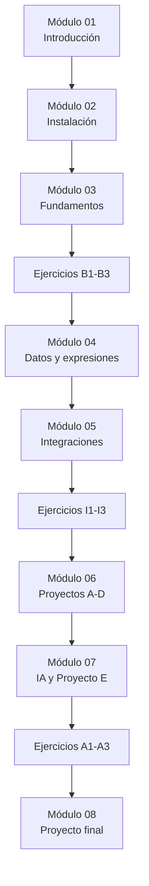

# Ejercicios y ruta de aprendizaje

Ejercicios adicionales a los de cada módulo, organizados en tres niveles. Cada ejercicio tiene enunciado, pistas, solución explicada y resultado esperado. Algunas soluciones se incluyen además como workflow importable en la carpeta `solutions/` de su nivel.

| Nivel | Ejercicios | Requisitos | Credenciales |
| --- | --- | --- | --- |
| [Beginner](beginner/README.md) | B1 a B3 | Módulos 01 a 03 | Ninguna |
| [Intermediate](intermediate/README.md) | I1 a I3 | Módulos 04 y 05 | I3 necesita Google Sheets y Telegram |
| [Advanced](advanced/README.md) | A1 a A3 | Módulos 06 y 07 | A3 necesita un proveedor de IA (o respuesta fijada) |

## Ruta de aprendizaje

| Etapa | Duración orientativa | Al terminar sabrás |
| --- | --- | --- |
| Módulos 01 a 03 y B1 a B3 | 4 horas | Crear workflows con triggers, lógica y código básico |
| Módulos 04 a 05 e I1 a I3 | 5 horas | Transformar datos y conectar servicios reales |
| Módulos 06 a 07 y A1 a A3 | 8 horas | Construir automatizaciones completas, robustas y con IA |
| Módulo 08 | 5 horas | Diseñar un sistema de varios workflows |

## Soluciones importables

| Archivo | Ejercicio | Estado de verificación |
| --- | --- | --- |
| [beginner/solutions/m01-reto-if.json](beginner/solutions/m01-reto-if.json) | Reto del módulo 01 | Validación estática, importación y ejecución comprobadas en n8n 2.48.4 |
| [beginner/solutions/b3-filtrar-tareas.json](beginner/solutions/b3-filtrar-tareas.json) | B3 | Validación estática, importación y ejecución comprobadas en n8n 2.48.4 |
| [intermediate/solutions/i2-api-agregacion.json](intermediate/solutions/i2-api-agregacion.json) | I2 | Validación estática, importación y ejecución comprobadas en n8n 2.48.4 (llamada real a JSONPlaceholder) |
| [advanced/solutions/a2-reintentos-y-errores.json](advanced/solutions/a2-reintentos-y-errores.json) | A2 | Validación estática, importación y ejecución comprobadas en n8n 2.48.4 (llamadas reales a JSONPlaceholder) |

El resto de soluciones están explicadas en el propio README del nivel para que las construyas tú.

## Cómo trabajar los ejercicios

1. Intenta resolver el ejercicio sin mirar la solución. Las pistas están plegadas.
2. Compara tu resultado con el *Resultado esperado*.
3. Solo después, lee la solución o importa el workflow de `solutions/`.
4. Si propones un ejercicio nuevo, sigue [CONTRIBUTING.md](../CONTRIBUTING.md).
