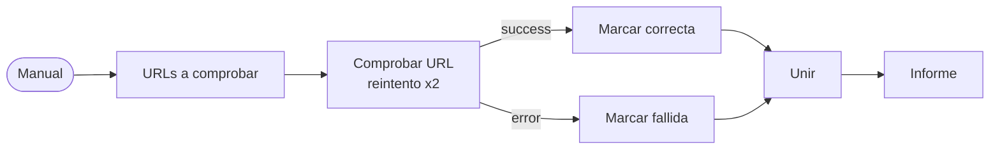
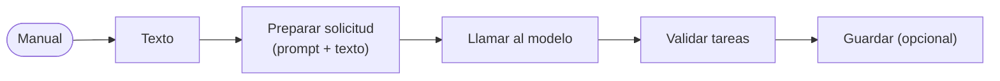

# Ejercicios — Nivel Advanced

Requisitos: módulos 06 y 07. A1 y A2 no necesitan credenciales; A3 necesita un proveedor de IA o una respuesta fijada.

---

## A1 — Sub-workflow reutilizable de formateo

**Enunciado.** Varios proyectos formatean listas de tareas. Crea un sub-workflow **Formatear tareas** que reciba `{ tareas: [...], titulo: "..." }` y devuelva `{ texto }` con una línea por tarea, ordenadas por prioridad. Llámalo desde otro workflow con **Execute Workflow**.

<details>
<summary>Pistas</summary>

- Entrada: **Execute Workflow Trigger** con *Input data mode*: Accept all data.
- El sub-workflow devuelve la salida de su **último nodo**.
- En el workflow principal, en **Execute Workflow**, elige el sub-workflow en *From list* y activa *Wait for Sub-Workflow Completion*.

</details>

### Solución explicada

Sub-workflow: `Entrada` (Execute Workflow Trigger), luego `Formatear` (Code):

```javascript
const { tareas = [], titulo = 'Tareas' } = $input.first().json;
const orden = { alta: 0, media: 1, baja: 2 };
const lineas = [...tareas]
  .sort((a, b) => (orden[a.prioridad] ?? 3) - (orden[b.prioridad] ?? 3))
  .map((t) => `[${String(t.prioridad || '-').toUpperCase()}] ${t.titulo}`);
return [{ json: { texto: [`${titulo} (${tareas.length})`, ...lineas].join('\n') } }];
```

Workflow principal: Manual Trigger, luego un Code que devuelve `{ titulo: 'Hoy', tareas: [...] }`, luego Execute Workflow.

**Resultado esperado:** el nodo Execute Workflow devuelve `{ "texto": "Hoy (3)\n[ALTA] ...\n[MEDIA] ...\n[BAJA] ..." }`. Es el mismo patrón que usa el [proyecto final](../../modules/08-final-project/README.md).

---

## A2 — Reintentos y ruta de error

**Enunciado.** Comprueba una lista de URLs con HTTP Request. Una de ellas devuelve 404. El workflow **no debe detenerse**: cada URL se marca como `ok` o `error`, y un informe final indica cuántas fueron correctas y cuáles fallaron. Cada petición se reintenta una vez antes de darse por fallida.

URLs:

```text
https://jsonplaceholder.typicode.com/todos/1
https://jsonplaceholder.typicode.com/no-existe
https://jsonplaceholder.typicode.com/users/1
```

<details>
<summary>Pistas</summary>

- *Settings* del HTTP Request: **Retry On Fail** (*Max Tries* 2, *Wait Between Tries* 1000 ms) y **On Error** = *Continue (using error output)*.
- Aparece una segunda salida, `error`. Únelas con un **Merge** en modo Append.
- Para recuperar la URL original en cada rama: `{{ $('URLs a comprobar').item.json.url }}`.

</details>

### Solución explicada



- **Marcar fallida** guarda `detalle` = `{{ $json.error.message }}`.
- **Informe** cuenta `estado === 'ok'` y lista las URLs con `estado === 'error'`.

Solución importable: [solutions/a2-reintentos-y-errores.json](solutions/a2-reintentos-y-errores.json).

**Resultado esperado:**

```json
{ "correctas": 2, "fallidas": ["https://jsonplaceholder.typicode.com/no-existe"] }
```

---

## A3 — Extraer tareas de un correo con IA

**Enunciado.** Convierte un texto libre (un correo o notas de reunión) en filas listas para la pestaña `Tareas` del Proyecto A, usando el prompt [task-extractor.md](../../templates/prompts/task-extractor.md).

Requisitos:

1. Entrada manual con un texto, por ejemplo el correo `demo-0005` de [emails.json](../../templates/sample-data/emails.json) o el ejemplo del prompt.
2. Llamada al modelo con la misma estructura que el [Proyecto E](../../workflows/06-ai-knowledge-assistant/README.md) (`POST {apiBaseUrl}/chat/completions`, credencial Header Auth).
3. Validación de cada tarea: título de 3 a 200 caracteres, prioridad en `alta|media|baja`, `fecha_limite` vacía o `AAAA-MM-DD` válida y no pasada. Máximo 5 tareas.
4. Salida: un item por tarea válida con las columnas de `Tareas` (`id`, `titulo`, `prioridad`, `fecha_limite`, `estado`, `creada_en`, `actualizada_en`, `chat_id`).
5. Opcional: guardar con Google Sheets *Append*.

Si no tienes proveedor, fija (*pin*) en el nodo del modelo la respuesta del ejemplo del prompt.

<details>
<summary>Pistas</summary>

- Reutiliza la función `extraerJson` de **Validar respuesta** del Proyecto E.
- Sustituye `{{HOY}}` del prompt por la fecha con `.replace('{{HOY}}', $now.toFormat('yyyy-MM-dd'))` dentro de un Code (no en una expresión).
- Genera el `id` en n8n, nunca lo pidas al modelo.

</details>

### Solución explicada



`Preparar solicitud` (Code):

```javascript
const texto = String($input.first().json.texto || '').trim().slice(0, 4000);
const sistema = [
  'Extrae las tareas accionables del texto del usuario.',
  'Responde SOLO con JSON válido con esta forma:',
  '{"tareas": [{"titulo": "...", "prioridad": "alta|media|baja", "fecha_limite": "AAAA-MM-DD o vacío"}]}',
  'Reglas:',
  '- Un título por tarea, en infinitivo, máximo 100 caracteres.',
  '- Prioridad "alta" solo si el texto indica urgencia o una fecha en los próximos 3 días.',
  '- fecha_limite solo si aparece una fecha explícita; si no, cadena vacía.',
  '- Si no hay tareas, devuelve {"tareas": []}.',
  '- Hoy es {{HOY}}.',
].join('\n').replace('{{HOY}}', $now.toFormat('yyyy-MM-dd'));
return [{ json: { requestBody: {
  model: 'llama3.2',
  temperature: 0.1,
  messages: [
    { role: 'system', content: sistema },
    { role: 'user', content: `Texto:\n<<<\n${texto}\n>>>` },
  ],
} } }];
```

`Llamar al modelo`: igual que en el Proyecto E (cuerpo `{{ JSON.stringify($json.requestBody) }}`).

`Validar tareas` (Code):

```javascript
const contenido = String($input.first().json.choices?.[0]?.message?.content || '');
const limpio = contenido.replace(/```(?:json)?/gi, '');
const inicio = limpio.indexOf('{');
const fin = limpio.lastIndexOf('}');
let tareas = [];
try { tareas = JSON.parse(limpio.slice(inicio, fin + 1)).tareas || []; } catch (e) { tareas = []; }

const hoy = $now.toFormat('yyyy-MM-dd');
const ahora = $now.toFormat('yyyy-MM-dd HH:mm');
const validas = [];
for (const t of tareas.slice(0, 5)) {
  const titulo = String(t.titulo || '').trim();
  const prioridad = String(t.prioridad || '').toLowerCase();
  const fecha = String(t.fecha_limite || '');
  const fechaOk = !fecha || (/^\d{4}-\d{2}-\d{2}$/.test(fecha) && DateTime.fromISO(fecha).isValid && fecha >= hoy);
  if (titulo.length < 3 || titulo.length > 200 || !['alta', 'media', 'baja'].includes(prioridad) || !fechaOk) continue;
  validas.push({ json: {
    id: 'T-' + Math.random().toString(36).slice(2, 8).toUpperCase(),
    titulo, prioridad, fecha_limite: fecha, estado: 'pendiente',
    creada_en: ahora, actualizada_en: ahora, chat_id: 'REEMPLAZAR_CON_TU_CHAT_ID',
  } });
}
return validas;
```

**Resultado esperado:** con el ejemplo del prompt (y hoy = 2026-11-17), 3 items: `Enviar el presupuesto al cliente` (alta, 2026-11-18), `Revisar el contrato` (media, 2026-12-10) y `Actualizar la web` (baja, sin fecha). Una tarea con prioridad inventada o fecha pasada se descarta sin detener el workflow.

> [!NOTE]
> Este ejercicio no incluye un workflow importable: la gracia está en construirlo combinando piezas del Proyecto E. Los dos nodos Code anteriores se han probado con Node.js y Luxon sobre respuestas de modelo simuladas (incluida una sin JSON), pero no dentro de n8n ni contra un proveedor de IA real.

---

Anterior: [Intermediate](../intermediate/README.md) | [Ruta de aprendizaje](../README.md) | Siguiente: [Módulo 08 — Proyecto final](../../modules/08-final-project/README.md)
