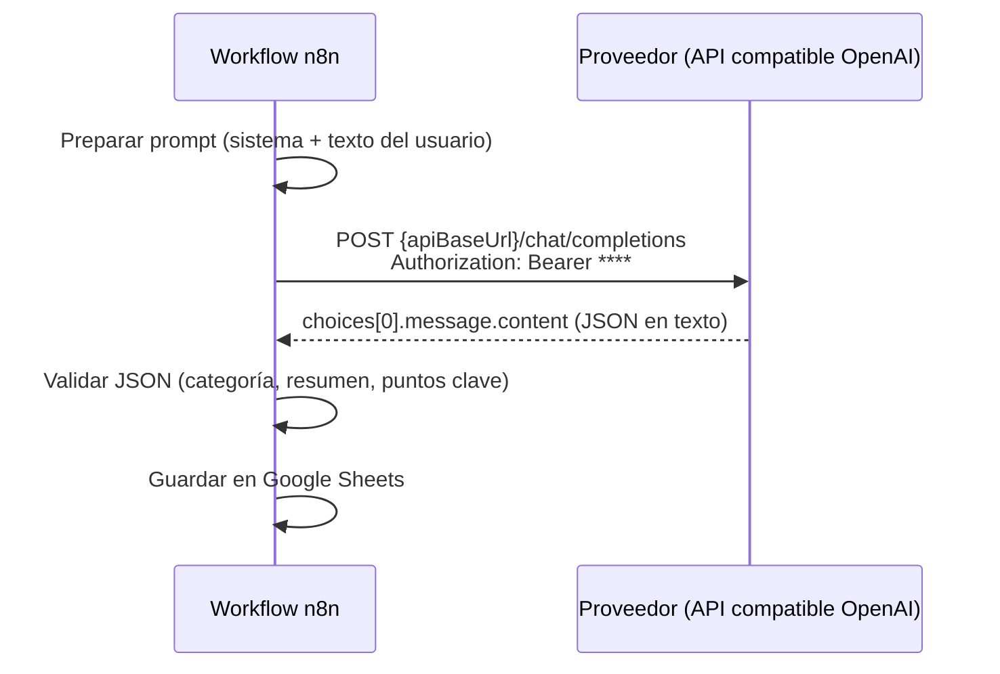

# Guía de integración: proveedores de IA

El Proyecto E (AI Knowledge Assistant) y la función opcional `/nota` del proyecto final envían texto a un modelo de lenguaje para clasificarlo y resumirlo. El taller usa la **API compatible con OpenAI** (`POST /chat/completions`) mediante el nodo **HTTP Request**, de modo que puedes elegir proveedor cambiando dos valores.

## Índice

- [Qué hace](#qué-hace)
- [Qué necesitamos](#qué-necesitamos)
- [Elegir proveedor](#elegir-proveedor)
- [Opción local y gratuita: Ollama](#opción-local-y-gratuita-ollama)
- [Proveedores en la nube](#proveedores-en-la-nube)
- [Crear la credencial en n8n](#crear-la-credencial-en-n8n)
- [Configurar el workflow](#configurar-el-workflow)
- [Modo simulado sin proveedor](#modo-simulado-sin-proveedor)
- [Probar la conexión](#probar-la-conexión)
- [Errores frecuentes](#errores-frecuentes)
- [Consideraciones de seguridad y costos](#consideraciones-de-seguridad-y-costos)
- [Por qué HTTP Request y no los nodos de IA de n8n](#por-qué-http-request-y-no-los-nodos-de-ia-de-n8n)

## Qué hace



Petición que envía el workflow:

```json
{
  "model": "llama3.2",
  "temperature": 0.2,
  "messages": [
    { "role": "system", "content": "Eres un asistente que organiza información..." },
    { "role": "user", "content": "Texto a analizar..." }
  ]
}
```

## Qué necesitamos

- Un proveedor con API compatible con OpenAI (local o en la nube).
- Su **URL base** y el **nombre del modelo**.
- Una **API key** (los proveedores locales como Ollama no la necesitan).

## Elegir proveedor

> [!WARNING]
> Las condiciones de los planes gratuitos, los límites y los nombres de los modelos cambian con frecuencia. Los datos de esta tabla son orientativos: **consulta siempre la página oficial del proveedor** antes de usarlo. El taller no garantiza la disponibilidad de ningún plan gratuito.

| Proveedor | URL base (`apiBaseUrl`) | Costo | Notas |
| --- | --- | --- | --- |
| **Ollama** (local) | `http://host.docker.internal:11434/v1` | Gratis, se ejecuta en tu equipo | Privacidad total. Requiere RAM suficiente (8 GB recomendados para modelos de 3B). |
| Groq | `https://api.groq.com/openai/v1` | Plan gratuito con límites de uso | Muy rápido. Requiere cuenta. |
| Google Gemini (compatibilidad OpenAI) | `https://generativelanguage.googleapis.com/v1beta/openai` | Plan gratuito con límites de uso | Los datos del plan gratuito pueden usarse para mejorar productos de Google; revisa sus condiciones. |
| OpenRouter | `https://openrouter.ai/api/v1` | Algunos modelos gratuitos con límites; el resto de pago | Un único punto de acceso a muchos modelos. |
| OpenAI | `https://api.openai.com/v1` | **De pago por uso** | Requiere método de pago. |

Modelos de ejemplo (verifica que sigan disponibles):

| Proveedor | Ejemplo de `model` |
| --- | --- |
| Ollama | `llama3.2` o `qwen2.5:3b` |
| Groq | Consulta <https://console.groq.com/docs/models> |
| Gemini | Consulta <https://ai.google.dev/gemini-api/docs/models> |
| OpenRouter | Modelos con sufijo `:free` en <https://openrouter.ai/models> |
| OpenAI | Consulta <https://platform.openai.com/docs/models> |

## Opción local y gratuita: Ollama

1. Instala Ollama desde <https://ollama.com/download>.
2. Descarga un modelo pequeño:

```bash
ollama pull llama3.2
```

3. Comprueba que responde:

```bash
curl http://localhost:11434/v1/chat/completions \
  -H "Content-Type: application/json" \
  -d '{"model":"llama3.2","messages":[{"role":"user","content":"Responde solo: ok"}]}'
```

4. Como n8n se ejecuta dentro de Docker, debe llegar a Ollama a través de `host.docker.internal`. El `docker-compose.yml` del taller ya incluye `extra_hosts: host.docker.internal:host-gateway` para que funcione también en Linux.

> [!NOTE]
> En Linux, Ollama escucha por defecto solo en `127.0.0.1`. Si n8n no puede conectar, configura `OLLAMA_HOST=0.0.0.0` en el servicio de Ollama y asegúrate de que el puerto 11434 no queda expuesto a Internet (firewall).

## Proveedores en la nube

Pasos generales (Groq como ejemplo):

1. Crea una cuenta en la consola del proveedor.
2. **Configura un límite de gasto o comprueba que estás en el plan gratuito.**
3. Crea una API key con un nombre reconocible (`n8n-workshop`).
4. Copia la clave: muchos proveedores solo la muestran una vez.

## Crear la credencial en n8n

El workflow usa una credencial genérica **Header Auth**, que sirve para cualquier proveedor compatible.

1. **Create credential > Header Auth**.
2. **Name**: `Authorization`
3. **Value**: `Bearer TU_API_KEY` (con la palabra `Bearer`, un espacio y la clave).
4. Guarda la credencial como `IA - Proveedor del taller`.

Para **Ollama**, que no requiere clave, crea igualmente la credencial con el valor `Bearer ollama`: Ollama ignora el encabezado y el workflow no necesita cambios.

## Configurar el workflow

Abre el nodo `Configuración` de [workflows/06-ai-knowledge-assistant/ai-knowledge-assistant.json](../workflows/06-ai-knowledge-assistant/ai-knowledge-assistant.json):

| Campo | Ejemplo | Descripción |
| --- | --- | --- |
| `useMockModel` | `true` / `false` | `true` usa respuestas simuladas sin llamar a ningún proveedor. |
| `apiBaseUrl` | `http://host.docker.internal:11434/v1` | URL base **sin** `/chat/completions` y sin `/` final. |
| `model` | `llama3.2` | Nombre exacto del modelo en el proveedor. |
| `maxInputChars` | `6000` | Recorta textos largos para controlar costo y latencia. |

Después abre el nodo **Llamar al modelo** y selecciona tu credencial Header Auth.

## Modo simulado sin proveedor

Con `useMockModel = true` el workflow genera una respuesta de ejemplo con el mismo formato que devolvería un modelo real. Sirve para:

- Aprender el flujo completo sin crear cuentas.
- Probar la validación y el guardado en Sheets.
- Trabajar sin conexión.

La respuesta simulada usa reglas sencillas por palabras clave. **No es IA** y así se indica en el campo `modelo` del resultado (`simulado`).

## Probar la conexión

1. Pon `useMockModel` en `false`.
2. Ejecuta el workflow con el **Manual Trigger**, que incluye un texto de ejemplo.
3. El nodo **Llamar al modelo** debe devolver un objeto con `choices[0].message.content`.
4. El nodo **Validar respuesta** debe mostrar `valido: true`.

## Errores frecuentes

| Error | Causa | Solución |
| --- | --- | --- |
| `ECONNREFUSED host.docker.internal:11434` | Ollama no está en marcha o solo escucha en 127.0.0.1 (Linux) | Arranca Ollama; revisa `OLLAMA_HOST`. |
| `401 Unauthorized` | API key incorrecta o sin `Bearer ` | Revisa el valor de la credencial Header Auth. |
| `404 Not Found` | `apiBaseUrl` mal escrita o con `/chat/completions` duplicado | Usa solo la URL base. |
| `model not found` | Nombre de modelo inexistente | Copia el nombre exacto de la documentación del proveedor u `ollama list`. |
| `429 Too Many Requests` | Límite del plan gratuito alcanzado | Espera o cambia de proveedor. El nodo reintenta automáticamente dos veces. |
| `valido: false` con `error: JSON no válido` | El modelo no devolvió JSON | Usa un modelo más capaz o baja `temperature`. El registro se guarda igualmente marcado como error. |
| Respuestas muy lentas | Modelo local grande en CPU | Usa un modelo más pequeño. |

## Consideraciones de seguridad y costos

- **Todo lo que envías a un proveedor en la nube sale de tu equipo.** No envíes contraseñas, datos de salud, datos de clientes ni correos de terceros.
- Configura límites de gasto en proveedores de pago.
- El workflow recorta la entrada a `maxInputChars` para evitar peticiones accidentales muy grandes.
- La salida del modelo se trata como **no confiable**: se valida la estructura y se limitan las categorías a una lista cerrada antes de guardarla.
- Si el webhook del Proyecto E se publica en Internet, protégelo con autenticación: cualquiera que conozca la URL podría consumir tu cuota.

## Por qué HTTP Request y no los nodos de IA de n8n

n8n incluye nodos de IA (*AI Agent*, *Basic LLM Chain*, modelos de OpenAI, Ollama, Groq, Gemini y otros). Son una excelente opción y se mencionan en el [Módulo 07](../modules/07-ai-automation/README.md). El taller usa **HTTP Request** en el proyecto principal porque:

- Muestra exactamente qué se envía y qué se recibe (valor pedagógico).
- Funciona igual con cualquier proveedor compatible cambiando solo la URL y el modelo.
- No depende de cambios de versión en los subnodos de IA.

Referencias:

- Nodo HTTP Request: <https://docs.n8n.io/integrations/builtin/core-nodes/n8n-nodes-base.httprequest/>
- Nodos de IA de n8n: <https://docs.n8n.io/advanced-ai/>
- Compatibilidad OpenAI de Ollama: <https://github.com/ollama/ollama/blob/main/docs/openai.md>
