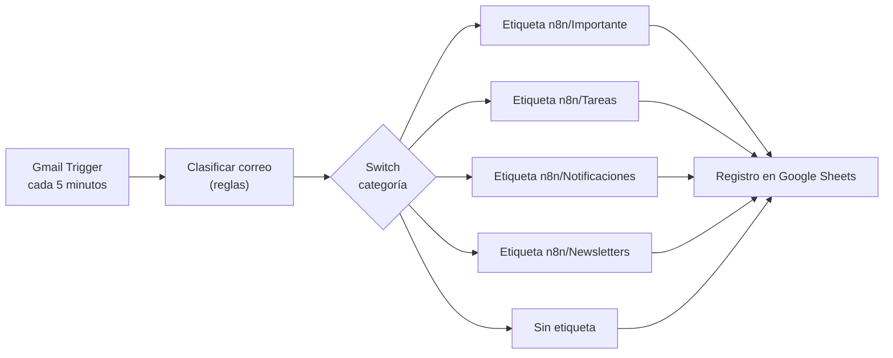

# Guía de integración: Gmail

El Proyecto C (Smart Email Organizer) revisa periódicamente los correos nuevos, los clasifica con reglas, les aplica una etiqueta de Gmail y registra el resultado en Google Sheets. Gmail es gratuito con una cuenta de Google personal.

## Índice

- [Qué hace](#qué-hace)
- [Qué necesitamos](#qué-necesitamos)
- [Crear la credencial OAuth2](#crear-la-credencial-oauth2)
- [Crear las etiquetas del taller](#crear-las-etiquetas-del-taller)
- [Cómo funciona el Gmail Trigger](#cómo-funciona-el-gmail-trigger)
- [Probar la conexión](#probar-la-conexión)
- [Errores frecuentes](#errores-frecuentes)
- [Consideraciones de seguridad](#consideraciones-de-seguridad)

## Qué hace

El workflow **solo lee y etiqueta**. No envía, archiva ni borra correos.

## Qué necesitamos

- El proyecto de Google Cloud de la [guía de Google Sheets](google-sheets-setup.md#opción-a-credencial-oauth2) con **Gmail API** habilitada.
- Un cliente OAuth (puedes reutilizar el mismo).
- La hoja del taller con la pestaña `RegistroCorreos`.

> [!IMPORTANT]
> n8n recomienda **OAuth2** para Gmail. La Service Account solo funciona con delegación de todo el dominio en Google Workspace, que Google desaconseja y no está disponible en cuentas personales.

## Crear la credencial OAuth2

1. Habilita **Gmail API** en **APIs & Services > Library**.
2. En n8n: **Create credential > Gmail OAuth2 API**.
3. Pega **Client ID** y **Client Secret** del cliente OAuth.
4. Pulsa **Sign in with Google**, elige tu cuenta (usuario de prueba) y acepta los permisos.
5. Guarda la credencial como `Gmail - Taller`.

## Crear las etiquetas del taller

1. Abre Gmail en el navegador.
2. En el panel izquierdo: **Más > Crear etiqueta nueva**.
3. Crea estas cuatro etiquetas:

| Etiqueta | Categoría del workflow |
| --- | --- |
| `n8n/Importante` | `importante` |
| `n8n/Tareas` | `tarea` |
| `n8n/Notificaciones` | `notificacion` |
| `n8n/Newsletters` | `newsletter` |

4. En n8n, abre cada nodo `Etiquetar ...` del workflow y elige la etiqueta correspondiente en el desplegable **Label Names or IDs**. El desplegable lista las etiquetas de tu cuenta.

> [!NOTE]
> Los IDs de etiqueta tienen el formato `Label_1234567890123456789` y son distintos en cada cuenta. Por eso el workflow exportado no los incluye y debes seleccionarlos tú.

## Cómo funciona el Gmail Trigger

- Es un trigger de **sondeo** (*polling*): n8n consulta Gmail cada cierto tiempo. No necesita URL pública ni túnel.
- Solo entrega correos **nuevos** desde la última comprobación. La primera ejecución tras publicar no procesa el histórico.
- El workflow usa el filtro de búsqueda `in:inbox` (solo bandeja de entrada); puedes cambiarlo con la sintaxis de búsqueda de Gmail (por ejemplo `in:inbox newer_than:1d`).
- **Simplify** está desactivado para obtener el cuerpo completo (`text`) y los encabezados.

## Probar la conexión

1. Envía a tu cuenta un correo de prueba desde otra dirección con el asunto `URGENTE: revisar contrato ficticio`.
2. Abre el workflow y pulsa **Fetch Test Event** en el Gmail Trigger.
3. Ejecuta el resto del workflow con **Execute workflow**.
4. Comprueba que el correo tiene la etiqueta `n8n/Importante` y que aparece una fila nueva en `RegistroCorreos`.

También puedes probar solo la lógica de clasificación sin Gmail con [workflows/04-email-organizer/email-classifier-test.json](../workflows/04-email-organizer/email-classifier-test.json), que usa los correos ficticios de [templates/sample-data/emails.json](../templates/sample-data/emails.json).

## Errores frecuentes

| Error | Causa | Solución |
| --- | --- | --- |
| `Gmail API has not been used in project` | API no habilitada | Habilítala en Google Cloud. |
| `Invalid label` / `Label name or ID not found` | No seleccionaste una etiqueta en el nodo | Elige la etiqueta en cada nodo `Etiquetar ...`. |
| El trigger no devuelve nada en *Fetch Test Event* | No hay correos que cumplan el filtro | Envía un correo nuevo o relaja el filtro. |
| Correos procesados dos veces | Ejecutaste manualmente y además está publicado | Normal en pruebas. En producción cada correo se procesa una vez. |
| `insufficient authentication scopes` | La credencial se creó antes de habilitar la API o se denegó un permiso | Vuelve a pulsar **Sign in with Google** y acepta todos los permisos. |

## Consideraciones de seguridad

- La credencial de Gmail da acceso de lectura a **todo** tu correo. Úsala solo en tu instancia local o en una instancia protegida con HTTPS.
- El registro en Sheets guarda remitente, asunto y categoría, **no** el cuerpo del correo. Mantén esa decisión si modificas el workflow.
- No envíes el contenido de tus correos a proveedores de IA externos sin revisar sus políticas de datos.
- Revoca el acceso al terminar: <https://myaccount.google.com/permissions>.

Referencias oficiales:

- Nodo Gmail: <https://docs.n8n.io/integrations/builtin/app-nodes/n8n-nodes-base.gmail/>
- Gmail Trigger: <https://docs.n8n.io/integrations/builtin/trigger-nodes/n8n-nodes-base.gmailtrigger/>
- Sintaxis de búsqueda de Gmail: <https://support.google.com/mail/answer/7190>
