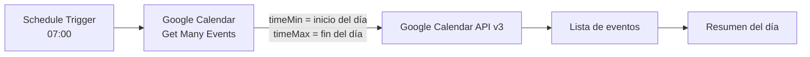

# Guía de integración: Google Calendar

El Proyecto B (Daily Productivity Assistant) y el Proyecto Final consultan los eventos del día en Google Calendar para construir un resumen. Google Calendar es gratuito con una cuenta de Google personal.

## Índice

- [Qué hace](#qué-hace)
- [Qué necesitamos](#qué-necesitamos)
- [Crear la credencial OAuth2](#crear-la-credencial-oauth2)
- [Elegir el calendario](#elegir-el-calendario)
- [Configuración del nodo en el taller](#configuración-del-nodo-en-el-taller)
- [Probar la conexión](#probar-la-conexión)
- [Errores frecuentes](#errores-frecuentes)
- [Consideraciones de seguridad](#consideraciones-de-seguridad)

## Qué hace



El taller **solo lee** eventos. No crea, modifica ni borra nada en tu calendario.

## Qué necesitamos

- El proyecto de Google Cloud de la [guía de Google Sheets](google-sheets-setup.md#opción-a-credencial-oauth2) con **Google Calendar API** habilitada.
- Un cliente OAuth (puedes reutilizar el mismo Client ID y Client Secret).

> [!IMPORTANT]
> Google Calendar **no admite Service Account** en n8n. Debes usar OAuth2.

## Crear la credencial OAuth2

1. En Google Cloud, comprueba que **Google Calendar API** está habilitada (**APIs & Services > Library**).
2. En n8n: **Create credential > Google Calendar OAuth2 API**.
3. Si el cliente OAuth aún no tiene la URL de redirección de n8n, añádela en Google Cloud (**Credentials > tu cliente > Authorized redirect URIs**).
4. Pega **Client ID** y **Client Secret**.
5. Pulsa **Sign in with Google**, elige tu cuenta (debe ser usuario de prueba) y acepta los permisos.
6. Guarda la credencial como `Google Calendar - Taller`.

## Elegir el calendario

| Valor | Significado |
| --- | --- |
| `primary` | Tu calendario principal. Valor por defecto en los workflows del taller. |
| `xxxx@group.calendar.google.com` | Un calendario secundario. Lo encuentras en Google Calendar > Configuración del calendario > **Integrar el calendario > ID del calendario**. |

> [!TIP]
> Crea un calendario secundario llamado `Taller n8n` con eventos ficticios (ver [templates/sample-data/calendar-events.json](../templates/sample-data/calendar-events.json)) para practicar sin exponer tu agenda real.

## Configuración del nodo en el taller

| Parámetro | Valor | Motivo |
| --- | --- | --- |
| Resource | Event | |
| Operation | Get Many | Devuelve todos los eventos de un rango. |
| Calendar | `={{ $('Configuración').first().json.calendarId }}` | Configurable desde un solo nodo. |
| Return All | Activado | Evita perder eventos en días ocupados. |
| After (`timeMin`) | `={{ $now.startOf('day').toISO() }}` | Inicio del día en la zona horaria de n8n. |
| Before (`timeMax`) | `={{ $now.endOf('day').toISO() }}` | Fin del día. |
| Options > Recurring Event Handling | Expand | Devuelve cada repetición de eventos recurrentes como evento individual. |
| Options > Order By | Start Time | Eventos en orden cronológico. |
| Settings > Always Output Data | Activado | El workflow continúa aunque no haya eventos. |

Formato de un evento devuelto (resumido):

```json
{
  "id": "abc123",
  "summary": "Reunión de planificación",
  "location": "Sala 2",
  "start": { "dateTime": "2026-11-17T10:00:00-06:00" },
  "end":   { "dateTime": "2026-11-17T11:00:00-06:00" }
}
```

Los eventos de día completo usan `start.date` (`"2026-11-17"`) en lugar de `start.dateTime`. El código del taller maneja ambos casos.

## Probar la conexión

1. Crea dos eventos de prueba para hoy en tu calendario.
2. Importa [workflows/03-daily-assistant/daily-assistant.json](../workflows/03-daily-assistant/daily-assistant.json).
3. Selecciona la credencial en el nodo **Eventos de hoy** y pulsa **Execute step** sobre ese nodo.
4. Deben aparecer tus dos eventos.

## Errores frecuentes

| Error | Causa | Solución |
| --- | --- | --- |
| `Google Calendar API has not been used in project` | API no habilitada | Habilítala en Google Cloud y espera unos minutos. |
| `Not Found` | ID de calendario incorrecto | Usa `primary` o copia el ID desde la configuración del calendario. |
| Eventos de otro día | Zona horaria de n8n distinta a la tuya | Ajusta `GENERIC_TIMEZONE` y `TZ` en `.env` y recrea el contenedor. |
| Solo aparece la primera repetición de un evento recurrente | Recurring Event Handling no está en *Expand* | Revisa la opción en el nodo. |
| `invalid_grant` tras unos días | Token caducado (modo Testing, 7 días) | Reconecta la credencial con **Sign in with Google**. |

## Consideraciones de seguridad

- El resumen diario envía títulos y ubicaciones de tus eventos a Telegram. No lo uses con calendarios que contengan información confidencial de terceros.
- Si activas la opción de IA en el proyecto final, los títulos de los eventos **no** se envían al modelo; solo el texto que tú mandes con `/nota`.

Referencias oficiales:

- Nodo Google Calendar: <https://docs.n8n.io/integrations/builtin/app-nodes/n8n-nodes-base.googlecalendar/>
- Calendar API, Events: list: <https://developers.google.com/workspace/calendar/api/v3/reference/events/list>
