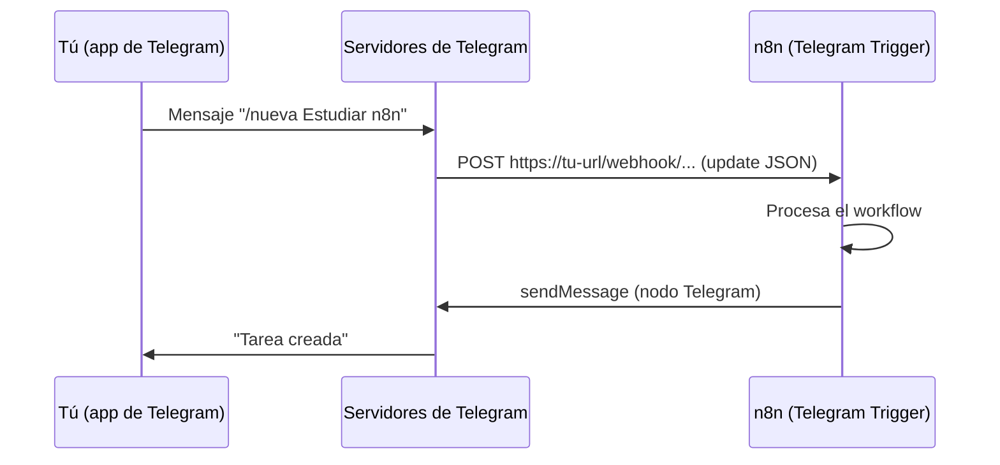

# Guía de integración: Telegram

Telegram es el canal de entrada y salida de los proyectos del taller: envías un mensaje al bot y n8n responde. La Bot API de Telegram es gratuita.

## Índice

- [Qué hace](#qué-hace)
- [Qué necesitamos](#qué-necesitamos)
- [Crear el bot y el token](#crear-el-bot-y-el-token)
- [Crear la credencial en n8n](#crear-la-credencial-en-n8n)
- [Obtener tu chat_id](#obtener-tu-chat_id)
- [Exponer n8n con HTTPS para el Telegram Trigger](#exponer-n8n-con-https-para-el-telegram-trigger)
- [Probar la conexión](#probar-la-conexión)
- [Errores frecuentes](#errores-frecuentes)
- [Consideraciones de seguridad](#consideraciones-de-seguridad)

## Qué hace



| Nodo | Uso en el taller |
| --- | --- |
| **Telegram Trigger** | Recibe mensajes del bot mediante un webhook. |
| **Telegram** (acción *Send Message*) | Envía respuestas y resúmenes. |

## Qué necesitamos

- Una cuenta de Telegram.
- n8n en marcha.
- **Una URL HTTPS pública** que apunte a n8n. Telegram solo envía webhooks a URLs `https` (puertos 443, 80, 88 u 8443). En local se consigue con un túnel; ver [más abajo](#exponer-n8n-con-https-para-el-telegram-trigger).

> [!NOTE]
> El nodo **Telegram** (enviar mensajes) funciona sin HTTPS público, porque es n8n quien llama a Telegram. Solo el **Telegram Trigger** necesita la URL pública. El Proyecto B (resumen diario) y el resumen semanal de hábitos funcionan sin túnel.

## Crear el bot y el token

1. En Telegram, abre una conversación con [@BotFather](https://t.me/BotFather) (cuenta oficial, con marca de verificación).
2. Envía `/newbot`.
3. Escribe un nombre visible, por ejemplo `Mi Asistente de Productividad`.
4. Escribe un nombre de usuario que termine en `bot`, por ejemplo `mi_productividad_2026_bot`.
5. BotFather responde con un **token** con el formato `123456789:AA...`. Cópialo.

Opcional: envía `/setcommands`, elige tu bot y pega la lista de comandos del taller para que aparezcan como sugerencias:

```text
nueva - Crear tarea: /nueva Título | prioridad | AAAA-MM-DD
tareas - Ver tareas pendientes
estado - Cambiar estado: /estado ID pendiente|en_progreso|completada
hecha - Marcar tarea completada: /hecha ID
habito - Registrar hábito: /habito nombre
habitos - Ver hábitos disponibles
hoy - Ver hábitos de hoy
stats - Estadísticas de hábitos
agenda - Agenda de hoy
nota - Guardar una nota clasificada con IA
ayuda - Ver ayuda
```

## Crear la credencial en n8n

1. En n8n: **Overview > Credentials > Create credential**.
2. Busca **Telegram API**.
3. Pega el token en **Access Token**.
4. Deja **Base URL** con su valor por defecto (`https://api.telegram.org`).
5. Pulsa **Save**. n8n prueba el token y muestra *Connection tested successfully* si es válido.
6. Cambia el nombre a algo claro, por ejemplo `Telegram - Bot del taller`.

## Obtener tu chat_id

El `chat_id` identifica tu conversación con el bot. Lo necesitas para enviar notificaciones programadas y para restringir el bot.

**Opción A, con n8n (recomendada):**

1. Importa [workflows/02-task-manager/task-manager.json](../workflows/02-task-manager/task-manager.json) o crea un workflow con un solo **Telegram Trigger**.
2. Con el túnel activo, pulsa **Execute workflow** (o **Listen for test event** en el trigger).
3. Envía cualquier mensaje al bot.
4. En la salida del trigger, copia el valor de `message.chat.id`.

**Opción B, con la Bot API (sin webhook activo):**

1. Envía un mensaje a tu bot.
2. Abre en el navegador `https://api.telegram.org/bot<TOKEN>/getUpdates` sustituyendo `<TOKEN>`.
3. Busca `"chat":{"id": ...}`.

> [!WARNING]
> `getUpdates` no funciona mientras haya un webhook registrado (devuelve un error de conflicto). Además, la URL contiene tu token: no la compartas ni la guardes en el historial de un equipo ajeno.

## Exponer n8n con HTTPS para el Telegram Trigger

n8n 2.x ya no incluye la opción `--tunnel`. Usa un túnel externo. Ambas opciones tienen modalidad gratuita, sujeta a las condiciones vigentes de cada proveedor.

### Opción 1: Cloudflare Tunnel (túnel rápido, sin cuenta)

1. Instala `cloudflared`: <https://developers.cloudflare.com/cloudflare-one/connections/connect-networks/downloads/>.
2. Ejecuta:

```bash
cloudflared tunnel --url http://localhost:5678
```

3. Copia la URL `https://<algo>.trycloudflare.com` que aparece en la consola.

### Opción 2: ngrok

1. Crea una cuenta en <https://ngrok.com/> e instala el agente.
2. Ejecuta:

```bash
ngrok http 5678
```

3. Copia la URL `https://...` de *Forwarding*.

### Configurar n8n con la URL del túnel

Edita `.env`:

```dotenv
WEBHOOK_URL=https://tu-subdominio.trycloudflare.com/
N8N_PROXY_HOPS=1
```

Recrea el contenedor para aplicar los cambios:

```bash
docker compose up -d
```

> [!IMPORTANT]
> Los túneles rápidos cambian de URL cada vez que los reinicias. Cuando cambie, actualiza `WEBHOOK_URL`, recrea el contenedor y vuelve a publicar el workflow para que n8n registre el nuevo webhook en Telegram.

## Probar la conexión

1. Abre el workflow con el Telegram Trigger.
2. Selecciona tu credencial en el trigger y en los nodos Telegram.
3. Pulsa **Execute workflow**. n8n registra un webhook de prueba en Telegram.
4. Envía `/ayuda` al bot. La ejecución debe aparecer en el editor.
5. Cuando funcione, pulsa **Publish** para registrar el webhook de producción.

### URL de prueba frente a URL de producción

| | URL de prueba | URL de producción |
| --- | --- | --- |
| Ruta | `/webhook-test/...` | `/webhook/...` |
| Cuándo se registra | Al pulsar *Execute workflow* | Al publicar el workflow |
| Dónde ves los datos | En el editor, en tiempo real | En la pestaña *Executions* |

Como Telegram solo admite un webhook por bot, **probar en el editor sustituye el webhook de producción**. Después de probar, vuelve a publicar el workflow (o despublícalo y publícalo de nuevo) para restaurarlo.

## Errores frecuentes

| Error | Causa | Solución |
| --- | --- | --- |
| `Bad Request: bad webhook: An HTTPS URL must be provided for webhook` | `WEBHOOK_URL` usa `http://` | Configura un túnel HTTPS y actualiza `WEBHOOK_URL`. |
| El bot no responde y no aparecen ejecuciones | Webhook registrado con una URL antigua del túnel | Actualiza `WEBHOOK_URL`, recrea el contenedor y vuelve a publicar. |
| `Unauthorized` al guardar la credencial | Token incorrecto o revocado | Copia de nuevo el token desde BotFather. |
| `Conflict: can't use getUpdates method while webhook is active` | Hay un webhook activo | Normal mientras el workflow está publicado. Usa la opción A para obtener el `chat_id`. |
| `Bad Request: chat not found` | `chat_id` incorrecto o nunca escribiste al bot | Envía `/start` al bot y revisa el `chat_id` del nodo `Configuración`. |
| Funciona en pruebas pero no en producción | El workflow no está publicado o la prueba sobrescribió el webhook | Pulsa **Publish** de nuevo. |
| `Bad Request: can't parse entities` | El texto contiene caracteres especiales con *Parse Mode* activado | Los workflows del taller envían texto plano. No actives *Parse Mode* o escapa los caracteres. |

## Consideraciones de seguridad

- El token es un secreto. Guárdalo solo en la credencial de n8n.
- Restringe el trigger a tu `chat_id` (*Additional Fields > Restrict to Chat IDs*).
- No añadas el bot a grupos con personas ajenas: leería sus mensajes de comandos.
- Cierra el túnel cuando no lo uses.

Referencias oficiales:

- Bot API: <https://core.telegram.org/bots/api>
- setWebhook: <https://core.telegram.org/bots/api#setwebhook>
- Nodo Telegram en n8n: <https://docs.n8n.io/integrations/builtin/app-nodes/n8n-nodes-base.telegram/>
- Telegram Trigger en n8n: <https://docs.n8n.io/integrations/builtin/trigger-nodes/n8n-nodes-base.telegramtrigger/>
