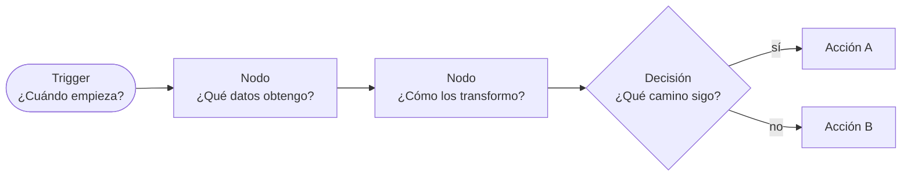
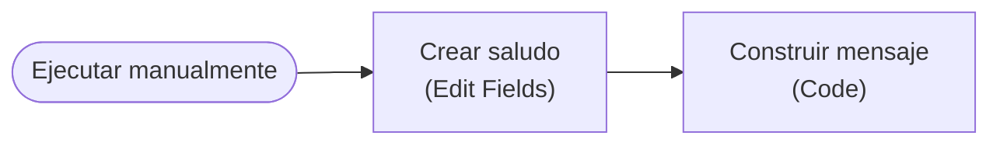

# Módulo 01 — Introducción a n8n

| Duración estimada | Nivel | Requisitos |
| --- | --- | --- |
| 45 minutos | Beginner | Ninguno (la instalación se ve en el Módulo 02) |

## Objetivos

Al terminar este módulo podrás:

- Explicar qué es n8n y qué problemas resuelve.
- Distinguir automatización tradicional y automatización inteligente.
- Identificar triggers, nodos y conexiones en un workflow.
- Leer el JSON de un workflow sencillo.

## Índice

1. [Qué es n8n](#1-qué-es-n8n)
2. [Para qué sirve y qué problemas resuelve](#2-para-qué-sirve-y-qué-problemas-resuelve)
3. [Automatización tradicional frente a inteligente](#3-automatización-tradicional-frente-a-inteligente)
4. [Cómo funciona un workflow](#4-cómo-funciona-un-workflow)
5. [Nodos, triggers y conexiones](#5-nodos-triggers-y-conexiones)
6. [Casos reales de aplicación](#6-casos-reales-de-aplicación)
7. [Demostración: tu primer workflow](#7-demostración-tu-primer-workflow)
8. [Ejercicio guiado](#8-ejercicio-guiado)
9. [Reto individual](#9-reto-individual)
10. [Solución explicada](#10-solución-explicada)

---

## 1. Qué es n8n

**n8n** (se pronuncia *n-eight-n*, abreviatura de *nodemation*) es una herramienta de automatización de flujos de trabajo. Conecta aplicaciones, APIs y datos mediante un editor visual de nodos, y permite escribir JavaScript cuando el editor visual no es suficiente.

Características relevantes para este taller:

| Característica | Por qué importa |
| --- | --- |
| Editor visual | Ves el flujo de datos nodo a nodo. |
| Self-hosted | Puedes ejecutarlo en tu equipo; tus datos no pasan por terceros salvo los servicios que conectes. |
| Más de 400 integraciones | Telegram, Google, Gmail y APIs genéricas sin programar clientes HTTP. |
| Código cuando hace falta | Nodo Code con JavaScript para lógica a medida. |
| Licencia *fair-code* | Código fuente disponible bajo la Sustainable Use License (no es MIT). |

## 2. Para qué sirve y qué problemas resuelve

Problemas típicos de productividad personal que resuelve el taller:

| Problema | Automatización del taller |
| --- | --- |
| "Apunto tareas en mil sitios y las olvido." | Proyecto A: tareas desde Telegram a Google Sheets. |
| "Cada mañana reviso calendario y pendientes a mano." | Proyecto B: resumen diario automático. |
| "Mi bandeja de entrada es un caos." | Proyecto C: clasificación y etiquetado de correos. |
| "Empiezo hábitos y no sé si los cumplo." | Proyecto D: registro y estadísticas de hábitos. |
| "Guardo notas y enlaces pero nunca los encuentro." | Proyecto E: notas clasificadas y resumidas con IA. |

## 3. Automatización tradicional frente a inteligente

| | Tradicional (reglas) | Inteligente (con IA) |
| --- | --- | --- |
| Cómo decide | Condiciones explícitas: *si el asunto contiene "factura"...* | Un modelo interpreta el contenido. |
| Predecible | Totalmente | Parcialmente: puede equivocarse. |
| Costo | Ninguno | Gratuito en local (Ollama) o de pago por uso en la nube. |
| Mantenimiento | Añadir reglas a mano | Ajustar instrucciones (prompts) y validar resultados. |
| Ejemplo del taller | Proyecto C (clasificador de correo por reglas) | Proyecto E (clasificador de notas con IA) |

Regla del taller: **empieza con reglas; añade IA solo donde las reglas no alcanzan, y valida siempre su salida.**

## 4. Cómo funciona un workflow



1. Un **trigger** detecta un evento y produce los primeros datos.
2. Los datos viajan por las **conexiones** como una lista de **items**.
3. Cada **nodo** recibe items, hace su trabajo y entrega items al siguiente.
4. La **ejecución** termina cuando no quedan nodos por ejecutar.

## 5. Nodos, triggers y conexiones

| Concepto | Definición | Ejemplo |
| --- | --- | --- |
| **Trigger** | Nodo que inicia el workflow. No tiene entrada. | *Schedule Trigger* cada día a las 07:00. |
| **Nodo** | Paso que procesa datos. Tiene entrada y salida. | *Edit Fields* añade un campo `fecha`. |
| **Conexión** | Línea que lleva los items de la salida de un nodo a la entrada de otro. | Trigger → Edit Fields. |
| **Item** | Unidad de datos (un objeto JSON). | `{ "titulo": "Estudiar n8n" }` |

## 6. Casos reales de aplicación

- Recibir formularios web y guardarlos en una hoja de cálculo.
- Sincronizar contactos entre un CRM y una herramienta de correo.
- Generar informes semanales a partir de varias fuentes.
- Avisar en un chat cuando falla un servicio.
- Clasificar tickets de soporte y asignarlos.
- Hacer copias de seguridad periódicas de datos de APIs.

## 7. Demostración: tu primer workflow

Workflow: [workflows/01-getting-started/01-hello-world.json](../../workflows/01-getting-started/01-hello-world.json)



1. Importa el archivo (menú `...` > **Import from File...**). Si aún no tienes n8n instalado, hazlo con el [Módulo 02](../02-installation-and-setup/README.md) y vuelve aquí.
2. Pulsa **Execute workflow**.
3. Abre cada nodo y observa su *INPUT* y *OUTPUT*.

Salida del último nodo:

```json
{
  "mensaje": "Hola, Estudiante. Hoy es 2026-11-17 y acabas de ejecutar tu primer workflow.",
  "longitud": 76
}
```

(La fecha y la longitud dependen del día de ejecución.)

## 8. Ejercicio guiado

**Objetivo:** modificar el workflow para que salude con tu nombre y añada tu objetivo del taller.

1. Abre el nodo **Crear saludo**.
2. Cambia el valor de `nombre` por tu nombre.
3. Añade un campo nuevo: nombre `objetivo`, tipo *String*, valor `automatizar mis tareas`.
4. Abre el nodo **Construir mensaje** y cambia la línea del mensaje por:

```javascript
const mensaje = `Hola, ${datos.nombre}. Tu objetivo es: ${datos.objetivo}.`;
```

5. Ejecuta el workflow.

**Resultado esperado:** `"mensaje": "Hola, <tu nombre>. Tu objetivo es: automatizar mis tareas."`

## 9. Reto individual

Sin mirar la solución:

1. Añade al final un nodo **IF** que compruebe si `longitud` es mayor que 50.
2. En la salida `true`, añade un **Edit Fields** que cree el campo `resultado` = `mensaje largo`.
3. En la salida `false`, otro **Edit Fields** con `resultado` = `mensaje corto`.

## 10. Solución explicada

1. Nodo **IF**, condición: *Number* > `{{ $json.longitud }}` *is greater than* `50`.
2. Los items que cumplen la condición salen por `true`; el resto por `false`.
3. Cada rama termina en su propio Edit Fields.
4. Solo se ejecuta una rama, porque el workflow tiene un único item.

Solución completa importable: [exercises/beginner/solutions/m01-reto-if.json](../../exercises/beginner/solutions/m01-reto-if.json).

**Resultado esperado:** con el mensaje del ejercicio guiado (más de 50 caracteres), se ejecuta la rama `true` y la salida contiene `"resultado": "mensaje largo"`.

---

Anterior: [Inicio](../../README.md) | Siguiente: [Módulo 02 — Instalación y configuración](../02-installation-and-setup/README.md)
