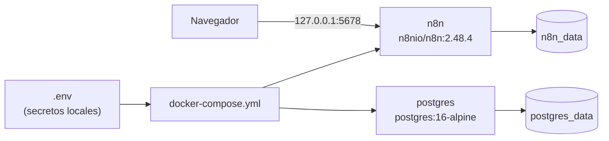

# Módulo 02 — Instalación y configuración

| Duración estimada | Nivel | Requisitos |
| --- | --- | --- |
| 60 minutos | Beginner | Docker Desktop o Docker Engine con Compose v2 |

## Objetivos

- Instalar n8n con Docker Compose y PostgreSQL.
- Entender qué guarda cada volumen y cada variable de entorno.
- Actualizar n8n y hacer copias de seguridad sin perder datos.
- Distinguir un entorno local de un despliegue público.

## Índice

1. [Explicación: piezas de la instalación](#1-explicación-piezas-de-la-instalación)
2. [Demostración: instalación paso a paso](#2-demostración-instalación-paso-a-paso)
3. [Ejercicio guiado: copia de seguridad y restauración](#3-ejercicio-guiado-copia-de-seguridad-y-restauración)
4. [Reto individual](#4-reto-individual)
5. [Solución explicada](#5-solución-explicada)
6. [Resultado esperado](#6-resultado-esperado)

---

## 1. Explicación: piezas de la instalación



| Pieza | Archivo | Qué decide |
| --- | --- | --- |
| Imagen y versión | [docker-compose.yml](../../docker-compose.yml) | Qué versión de n8n se ejecuta. Fijada para que todos usen la misma. |
| Base de datos | `docker-compose.yml` | PostgreSQL en lugar de SQLite: más robusta y fácil de respaldar con `pg_dump`. |
| Secretos | `.env` (a partir de [.env.example](../../.env.example)) | Clave de cifrado y contraseña de la base de datos. |
| Persistencia | Volúmenes con nombre | Los datos sobreviven a reinicios y actualizaciones. |
| Exposición | `127.0.0.1:5678:5678` | Solo tu equipo puede abrir n8n. |

Decisiones de seguridad de la configuración del taller:

- PostgreSQL no publica ningún puerto.
- n8n solo escucha en `127.0.0.1`.
- Las variables obligatorias (`N8N_ENCRYPTION_KEY`, `POSTGRES_PASSWORD`) hacen fallar el arranque si no se definen, en lugar de usar un valor inseguro por defecto.
- La telemetría está desactivada y las ejecuciones antiguas se borran a los 14 días.

## 2. Demostración: instalación paso a paso

Sigue la guía completa [docs/installation.md](../../docs/installation.md). Resumen:

```bash
git clone https://github.com/VITIDEV06/n8n-productivity-workshop.git
cd n8n-productivity-workshop
cp .env.example .env
# Edita .env: N8N_ENCRYPTION_KEY, POSTGRES_PASSWORD, GENERIC_TIMEZONE, TZ
docker compose up -d
docker compose logs -f n8n
```

Abre <http://localhost:5678>, crea la cuenta de propietario e importa [01-hello-world.json](../../workflows/01-getting-started/01-hello-world.json).

Comprobaciones:

```bash
docker compose ps                          # ambos servicios "running" / "healthy"
docker compose exec n8n n8n --version      # 2.48.4
docker volume ls | grep n8n                # volúmenes creados
```

## 3. Ejercicio guiado: copia de seguridad y restauración

**Objetivo:** comprobar que sabes recuperar tus workflows.

1. Importa y guarda el workflow `01 - Hola mundo`.
2. Exporta todos los workflows:

```bash
docker compose exec n8n n8n export:workflow --backup --output=/home/node/.n8n/backups/workflows/
docker compose cp n8n:/home/node/.n8n/backups ./backups
ls backups/workflows
```

3. Borra el workflow desde el editor (*Overview > ... > Delete*).
4. Restáuralo:

```bash
docker compose exec n8n n8n import:workflow --separate --input=/home/node/.n8n/backups/workflows/
```

5. Recarga el editor: el workflow ha vuelto.

## 4. Reto individual

1. Cambia la zona horaria a la de otra ciudad en `.env`, aplica el cambio y demuestra con el workflow [02-schedule-trigger.json](../../workflows/01-getting-started/02-schedule-trigger.json) que `zonaHoraria` cambió.
2. Haz un volcado completo de PostgreSQL a un archivo `.sql`.
3. Responde: ¿qué pasaría si borras el volumen `postgres_data` pero conservas el `.sql` y el `.env`? ¿Y si pierdes el `.env`?

## 5. Solución explicada

1. Edita `.env` (`GENERIC_TIMEZONE=Europe/Madrid` y `TZ=Europe/Madrid`) y ejecuta `docker compose up -d`. Compose detecta el cambio de entorno y recrea el contenedor. Al ejecutar el workflow 02, `zonaHoraria` muestra `Europe/Madrid`.
2. Volcado:

```bash
docker compose exec -T postgres sh -c 'pg_dump -U "$POSTGRES_USER" -d "$POSTGRES_DB"' > n8n-backup.sql
```

3. Respuestas:
   - Sin el volumen pero con `.sql` y `.env`: arrancas una base vacía, restauras el `.sql` con `psql` y recuperas todo, incluidas las credenciales, porque la clave de cifrado del `.env` es la misma.
   - Sin el `.env`: los workflows se recuperan, pero **las credenciales no se pueden descifrar** sin la `N8N_ENCRYPTION_KEY` original. Habría que crearlas de nuevo. Por eso la clave se guarda en un gestor de contraseñas.

## 6. Resultado esperado

- n8n accesible en `http://localhost:5678` con la versión 2.48.4.
- Un directorio `backups/` (ignorado por Git) con tus workflows exportados.
- Un archivo `n8n-backup.sql` fuera del repositorio.

---

Anterior: [Módulo 01](../01-introduction/README.md) | Siguiente: [Módulo 03 — Fundamentos de automatización](../03-automation-fundamentals/README.md)
