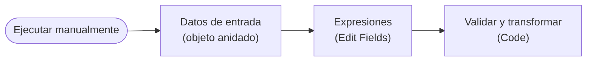

# Módulo 04 — Datos y expresiones

| Duración estimada | Nivel | Requisitos |
| --- | --- | --- |
| 90 minutos | Beginner / Intermediate | Módulo 03 completado |

## Objetivos

- Entender cómo viajan los datos entre nodos (items y JSON).
- Leer campos anidados, arrays y datos de nodos anteriores con expresiones.
- Trabajar con fechas y zonas horarias usando Luxon.
- Validar y transformar datos antes de enviarlos a un servicio externo.

Referencia completa: [docs/expressions.md](../../docs/expressions.md).

Workflow de demostración: [09-data-expressions.json](../../workflows/01-getting-started/09-data-expressions.json).

---

## 1. Explicación

### Items

Cada nodo recibe y devuelve una **lista de items**. Cada item tiene una clave `json` con los datos. La mayoría de nodos se ejecutan **una vez por item**.

```json
[
  { "json": { "titulo": "Enviar informe", "prioridad": "alta" } },
  { "json": { "titulo": "Reservar vuelo", "prioridad": "media" } }
]
```

### Expresiones

Una expresión es JavaScript entre `{{ }}` dentro de un parámetro. Se evalúa para cada item.

| Expresión | Devuelve |
| --- | --- |
| `{{ $json.titulo }}` | Campo del item actual |
| `{{ $json.usuario.nombre }}` | Campo anidado |
| `{{ $json["fecha limite"] }}` | Campo con espacios |
| `{{ $json.tareas.length }}` | Longitud de un array |
| `{{ $json.tareas.filter(t => !t.hecha).map(t => t.titulo) }}` | Array transformado |
| `{{ $('Configuración').first().json.spreadsheetId }}` | Dato de otro nodo |
| `{{ $('Datos de entrada').item.json.usuario.email }}` | Item emparejado de otro nodo |
| `{{ $now.toFormat('yyyy-MM-dd') }}` | Fecha actual en la zona horaria de la instancia |
| `{{ $json.texto ?? 'sin texto' }}` | Valor por defecto |

### `.first()` frente a `.item`

- `$('Nodo').first()` devuelve siempre el primer item de ese nodo. Úsalo para configuración (un único item).
- `$('Nodo').item` devuelve el item **emparejado** con el actual (n8n rastrea de qué item procede cada uno). Úsalo cuando cada item tiene sus propios datos.

### Fechas con Luxon

```javascript
$now                                         // DateTime actual (zona GENERIC_TIMEZONE)
$now.plus({ days: 7 }).toFormat('yyyy-MM-dd')
$now.setLocale('es').toFormat("cccc d 'de' LLLL")   // "martes 17 de noviembre"
DateTime.fromISO('2026-11-18').diff($now.startOf('day'), 'days').days
$now.setZone('America/Bogota').toFormat('HH:mm')
```

> [!TIP]
> Guarda las fechas como texto `AAAA-MM-DD` en Google Sheets con *Cell Format* RAW. Así se ordenan bien y no dependen de la configuración regional de la hoja.

## 2. Demostración

Importa [09-data-expressions.json](../../workflows/01-getting-started/09-data-expressions.json) y ejecútalo.



| Nodo | Qué observar |
| --- | --- |
| Datos de entrada | Un item con `usuario` (objeto), `tareas` (array de 3) y `etiquetas`. |
| Expresiones | Cada campo usa una técnica: `iniciales`, `pendientes`, `titulosPendientes`, `hoy`, `dentroDeUnaSemana`, `diaEnEspanol`, `hayAlta`. |
| Validar y transformar | Convierte **1 item con 3 tareas** en **3 items**, cada uno con `diasRestantes`, `vencida`, `valida` y `errores`. |

Salida de **Expresiones** (los campos de fecha dependen del día de ejecución):

```json
{
  "nombre": "Laura Gómez",
  "iniciales": "LG",
  "totalTareas": 3,
  "pendientes": 2,
  "titulosPendientes": ["Enviar informe", "Comprar regalo"],
  "etiquetasTexto": "personal, trabajo",
  "hayAlta": true
}
```

## 3. Ejercicio guiado

**Objetivo:** extraer y combinar datos de varios nodos.

1. Duplica el workflow 09.
2. Después de **Validar y transformar**, añade un **Edit Fields** llamado `Ficha` con *Include Other Input Fields* desactivado y estos campos:

| Campo | Tipo | Expresión |
| --- | --- | --- |
| `tarea` | String | `{{ $json.titulo.toUpperCase() }}` |
| `email` | String | `{{ $('Datos de entrada').first().json.usuario.email }}` |
| `estadoTexto` | String | `{{ $json.hecha ? 'hecha' : ($json.vencida ? 'vencida' : 'pendiente') }}` |
| `plazo` | String | `{{ $json.diasRestantes === null ? 'sin fecha' : $json.diasRestantes + ' días' }}` |

3. Ejecuta.

**Resultado esperado:** 3 items. `Reservar vuelo` aparece como `hecha`. `Comprar regalo` tiene `plazo: "sin fecha"`. Todos tienen `email: "laura@example.com"`.

## 4. Ejercicios

### Ejercicio 4.1 — Nombre completo

Con la entrada `{ "nombre": "  ana ", "apellido": "PÉREZ" }`, obtén `"Ana Pérez"` con una sola expresión.

### Ejercicio 4.2 — Días hasta fin de mes

Con una expresión, calcula cuántos días faltan hasta el último día del mes actual.

### Ejercicio 4.3 — Agrupar por prioridad

En un nodo Code, a partir de los items de [b3-filtrar-tareas.json](../../exercises/beginner/solutions/b3-filtrar-tareas.json) (nodo *Tareas de ejemplo*), devuelve **un único item** `{ alta: [...títulos], media: [...], baja: [...] }`.

### Ejercicio 4.4 — Validación con mensajes

En un nodo Code, rechaza (`valida: false`) las tareas cuyo `titulo` tenga menos de 3 caracteres o cuya `prioridad` no sea `alta`, `media` o `baja`. Añade un array `errores` con los motivos.

## 5. Soluciones explicadas

### 4.1

```javascript
{{ [$json.nombre, $json.apellido].map(p => p.trim().toLowerCase()).map(p => p.charAt(0).toUpperCase() + p.slice(1)).join(' ') }}
```

`trim()` quita espacios; se pasa todo a minúsculas y se pone en mayúscula la primera letra de cada parte.

### 4.2

```javascript
{{ Math.round($now.endOf('month').startOf('day').diff($now.startOf('day'), 'days').days) }}
```

Se comparan ambas fechas al inicio del día para no obtener decimales por la hora actual.

### 4.3

```javascript
const grupos = { alta: [], media: [], baja: [] };
for (const { json } of $input.all()) {
  (grupos[json.prioridad] ??= []).push(json.titulo);
}
return [{ json: grupos }];
```

Resultado: `{ "alta": ["Enviar informe", "Llamar al dentista"], "media": ["Reservar vuelo"], "baja": ["Ordenar fotos"] }`.

### 4.4

Es la lógica del nodo **Validar y transformar** del workflow 09:

```javascript
return $input.all().map(({ json }) => {
  const errores = [];
  if (!json.titulo || json.titulo.trim().length < 3) errores.push('título demasiado corto');
  if (!['alta', 'media', 'baja'].includes(json.prioridad)) errores.push('prioridad no válida');
  return { json: { ...json, valida: errores.length === 0, errores } };
});
```

## 6. Reto individual

Transforma el resultado del ejercicio guiado en **un único mensaje de texto** listo para Telegram:

```text
Tareas de Laura Gómez (2 pendientes)
- ENVIAR INFORME (1 días)
- COMPRAR REGALO (sin fecha)
```

Condiciones: excluir las tareas hechas y usar un salto de línea `\n` entre líneas.

### Solución

Añade un **Code** al final:

```javascript
const fichas = $input.all().map((i) => i.json).filter((f) => f.estadoTexto !== 'hecha');
const nombre = $('Datos de entrada').first().json.usuario.nombre;
const lineas = fichas.map((f) => `- ${f.tarea} (${f.plazo})`);
return [{ json: { mensaje: [`Tareas de ${nombre} (${fichas.length} pendientes)`, ...lineas].join('\n') } }];
```

## 7. Resultado esperado

- Puedes leer cualquier campo de cualquier nodo anterior.
- Sabes cuándo usar una expresión (transformación de un valor) y cuándo un nodo Code (varios items, bucles, validaciones).
- Tienes un workflow que convierte datos anidados en un mensaje legible: la misma técnica que usan los proyectos A a E.

---

Anterior: [Módulo 03](../03-automation-fundamentals/README.md) | Siguiente: [Módulo 05 — Integraciones](../05-integrations/README.md)
