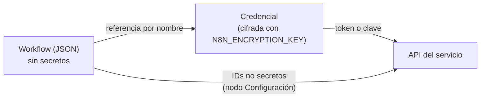

# Módulo 05 — Integraciones

| Duración estimada | Nivel | Requisitos |
| --- | --- | --- |
| 2 horas | Intermediate | Módulos 01 a 04, cuenta de Google y cuenta de Telegram |

## Objetivos

- Crear y asignar credenciales de forma segura.
- Conectar n8n con Telegram, Google Sheets, Google Calendar y Gmail.
- Consumir una API REST genérica y una API de IA compatible con OpenAI.
- Elegir entre OAuth2 y Service Account según el servicio.

## Guías de cada integración

| Servicio | Guía | Credencial en n8n | Usada en |
| --- | --- | --- | --- |
| Telegram | [telegram-setup.md](../../guides/telegram-setup.md) | Telegram API | Proyectos A, B, D y final |
| Google Sheets | [google-sheets-setup.md](../../guides/google-sheets-setup.md) | Google Sheets OAuth2 API o Service Account | Proyectos A a E y final |
| Google Calendar | [google-calendar-setup.md](../../guides/google-calendar-setup.md) | Google Calendar OAuth2 API | Proyecto B y final |
| Gmail | [gmail-setup.md](../../guides/gmail-setup.md) | Gmail OAuth2 API | Proyecto C |
| IA (OpenAI compatible) | [ai-provider-setup.md](../../guides/ai-provider-setup.md) | Header Auth | Proyecto E y final (opcional) |
| API REST pública | Este módulo | Ninguna | Workflows 04 y soluciones I2 y A2 |

Conceptos generales de credenciales: [docs/credentials.md](../../docs/credentials.md).

---

## 1. Explicación

### Cómo se conecta n8n a un servicio



- El workflow guarda solo una **referencia** a la credencial. Al exportarlo no se exportan secretos.
- Los IDs que no son secretos (ID de hoja, `chat_id`, ID de calendario) van en el nodo **Configuración** de cada workflow.

### OAuth2 frente a Service Account

| Criterio | OAuth2 (recomendado en el taller) | Service Account |
| --- | --- | --- |
| Actúa como | Tu usuario de Google | Una cuenta técnica independiente |
| Configuración | Pantalla de consentimiento y cliente OAuth | Clave JSON de la cuenta de servicio |
| Google Sheets | Soportado | Soportado (compartiendo la hoja con el email de la cuenta) |
| Google Calendar | Soportado | **No soportado** por el nodo de n8n |
| Gmail | Soportado | Solo con delegación de dominio de Google Workspace; no recomendado |
| Caducidad | En modo *Testing* el token caduca a los 7 días | No caduca, pero la clave JSON es un secreto muy sensible |

URL de redirección OAuth para la instalación local: `http://localhost:5678/rest/oauth2-credential/callback`.

### APIs REST genéricas

El nodo **HTTP Request** conecta con cualquier API:

| Autenticación | Cuándo |
| --- | --- |
| None | APIs públicas como `jsonplaceholder.typicode.com` |
| Generic > Header Auth | Claves en un header (`Authorization: Bearer ...`, `X-API-Key`) |
| Generic > Query Auth | Claves en la URL (evítalo si la API ofrece header) |
| Predefined Credential Type | Reutilizar una credencial de un servicio que n8n ya conoce |

## 2. Demostración

1. Crea la credencial de Google Sheets siguiendo la [guía](../../guides/google-sheets-setup.md) y prepara la hoja `Productivity Workshop` con las [plantillas](../../templates/google-sheets/README.md).
2. Importa [07-google-sheets-connection-test.json](../../workflows/01-getting-started/07-google-sheets-connection-test.json).
3. Rellena `spreadsheetId` en **Configuración**, asigna la credencial en **Leer pestaña Tareas** y ejecuta.
4. **Contar filas** debe devolver el número de filas de ejemplo de la pestaña `Tareas`.

## 3. Ejercicio guiado: primer mensaje de Telegram

1. Crea el bot y la credencial ([guía](../../guides/telegram-setup.md#crear-el-bot-y-el-token)).
2. Obtén tu `chat_id` ([guía](../../guides/telegram-setup.md#obtener-tu-chat_id)).
3. Crea un workflow: **Manual Trigger**, luego **Edit Fields** (`chatId` = tu chat, `texto` = `Hola desde n8n a las {{ $now.toFormat('HH:mm') }}`), luego **Telegram** (*Send Message*).
4. En Telegram: *Chat ID* `{{ $json.chatId }}`, *Text* `{{ $json.texto }}`. En *Additional Fields*, desactiva **Append n8n Attribution**.
5. Ejecuta.

**Resultado esperado:** recibes el mensaje en Telegram. Para **enviar** mensajes no hace falta túnel HTTPS; solo para **recibirlos** con el Telegram Trigger.

## 4. Reto individual

Combina dos integraciones sin trigger externo:

1. Lee los eventos de mañana de tu calendario (Google Calendar, *Event > Get Many*, *After* = inicio de mañana, *Before* = fin de mañana).
2. Construye un texto con el número de eventos y el título del primero.
3. Envíalo por Telegram.

## 5. Solución explicada

| Nodo | Configuración |
| --- | --- |
| Google Calendar | *Calendar*: `primary` (o tu ID), *Return All*: activado, *After*: `{{ $now.plus({ days: 1 }).startOf('day').toISO() }}`, *Before*: `{{ $now.plus({ days: 1 }).endOf('day').toISO() }}`, *Options > Order By*: Start Time, *Recurring Event Handling*: Expand. Activa *Settings > Always Output Data* para que el flujo siga si no hay eventos. |
| Code | Ver abajo. |
| Telegram | *Chat ID* y *Text* desde el Code. |

```javascript
const eventos = $input.all().map((i) => i.json).filter((e) => e.id);
const texto = eventos.length
  ? `Mañana tienes ${eventos.length} evento(s). El primero: ${eventos[0].summary ?? '(sin título)'}`
  : 'Mañana no tienes eventos.';
return [{ json: { chatId: 'REEMPLAZAR_CON_TU_CHAT_ID', texto } }];
```

El filtro `e.id` descarta el item vacío que genera *Always Output Data* cuando no hay eventos. El [Proyecto B](../../workflows/03-daily-assistant/README.md) amplía esta idea con huecos libres y tareas.

## 6. Resultado esperado

- Credenciales de Telegram, Google Sheets, Google Calendar y Gmail creadas y probadas.
- El workflow 07 cuenta las filas de tu hoja.
- Recibes en Telegram un mensaje generado por n8n.
- Opcional: un proveedor de IA configurado o, en su lugar, el modo simulado del Proyecto E.

> [!IMPORTANT]
> Nunca pegues tokens en nodos Code, en campos de texto ni en notas. Si un token aparece en un workflow exportado, revócalo de inmediato y genera otro ([SECURITY.md](../../SECURITY.md)).

---

Anterior: [Módulo 04](../04-data-and-expressions/README.md) | Siguiente: [Módulo 06 — Proyectos prácticos](../06-practical-projects/README.md)
