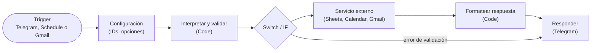

# Módulo 06 — Proyectos prácticos

| Duración estimada | Nivel | Requisitos |
| --- | --- | --- |
| 4 a 6 horas (los cuatro proyectos) | Intermediate | Módulo 05 completado y credenciales creadas |

## Objetivos

Construir cuatro automatizaciones de productividad completas, cada una con su workflow importable y documentación de 15 apartados.

| Proyecto | Qué resuelve | Integraciones | Documentación |
| --- | --- | --- | --- |
| A — Personal Task Manager | Tareas desde Telegram | Telegram, Google Sheets | [README](../../workflows/02-task-manager/README.md) |
| B — Daily Productivity Assistant | Resumen diario a las 07:00 | Google Calendar, Google Sheets, Telegram | [README](../../workflows/03-daily-assistant/README.md) |
| C — Smart Email Organizer | Clasificar correos | Gmail, Google Sheets | [README](../../workflows/04-email-organizer/README.md) |
| D — Habit Tracker | Hábitos y estadísticas | Telegram, Google Sheets | [README](../../workflows/05-habit-tracker/README.md) |

Orden recomendado: A, D, B, C. A y D comparten el patrón de bot de Telegram; B reutiliza la pestaña `Tareas` de A; C es independiente.

---

## 1. Explicación: patrones comunes

Los cuatro proyectos siguen la misma estructura. Aprenderla una vez simplifica todos.



| Patrón | Dónde | Por qué |
| --- | --- | --- |
| Nodo `Configuración` | Al inicio de todos | n8n 2.x bloquea `$env` en nodos; los IDs se editan en un solo lugar. |
| Validar antes de escribir | `Interpretar mensaje` (A, D) | Los datos incorrectos se responden al usuario y nunca llegan a la hoja. |
| Filtrar por `chat_id` | A, D | Cada usuario ve solo sus datos aunque compartan hoja. |
| *Always Output Data* en lecturas | Lecturas de Sheets y Calendar | El flujo continúa cuando la pestaña o el día están vacíos. |
| *Execute Once* en lecturas de catálogo | D | Leer la pestaña una sola vez aunque lleguen varios items. |
| Mensaje de error amable | Todos | El usuario recibe un texto claro, no un fallo silencioso. |

## 2. Demostración: Proyecto A en directo

1. Importa [task-manager.json](../../workflows/02-task-manager/task-manager.json).
2. Asigna las credenciales de Telegram y Google Sheets; rellena `spreadsheetId`.
3. Inicia el túnel HTTPS ([guía](../../guides/telegram-setup.md#exponer-n8n-con-https-para-el-telegram-trigger)) y pulsa **Execute workflow**.
4. Envía al bot:

```text
/ayuda
/nueva Preparar presentación | alta | 2026-12-01
Comprar pan
/tareas
/hecha T-XXXXXX
```

5. Observa en el editor la rama que toma cada mensaje en el Switch **Según la acción**.

## 3. Ejercicio guiado

Para cada proyecto, sigue su sección *11. Ejecución paso a paso*. Si no tienes credenciales todavía, empieza por la parte que funciona sin ellas:

| Proyecto | Práctica sin credenciales |
| --- | --- |
| A | Fija (*pin*) en **Telegram Trigger** un mensaje de [telegram-messages.json](../../templates/sample-data/telegram-messages.json) y ejecuta hasta **Según la acción**. |
| B | Fija en **Eventos de hoy** los eventos de [calendar-events.json](../../templates/sample-data/calendar-events.json) y en **Tareas pendientes** filas de [tareas.csv](../../templates/google-sheets/tareas.csv). |
| C | Ejecuta [email-classifier-test.json](../../workflows/04-email-organizer/email-classifier-test.json): no necesita ninguna credencial. |
| D | Fija en **Telegram Trigger** `/habito leer` y en las lecturas de Sheets las filas de las plantillas. |

## 4. Reto individual

Elige **uno**:

1. **A:** añade el comando `/hoy` que liste solo las tareas con `fecha_limite` igual a hoy.
2. **B:** incluye en el resumen la previsión del tiempo de tu ciudad con la API pública `https://api.open-meteo.com/v1/forecast` (no requiere clave).
3. **C:** añade la categoría `facturas` (asunto o remitente con `factura`, `invoice` o `recibo`) con su propia etiqueta de Gmail.
4. **D:** añade el comando `/racha habito` que devuelva los días consecutivos registrados hasta hoy.

## 5. Solución explicada

### 1. `/hoy` en el Proyecto A

En **Interpretar mensaje**, dentro de `interpretarTarea`, añade una ruta junto a la de `/tareas`:

```javascript
if (comando === '/hoy') return { ...base, accion: 'listar', soloHoy: true, incluirCompletadas: false };
```

En **Formatear lista**, después de calcular `visibles`:

```javascript
const hoyTexto = $now.toFormat('yyyy-MM-dd');
const lista = peticion.soloHoy ? visibles.filter((t) => t.fecha_limite === hoyTexto) : visibles;
```

y usa `lista` en lugar de `visibles` en el resto del nodo. No hace falta tocar el Switch: la acción sigue siendo `listar`. Añade `/hoy` al texto de `AYUDA`.

### 2. Tiempo en el Proyecto B

Añade un **HTTP Request** llamado `Tiempo` entre **Tareas pendientes** y **Construir resumen**:

- URL: `https://api.open-meteo.com/v1/forecast`
- Query: `latitude`, `longitude`, `daily` = `temperature_2m_max,temperature_2m_min,precipitation_probability_max`, `timezone` = `auto`, `forecast_days` = `1`.
- *Settings*: *Execute Once* activado y *On Error* = Continue, para que un fallo del tiempo no impida el resumen.

**Construir resumen** ya lee los nodos anteriores por nombre con `leerNodo()`, así que el nuevo nodo no rompe nada. Añade:

```javascript
const d = $('Tiempo').first().json.daily;
const lineaTiempo = d ? `Tiempo: ${d.temperature_2m_min[0]} a ${d.temperature_2m_max[0]} C, lluvia ${d.precipitation_probability_max[0]}%` : '';
```

### 3. Categoría `facturas` en el Proyecto C

En **Clasificar correo**:

```javascript
// 1. Nueva lista en REGLAS (y quita 'recibo' de notificacionAsunto)
facturas: ['factura', 'invoice', 'recibo'],

// 2. Nueva rama en clasificar(), justo después de la de newsletter
} else if ((palabra = contiene(texto, REGLAS.facturas))) {
  categoria = 'facturas'; motivo = `Contiene "${palabra}"`;
```

El orden de las ramas decide qué regla gana: un correo `noreply` con «Tu factura» debe acabar en `facturas`, no en `notificacion`. Después añade la salida `facturas` al Switch **Según categoría**, un nodo `Etiquetar Facturas` y el ID de la etiqueta en **Configuración**. Prueba primero en [email-classifier-test.json](../../workflows/04-email-organizer/email-classifier-test.json) con un correo de ejemplo propio.

### 4. `/racha` en el Proyecto D

1. En **Interpretar mensaje**, añade junto a `/hoy`: `if (comando === '/racha') return { ...base, accion: 'racha', habito: resto[0] || '' };`
2. En **Procesar hábito**, añade un `case` (los registros ya vienen filtrados por chat y normalizados):

```javascript
case 'racha': {
  const buscado = normalizar(peticion.habito);
  const dias = new Set(registros.filter((r) => r.habito === buscado).map((r) => r.fecha));
  let racha = 0;
  let dia = $now.startOf('day');
  while (dias.has(dia.toFormat('yyyy-MM-dd'))) { racha++; dia = dia.minus({ days: 1 }); }
  salida.respuesta = `Racha de ${buscado}: ${racha} día(s) seguidos.`;
  break;
}
```

## 6. Resultado esperado

- Cuatro workflows funcionando con tus credenciales: A y D publicados con el túnel activo, B publicado con su horario, C publicado con el sondeo de Gmail.
- Una hoja `Productivity Workshop` con datos reales en `Tareas`, `RegistroHabitos` y `RegistroCorreos`.
- Al menos un reto implementado.

> [!IMPORTANT]
> Telegram admite **un solo webhook por bot**. Si publicas A y D a la vez, usa un bot distinto para cada uno o pasa directamente al [proyecto final](../08-final-project/README.md), que los une en un solo bot.

---

Anterior: [Módulo 05](../05-integrations/README.md) | Siguiente: [Módulo 07 — Automatización con IA](../07-ai-automation/README.md)
