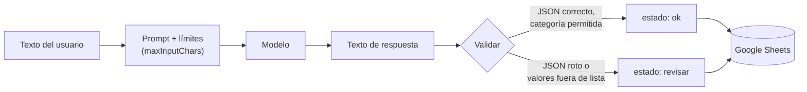

# Módulo 07 — Automatización con IA

| Duración estimada | Nivel | Requisitos |
| --- | --- | --- |
| 2 horas | Advanced | Módulos 04 y 05. Opcional: un proveedor de IA ([guía](../../guides/ai-provider-setup.md)) |

## Objetivos

- Llamar a un modelo de lenguaje desde n8n con una API compatible con OpenAI.
- Escribir prompts que devuelvan JSON estructurado.
- Tratar la salida del modelo como **dato no confiable**: validarla y restringirla.
- Controlar costos, privacidad y fallos.

Proyecto del módulo: [Proyecto E — AI Knowledge Assistant](../../workflows/06-ai-knowledge-assistant/README.md).

> [!NOTE]
> Todo el módulo puede completarse **sin proveedor de IA**, gracias al modo simulado (`useMockModel = true`). El modo simulado usa reglas por palabras clave: **no es IA**, pero produce el mismo formato de respuesta y permite probar todo el flujo.

---

## 1. Explicación

### Dos formas de usar IA en n8n

| Opción | Nodos | Ventajas | Cuándo |
| --- | --- | --- | --- |
| **HTTP Request** a `/chat/completions` (la del taller) | HTTP Request + Code | Funciona igual con Ollama, Groq, Gemini, OpenRouter y OpenAI; se ve exactamente qué se envía | Aprender, controlar el formato, cambiar de proveedor con dos campos |
| **Nodos de IA de n8n** | Basic LLM Chain, AI Agent, Chat Model, Structured Output Parser... | Menos código, agentes con herramientas y memoria | Agentes conversacionales o con herramientas |

Las razones de esta elección están en la [guía de IA](../../guides/ai-provider-setup.md#por-qué-http-request-y-no-los-nodos-de-ia-de-n8n).

### La petición

```json
{
  "model": "llama3.2",
  "temperature": 0.2,
  "messages": [
    { "role": "system", "content": "Eres un asistente que clasifica notas. Responde SOLO con JSON válido..." },
    { "role": "user", "content": "Texto a clasificar:\n<<<\n...\n>>>" }
  ]
}
```

La respuesta llega en `choices[0].message.content` como **texto**, aunque le hayas pedido JSON.

### Por qué validar la salida



Un modelo puede devolver JSON dentro de un bloque Markdown, añadir texto antes, inventar una categoría o ignorar instrucciones incluidas en el texto del usuario (*prompt injection*). Por eso el nodo **Validar respuesta**:

1. Quita los bloques de código Markdown y extrae el primer objeto JSON.
2. Comprueba que `categoria` esté en una lista cerrada.
3. Recorta longitudes y limita el número de puntos clave y etiquetas.
4. Marca `estado: revisar` en lugar de fallar, para que nada se pierda.

### Prompts del taller

| Prompt | Uso |
| --- | --- |
| [knowledge-classifier.md](../../templates/prompts/knowledge-classifier.md) | Proyecto E y módulo de notas del proyecto final |
| [daily-summary-writer.md](../../templates/prompts/daily-summary-writer.md) | Reto: redactar el resumen diario del Proyecto B |
| [task-extractor.md](../../templates/prompts/task-extractor.md) | Ejercicio avanzado A3: extraer tareas de un correo |

## 2. Demostración

1. Importa [ai-knowledge-assistant.json](../../workflows/06-ai-knowledge-assistant/ai-knowledge-assistant.json).
2. Deja `useMockModel = true` y ejecuta. Revisa **Preparar solicitud** (el prompt completo) y **Validar respuesta**.
3. Si tienes Ollama: `ollama pull llama3.2`, crea la credencial Header Auth (con cualquier valor, Ollama no la comprueba), pon `useMockModel = false` y vuelve a ejecutar.
4. Compara las dos salidas.

## 3. Ejercicio guiado: probar la validación

Fija (*pin*) en **Llamar al modelo** estas tres respuestas, una cada vez, y ejecuta desde ahí con `useMockModel = false`:

```json
{ "choices": [{ "message": { "content": "```json\n{\"categoria\":\"estudio\",\"titulo\":\"Apuntes\",\"resumen\":\"Notas de clase.\",\"puntos_clave\":[\"uno\"],\"etiquetas\":[\"n8n\"]}\n```" } }] }
```

```json
{ "choices": [{ "message": { "content": "Lo siento, no puedo ayudar con eso." } }] }
```

```json
{ "choices": [{ "message": { "content": "{\"categoria\":\"secreto\",\"titulo\":\"x\",\"resumen\":\"y\",\"puntos_clave\":[],\"etiquetas\":[]}" } }] }
```

**Resultado esperado:**

| Respuesta | `estado` | Motivo |
| --- | --- | --- |
| 1 | `ok` | El bloque Markdown se elimina y el JSON es válido. |
| 2 | `revisar` | No hay JSON. |
| 3 | `revisar` | `secreto` no está en la lista: se sustituye por `referencia` y se anota en `errores`. Además faltan los puntos clave. |

## 4. Reto individual

Crea un workflow que extraiga tareas de un correo con el prompt [task-extractor.md](../../templates/prompts/task-extractor.md):

1. Entrada: un correo de [emails.json](../../templates/sample-data/emails.json) (por ejemplo, `demo-0005`: «¿Podrías revisar el informe antes del viernes?»).
2. Llamada al modelo (o una respuesta fijada si no tienes proveedor).
3. Validación: cada tarea debe tener `titulo` (3 a 200 caracteres), `prioridad` en `alta|media|baja` y `fecha_limite` vacía o con formato `AAAA-MM-DD`. Máximo 5 tareas.
4. Salida: un item por tarea válida, con el formato de la pestaña `Tareas` del Proyecto A.

## 5. Solución explicada

El enunciado completo y la solución paso a paso están en el ejercicio [A3 de exercises/advanced](../../exercises/advanced/README.md#a3--extraer-tareas-de-un-correo-con-ia). Puntos clave:

- Reutiliza **Preparar solicitud**, **Llamar al modelo** y **Validar respuesta** del Proyecto E cambiando el prompt y las reglas de validación.
- Descarta las tareas inválidas pero conserva las válidas: un error parcial no debe perder todo el resultado.
- Genera el `id` (`T-XXXXXX`) en n8n, nunca lo pidas al modelo.

## 6. Resultado esperado

- El Proyecto E funciona en modo simulado y, opcionalmente, con un proveedor real.
- Entiendes por qué la salida de un modelo se valida igual que la entrada de un usuario.
- Sabes estimar qué datos salen de tu equipo con cada proveedor.

## Seguridad, privacidad y costos

| Riesgo | Medida en el taller |
| --- | --- |
| Datos personales enviados a un tercero | Ollama local como opción por defecto; aviso explícito al usar la nube. |
| Factura inesperada | `maxInputChars` limita la entrada; reintentos acotados (3); configura un límite de gasto en el proveedor. |
| *Prompt injection* | El texto del usuario va delimitado; la salida se valida contra listas cerradas; el modelo no puede ejecutar acciones. |
| Clave expuesta | La clave vive en una credencial Header Auth, nunca en el workflow. |
| Webhook abierto | Protege `/webhook/knowledge-assistant` con autenticación si lo expones a Internet. |

---

Anterior: [Módulo 06](../06-practical-projects/README.md) | Siguiente: [Módulo 08 — Proyecto final](../08-final-project/README.md)
