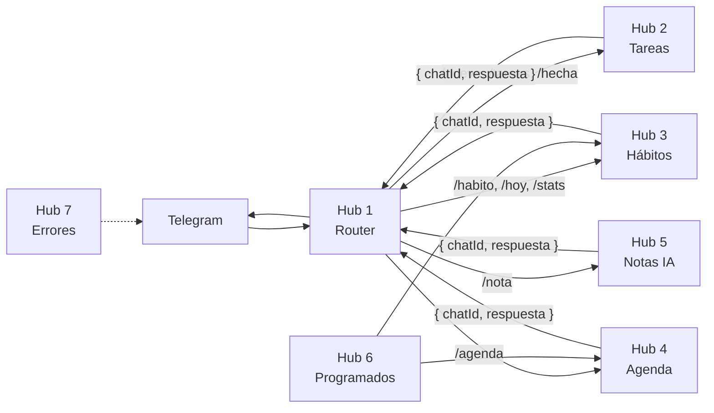

# Módulo 08 — Proyecto final: Personal Productivity Hub

| Duración estimada | Nivel | Requisitos |
| --- | --- | --- |
| 4 a 6 horas | Advanced | Módulos 01 a 07. Proyectos A, B y D funcionando con tus credenciales |

## Objetivos

- Unir las automatizaciones del taller en un único asistente de Telegram.
- Dividir un sistema grande en sub-workflows con un contrato de entrada y salida.
- Centralizar la configuración, controlar el acceso y notificar errores.
- Publicar y mantener varios workflows que dependen entre sí.

Documentación técnica completa (15 apartados): [workflows/07-final-productivity-system/README.md](../../workflows/07-final-productivity-system/README.md).

---

## 1. Explicación: de proyectos sueltos a un sistema

Los proyectos A y D son bots independientes: cada uno necesita su propio bot de Telegram, porque Telegram solo admite un webhook por bot. El proyecto final resuelve esto con un **router**:



| Concepto | Dónde se aprendió | Cómo se usa aquí |
| --- | --- | --- |
| Switch con *fallback* | Módulo 03 | El router decide el módulo; lo desconocido va a `Respuesta directa`. |
| Expresiones entre nodos | Módulo 04 | Los módulos leen `$('Entrada del router').first().json.config`. |
| Credenciales y túnel | Módulo 05 | Un solo bot y un solo túnel para todo el sistema. |
| Lógica de A, B y D | Módulo 06 | Reutilizada casi sin cambios en Hub 2, 3 y 4. |
| Validación de IA | Módulo 07 | Hub 5, desactivado por defecto. |

### Sub-workflows

- **Execute Workflow Trigger** (*Input data mode*: Accept all data) es la entrada de un sub-workflow.
- **Execute Workflow** en el router lo llama y, con *Wait for Sub-Workflow Completion*, recibe la salida del **último nodo** ejecutado en el sub-workflow.
- Los sub-workflows no se publican: se ejecutan cuando el router los llama.

### Contrato

Todos los módulos reciben `{ chatId, texto, modulo, comando, argumentos, config }` y devuelven `{ chatId, respuesta }`. Gracias a este contrato, el router no necesita saber qué hace cada módulo.

## 2. Demostración

Sigue el orden de importación de la [documentación del proyecto](../../workflows/07-final-productivity-system/README.md#8-instrucciones-de-importación):

1. Importa Hub 2 a Hub 5 y asigna credenciales.
2. Importa Hub 7 (errores).
3. Importa Hub 1 y Hub 6, selecciona los sub-workflows en los nodos `Módulo de ...` y rellena **Configuración**.
4. Asigna Hub 7 como *Error workflow* de Hub 1 y Hub 6.
5. Publica Hub 1 y Hub 6.

Prueba con tu bot:

```text
/ayuda
/nueva Preparar demo del taller | alta
/tareas
/habito leer
/stats 7
/agenda
/nota La reunión de hoy fijó la entrega para el día 30.
```

## 3. Ejercicio guiado: probar un módulo aislado

Antes de conectar el router, comprueba cada sub-workflow por separado:

1. Abre **Hub 2 - Módulo de tareas**.
2. En **Entrada del router**, fija (*pin*) este JSON (sustituye los valores):

```json
{
  "chatId": "TU_CHAT_ID",
  "texto": "/nueva Probar el hub | alta",
  "modulo": "tareas",
  "comando": "/nueva",
  "argumentos": "Probar el hub | alta",
  "config": { "spreadsheetId": "TU_ID_DE_HOJA" }
}
```

3. Ejecuta. El último nodo debe devolver `{ chatId, respuesta }` con `Tarea creada`.
4. Repite con Hub 3 (`/habito leer`) y Hub 4 (`/agenda`, añade `calendarId` en `config`).

**Resultado esperado:** cada módulo responde con el contrato correcto sin depender de Telegram.

## 4. Reto individual

Añade un **módulo de correo** (`/correos`) al hub:

1. Crea **Hub 8 - Módulo de correo** con *Entrada del router*.
2. Lee la pestaña `RegistroCorreos` del Proyecto C.
3. Devuelve `{ chatId, respuesta }` con el número de correos de hoy por categoría.
4. Conéctalo al router: nueva ruta en **Interpretar comando**, nueva salida en **Según el módulo** y un nodo **Módulo de correo**.
5. Añade `/correos` a la ayuda.

## 5. Solución explicada

**Hub 8** (4 nodos): `Entrada del router`, `Leer RegistroCorreos` (Google Sheets, Get Rows, *Always Output Data*), `Resumir` (Code) y nada más: el último nodo es la salida.

```javascript
const entrada = $('Entrada del router').first().json;
const hoy = $now.toFormat('yyyy-MM-dd');
const filas = $input.all().map((i) => i.json).filter((f) => String(f.fecha_procesado || '').startsWith(hoy));
const conteo = {};
for (const f of filas) conteo[f.categoria] = (conteo[f.categoria] || 0) + 1;
const lineas = Object.entries(conteo).sort((a, b) => b[1] - a[1]).map(([c, n]) => `- ${c}: ${n}`);
return [{ json: {
  chatId: entrada.chatId,
  respuesta: filas.length ? `Correos procesados hoy (${filas.length}):\n${lineas.join('\n')}` : 'Hoy no se ha procesado ningún correo.',
} }];
```

En **Google Sheets**, *Document* = `{{ $('Entrada del router').first().json.config.spreadsheetId }}`, *Sheet* = `RegistroCorreos`.

**Router:**

| Nodo | Cambio |
| --- | --- |
| Interpretar comando | Añadir `'/correos': 'correos'` a la tabla de rutas y la línea a la ayuda. |
| Según el módulo | Nueva regla `{{ $json.modulo }}` *is equal to* `correos`. |
| Módulo de correo | Execute Workflow con el mismo modo que los demás, conectado a la nueva salida y a **Enviar respuesta**. |

## 6. Resultado esperado

- Un único bot de Telegram responde a todos los comandos del taller.
- A las 07:00 recibes la agenda del día y cada domingo a las 20:00 el resumen de hábitos.
- Si un workflow publicado falla, recibes un aviso con el enlace a la ejecución.
- Cualquier otro chat recibe `Este bot es privado.`

## Lista de comprobación final

- [ ] Sub-workflows probados por separado con datos fijados.
- [ ] Hub 1 y Hub 6 publicados; el resto sin publicar.
- [ ] Hub 7 asignado como *Error workflow*.
- [ ] `chatIdAutorizado` configurado.
- [ ] Proyectos A y D despublicados o con otro bot.
- [ ] Copia de seguridad de workflows y de `.env` hecha ([módulo 02](../02-installation-and-setup/README.md#3-ejercicio-guiado-copia-de-seguridad-y-restauración)).
- [ ] Ningún secreto en workflows exportados (`python scripts/validate-workflows.py`).

---

Anterior: [Módulo 07](../07-ai-automation/README.md) | Volver al [índice del taller](../../README.md#mapa-de-módulos)
