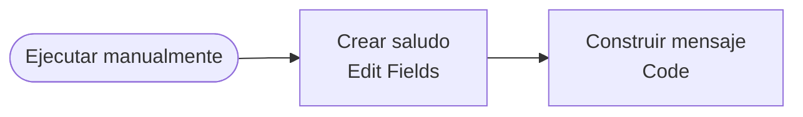
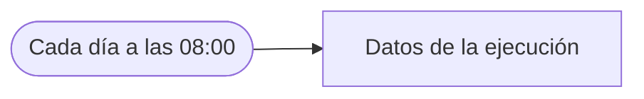
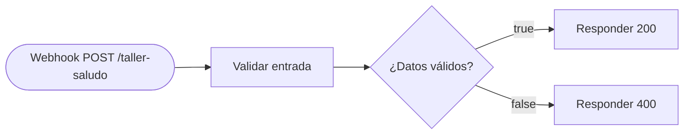
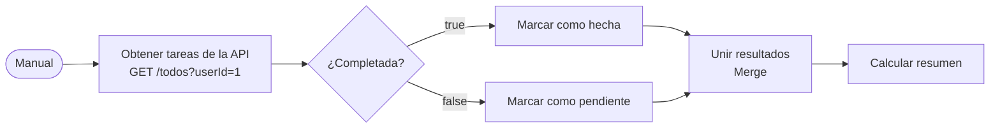
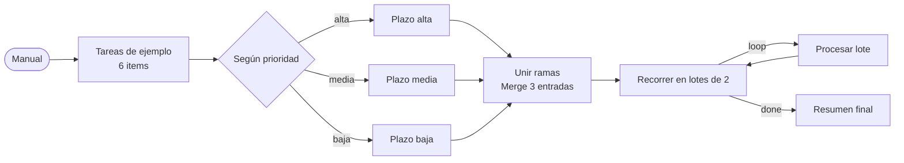
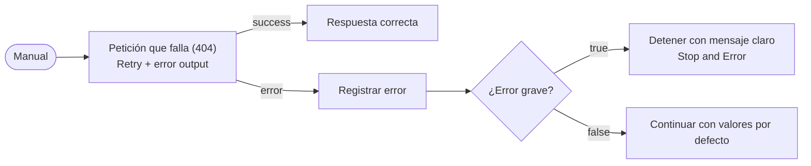
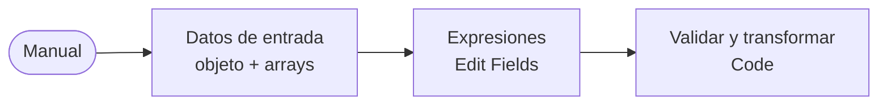

# Workflows de primeros pasos

Nueve workflows pequeños, cada uno centrado en un concepto. Siete funcionan **sin ninguna credencial**.

| Dificultad | Tecnologías | Requisitos |
| --- | --- | --- |
| Beginner | n8n (nodos core), JSONPlaceholder (API pública de pruebas) | n8n en marcha; conexión a Internet para 04 y 06 |

## Importación

Importa cada archivo con menú `...` > **Import from File...** en un workflow vacío, o todos a la vez con la CLI ([docs/first-steps.md](../../docs/first-steps.md#importar-un-workflow-del-taller)).

---

## 01 — Hola mundo



| Nodo | Configuración |
| --- | --- |
| Ejecutar manualmente | Manual Trigger, sin parámetros. |
| Crear saludo | Campos `nombre`, `curso` y `fecha = {{ $now.toFormat('yyyy-MM-dd') }}`. |
| Construir mensaje | Code: lee `$input.first().json` y devuelve `{ mensaje, longitud }`. |

**Resultado esperado** (último nodo):

```json
{ "mensaje": "Hola, Estudiante. Hoy es 2026-11-17 y acabas de ejecutar tu primer workflow.", "longitud": 76 }
```

---

## 02 — Schedule Trigger



- **Regla**: intervalo diario a las 08:00 (`triggerAtHour: 8`).
- Al pulsar *Execute workflow* se ejecuta una vez sin esperar.
- Solo se ejecuta automáticamente si el workflow está **publicado**.

**Resultado esperado**:

```json
{ "ejecutadoEn": "2026-11-17 08:00:00", "diaSemana": "martes", "esFinDeSemana": false, "zonaHoraria": "America/Mexico_City" }
```

---

## 03 — Webhook con validación



1. Pulsa **Execute workflow** (el webhook de prueba queda escuchando).
2. Envía una petición:

```bash
curl -X POST http://localhost:5678/webhook-test/taller-saludo \
  -H "Content-Type: application/json" \
  -d '{"nombre":"Ana","email":"ana@example.com"}'
```

Respuesta esperada:

```json
{ "ok": true, "mensaje": "Hola, Ana. Datos recibidos correctamente." }
```

Con datos incorrectos (`{"nombre":"A","email":"no-es-un-email"}`) responde con código **400**:

```json
{ "ok": false, "errores": ["\"nombre\" debe tener entre 2 y 60 caracteres", "\"email\" no tiene un formato válido"] }
```

Para la URL de producción (`/webhook/taller-saludo`) publica el workflow.

---

## 04 — HTTP Request a una API REST



- API: `https://jsonplaceholder.typicode.com/todos` (datos falsos para pruebas, sin registro).
- *Retry On Fail*: 3 intentos, 2 segundos entre intentos.
- La API devuelve un array de 20 elementos: n8n crea 20 items.

**Resultado esperado**: `{ "total": 20, "completadas": ..., "pendientes": ..., "porcentajeCompletado": ..., "primerasPendientes": [...] }`. Los valores concretos dependen de la API.

---

## 05 — Switch, Merge y Loop Over Items



**Resultado esperado**: `{ "totalTareas": 6, "lotes": 3, "porPrioridad": { "alta": 2, "media": 2, "baja": 2 }, "tareas": [...] }`.

---

## 06 — Manejo de errores



- *Retry On Fail*: 2 intentos.
- *On Error*: **Continue (using error output)**, por eso el nodo tiene dos salidas.
- **Comportamiento esperado**: la petición falla con 404, el error se registra y, como el mensaje contiene `404`, el workflow termina en **Stop and Error** con un mensaje claro. La ejecución aparece como fallida **a propósito**: así se ve cómo queda registrado un error controlado.

---

## 07 — Prueba de conexión con Google Sheets

Requiere la [guía de Google Sheets](../../guides/google-sheets-setup.md). Lee la pestaña `Tareas` y devuelve `{ conexion: "correcta", filasLeidas, columnas }`.

---

## 08 — Workflow de errores (Error Trigger)

Se ejecuta cuando falla **otro workflow publicado** que lo tenga asignado en *Settings > Error workflow*. Formatea nombre del workflow, nodo, mensaje y URL de la ejecución. Para probarlo: asígnalo al workflow 06, publica el 06 con un Schedule Trigger o webhook, y provoca el error.

---

## 09 — Datos y expresiones



Resultado esperado del nodo **Expresiones** (extracto):

```json
{ "nombre": "Laura Gómez", "iniciales": "LG", "totalTareas": 3, "pendientes": 2, "hayAlta": true, "estadoGeneral": "hay pendientes" }
```

El nodo **Validar y transformar** devuelve 3 items, uno por tarea, con `diasRestantes`, `vencida`, `valida` y `errores`.

---

## Errores frecuentes

| Problema | Solución |
| --- | --- |
| 04 o 06 fallan con `ENOTFOUND` | Sin conexión a Internet o DNS bloqueado. |
| 03 devuelve `404 The requested webhook is not registered` | Pulsa *Execute workflow* antes de enviar la petición de prueba. |
| 02 no se ejecuta solo | El workflow no está publicado. |

## Posibles mejoras

- 03: añade autenticación *Header Auth* al webhook.
- 04: guarda el resumen en Google Sheets.
- 06: asigna el workflow 08 como *Error workflow* y conecta un nodo Telegram.

## Seguridad

Estos workflows no manejan datos personales. El webhook 03 acepta datos de cualquiera que conozca su URL: no lo publiques en una instancia expuesta a Internet sin autenticación.
