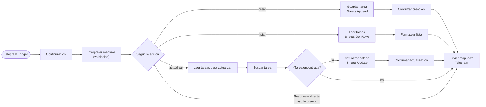

# Proyecto A — Personal Task Manager

## 1. Nombre

`task-manager.json` — *Proyecto A - Personal Task Manager*

## 2. Objetivo

Administrar tareas personales desde un chat de Telegram. Cada tarea se guarda en Google Sheets con prioridad, fecha límite y estado, y se puede consultar y actualizar con comandos.

## 3. Dificultad

Intermediate. Combina un trigger externo, validación con código, un Switch con varias ramas, lectura, escritura y actualización en Google Sheets.

## 4. Tecnologías utilizadas

| Tecnología | Nodo de n8n | Uso |
| --- | --- | --- |
| Telegram Bot API | Telegram Trigger, Telegram | Recibir comandos y responder |
| Google Sheets API | Google Sheets (Append, Get Rows, Update) | Almacenar tareas |
| JavaScript | Code | Interpretar y validar comandos, formatear respuestas |

## 5. Diagrama del flujo



## 6. Requisitos

- n8n 2.x en marcha ([instalación](../../docs/installation.md)).
- Un bot de Telegram y su token ([guía](../../guides/telegram-setup.md)).
- Un túnel HTTPS activo para el Telegram Trigger.
- La hoja `Productivity Workshop` con la pestaña `Tareas` ([plantilla](../../templates/google-sheets/tareas.csv)).
- Credencial de Google Sheets ([guía](../../guides/google-sheets-setup.md)).

## 7. Preparación de credenciales

| Credencial | Nodos que la usan |
| --- | --- |
| Telegram API | `Telegram Trigger`, `Enviar respuesta` |
| Google Sheets OAuth2 API (o Service Account) | `Guardar tarea`, `Leer tareas`, `Leer tareas para actualizar`, `Actualizar estado` |

## 8. Instrucciones de importación

1. Crea un workflow vacío > menú `...` > **Import from File...** > `task-manager.json`.
2. Abre los 6 nodos con aviso y selecciona tus credenciales.
3. Abre **Configuración** y pega el ID de tu hoja en `spreadsheetId`.
4. Guarda (`Ctrl + S`).

## 9. Configuración nodo por nodo

| Nodo | Tipo | Configuración clave |
| --- | --- | --- |
| Telegram Trigger | Telegram Trigger | *Trigger On*: `message`. Recomendado: *Additional Fields > Restrict to Chat IDs* con tu `chat_id`. |
| Configuración | Edit Fields | `spreadsheetId` |
| Interpretar mensaje | Code | Lee `message.text` y `message.chat.id`. Devuelve `accion` = `crear`, `listar`, `actualizar`, `ayuda` o `error`. |
| Según la acción | Switch | 3 reglas sobre `{{ $json.accion }}` y salida *fallback* renombrada como `Respuesta directa`. |
| Guardar tarea | Google Sheets, Append Row | Pestaña `Tareas` por nombre. *Mapping*: **Map Automatically**. *Cell Format*: RAW. *Handling extra fields*: **Ignore**. Solo se escriben los campos cuyo nombre coincide con una columna. |
| Leer tareas | Google Sheets, Get Row(s) | Lee toda la pestaña. *Always Output Data* activado para que el flujo continúe con la hoja vacía. |
| Formatear lista | Code | Filtra por `chat_id`, oculta completadas (salvo `/tareas todas`), ordena por prioridad y fecha, marca vencidas. Máximo 25 líneas. |
| Leer tareas para actualizar | Google Sheets, Get Row(s) | Igual que *Leer tareas*. |
| Buscar tarea | Code | Busca la tarea por `id` **y** `chat_id`, para que nadie modifique tareas de otro chat. |
| ¿Tarea encontrada? | IF | `{{ $json.encontrada }}` es `true`. |
| Actualizar estado | Google Sheets, Update Row | *Column to match on*: `id`. Escribe `estado` y `actualizada_en`. |
| Enviar respuesta | Telegram, Send Message | *Chat ID*: `{{ $json.chatId }}`. *Text*: `{{ $json.respuesta }}`. *Append n8n Attribution*: desactivado. |

### Reglas de validación

| Dato | Regla | Mensaje de error |
| --- | --- | --- |
| Título | 3 a 200 caracteres | `El título debe tener al menos 3 caracteres.` |
| Prioridad | `alta`, `media`, `baja` (sin distinguir mayúsculas ni tildes) | `Prioridad no válida` |
| Fecha límite | `AAAA-MM-DD`, fecha real y no pasada | `Fecha no válida` / `no puede estar en el pasado` |
| ID | `T-` seguido de 4 a 8 letras o números | `Indica un ID válido` |
| Estado | `pendiente`, `en_progreso`/`en progreso`, `completada`/`hecha` | `Estado no válido` |
| Tipo de mensaje | Solo texto | `Solo puedo procesar mensajes de texto.` |

## 10. Datos de prueba

- Pestaña `Tareas` con las filas de [tareas.csv](../../templates/google-sheets/tareas.csv).
- Mensajes de Telegram en [telegram-messages.json](../../templates/sample-data/telegram-messages.json), útiles para fijarlos en el trigger.

Entrada (salida del Telegram Trigger, resumida):

```json
{ "message": { "text": "/nueva Preparar presentación | alta | 2026-12-01", "chat": { "id": 111111111 } } }
```

Salida de **Interpretar mensaje**:

```json
{
  "chatId": "111111111",
  "accion": "crear",
  "id": "T-4F9K2A",
  "titulo": "Preparar presentación",
  "prioridad": "alta",
  "fecha_limite": "2026-12-01",
  "estado": "pendiente",
  "creada_en": "2026-11-17 09:30",
  "actualizada_en": "2026-11-17 09:30",
  "chat_id": "111111111"
}
```

## 11. Ejecución paso a paso

1. Arranca el túnel y configura `WEBHOOK_URL` ([guía](../../guides/telegram-setup.md#exponer-n8n-con-https-para-el-telegram-trigger)).
2. Pulsa **Execute workflow** y envía `/ayuda` al bot.
3. Comprueba que la ejecución recorre *Respuesta directa* y recibes la ayuda.
4. Repite con `/nueva Probar el taller | alta`. Revisa la nueva fila en Google Sheets.
5. Envía `/tareas` y copia el ID de la tarea.
6. Envía `/hecha T-XXXXXX` con ese ID.
7. Cuando todo funcione, pulsa **Publish**.

## 12. Resultado esperado

| Mensaje | Respuesta del bot |
| --- | --- |
| `/nueva Preparar presentación \| alta \| 2026-12-01` | `Tarea creada` con ID, título, prioridad, fecha y el comando para completarla |
| `/tareas` | `Tus tareas pendientes (N):` y una línea por tarea `T-XXXXXX [alta] Título - pendiente \| vence 2026-12-01` |
| `/hecha T-XXXXXX` | `Tarea T-XXXXXX actualizada ... Estado: pendiente -> completada` |
| `/estado T-NOEXISTE completada` | `No encontré la tarea ...` |
| `Llamar al banco` (sin comando) | Crea una tarea con prioridad `media` |

## 13. Errores frecuentes

| Síntoma | Causa | Solución |
| --- | --- | --- |
| El bot no responde | Webhook no registrado o URL del túnel caducada | Ver [guía de Telegram](../../guides/telegram-setup.md#errores-frecuentes). |
| `Unable to parse range: Tareas` | La pestaña no se llama exactamente `Tareas` | Renombra la pestaña. |
| La fila se crea con columnas vacías | Los encabezados no coinciden con los nombres de campo | Importa de nuevo [tareas.csv](../../templates/google-sheets/tareas.csv). |
| `/tareas` no muestra tareas creadas a mano | La fila no tiene tu `chat_id` | Escribe tu `chat_id` en la columna. |
| `Update` no cambia nada | El `id` de la hoja no coincide (espacios, minúsculas) | Los IDs se guardan en mayúsculas; corrige la celda. |

## 14. Posibles mejoras

- Teclado de botones (*Reply Markup: Inline Keyboard*) para cambiar estados con un toque.
- Comando `/borrar ID` con la operación *Delete Rows* de Google Sheets.
- Recordatorio diario de tareas vencidas (ya incluido en el [Proyecto B](../03-daily-assistant/README.md)).
- Extraer tareas de un texto libre con IA (reto avanzado A3).

## 15. Consideraciones de seguridad

- Restringe el trigger a tu `chat_id`: sin esa opción, cualquiera que encuentre el bot puede crear filas en tu hoja.
- Cada tarea guarda el `chat_id` y las consultas filtran por él, de modo que varios usuarios no ven ni modifican tareas ajenas.
- El texto de los mensajes se guarda en tu hoja de Google. No envíes datos sensibles.
- La validación limita longitudes y valores antes de escribir en la hoja.

## Estado de verificación

| Nivel | Resultado |
| --- | --- |
| Validación estática | Superada (`validate-workflows.py` y validador de parámetros de n8n 2.48.4). |
| Importación | Comprobada en n8n 2.48.4. |
| Ejecución | Comprobada en n8n 2.48.4 con Telegram y Google Sheets **simulados** (18 escenarios: creación, listados, cambios de estado, tareas de otro chat y todos los errores de validación). |
| Integración real | Pendiente: requiere tus credenciales. |
