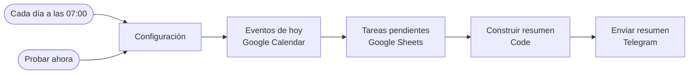

# Proyecto B — Daily Productivity Assistant

## 1. Nombre

`daily-assistant.json` — *Proyecto B - Daily Productivity Assistant*

## 2. Objetivo

Recibir cada mañana en Telegram un resumen del día: eventos del calendario ordenados, huecos libres en tu jornada y tareas vencidas, para hoy o de prioridad alta.

## 3. Dificultad

Intermediate. Trigger programado, lectura de dos servicios, manejo de fechas y zonas horarias con Luxon.

## 4. Tecnologías utilizadas

| Tecnología | Nodo de n8n | Uso |
| --- | --- | --- |
| Google Calendar API | Google Calendar (Event > Get Many) | Eventos de hoy |
| Google Sheets API | Google Sheets (Get Rows) | Tareas pendientes del Proyecto A |
| Telegram Bot API | Telegram (Send Message) | Notificación |
| Luxon | Code | Fechas, horas y huecos libres |

## 5. Diagrama del flujo



## 6. Requisitos

- Credencial **Google Calendar OAuth2** ([guía](../../guides/google-calendar-setup.md)).
- Credencial de **Google Sheets** y pestaña `Tareas` (opcional, si usas el Proyecto A).
- Credencial **Telegram API** y tu `chat_id`.
- **No necesita túnel HTTPS**: n8n envía el mensaje, no lo recibe.

## 7. Preparación de credenciales

| Credencial | Nodo |
| --- | --- |
| Google Calendar OAuth2 API | `Eventos de hoy` |
| Google Sheets OAuth2 API (o Service Account) | `Tareas pendientes` |
| Telegram API | `Enviar resumen` |

## 8. Instrucciones de importación

1. Importa `daily-assistant.json`.
2. Asigna las tres credenciales.
3. Rellena **Configuración**.
4. Si no usas el Proyecto A: pon `incluirTareas` en `false` y desactiva el nodo **Tareas pendientes** (selecciónalo y pulsa `D`).

## 9. Configuración nodo por nodo

| Nodo | Configuración clave |
| --- | --- |
| Cada día a las 07:00 | Schedule Trigger, intervalo diario, hora 7. Usa `GENERIC_TIMEZONE`. |
| Probar ahora | Manual Trigger para pruebas. |
| Configuración | `chatId`, `calendarId` (`primary`), `spreadsheetId`, `incluirTareas`, `inicioJornada` (`08:00`), `finJornada` (`20:00`). |
| Eventos de hoy | *Operation*: Get Many. *Calendar*: por ID desde `Configuración`. *Return All*. *After*: `{{ $now.startOf('day').toISO() }}`. *Before*: `{{ $now.endOf('day').toISO() }}`. *Order By*: Start Time. *Recurring Event Handling*: Expand. *Always Output Data*. |
| Tareas pendientes | Get Rows de `Tareas`. *Execute Once* (evita leer la hoja una vez por cada evento) y *Always Output Data*. |
| Construir resumen | Normaliza eventos (incluidos los de día completo y descartando cancelados), calcula huecos libres de 30 minutos o más y clasifica tareas del `chatId` configurado. |
| Enviar resumen | Chat ID `{{ $json.chatId }}`, texto `{{ $json.respuesta }}`. |

> [!NOTE]
> **Execute Once** es clave: Google Calendar devuelve un item por evento y, sin esta opción, el nodo de Sheets leería la hoja una vez por evento.

## 10. Datos de prueba

Crea en tu calendario (o en un calendario secundario `Taller n8n`) los eventos de [calendar-events.json](../../templates/sample-data/calendar-events.json) para el día de hoy.

Entrada de **Construir resumen** (un evento, resumido):

```json
{ "summary": "Reunión de planificación", "location": "Sala 2", "start": { "dateTime": "2026-11-17T09:00:00-06:00" }, "end": { "dateTime": "2026-11-17T10:00:00-06:00" } }
```

## 11. Ejecución paso a paso

1. Pulsa **Execute workflow** (usa *Probar ahora*).
2. Revisa la salida de **Eventos de hoy** y de **Tareas pendientes**.
3. Comprueba el texto en **Construir resumen** y el mensaje en Telegram.
4. Pulsa **Publish** para recibirlo cada día a las 07:00.

## 12. Resultado esperado

```text
Resumen del martes 17 de noviembre

AGENDA (3 eventos)
- Todo el día  Cumpleaños de Ana
- 09:00-10:00  Reunión de planificación (Sala 2)
- 12:30-13:30  Clase de inglés

TIEMPO LIBRE EN TU JORNADA
- 08:00-09:00 (1 h)
- 10:00-12:30 (2 h 30 min)
- 13:30-20:00 (6 h 30 min)

TAREAS
Vencidas: 1 | Para hoy: 1 | Pendientes: 2
- [VENCIDA] Pagar factura de luz (T-XY34ZT)
- [hoy] Preparar presentación (T-AB12CD)
```

Salida JSON del nodo **Construir resumen**:

```json
{ "chatId": "111111111", "fecha": "2026-11-17", "totalEventos": 3, "totalTareasPendientes": 2, "tareasVencidas": 1, "respuesta": "Resumen del martes 17 de noviembre\n..." }
```

## 13. Errores frecuentes

| Síntoma | Causa | Solución |
| --- | --- | --- |
| Eventos del día anterior o siguiente | Zona horaria incorrecta | Ajusta `GENERIC_TIMEZONE` y `TZ` en `.env` y recrea el contenedor. |
| `chat not found` | `chatId` incorrecto | Revisa el valor en **Configuración**. |
| Error en **Tareas pendientes** sin usar el Proyecto A | El nodo intenta leer una hoja inexistente | Desactívalo y pon `incluirTareas = false`. |
| No llega a las 07:00 | Workflow no publicado | Pulsa **Publish**. |

## 14. Posibles mejoras

- Añadir el tiempo con una API meteorológica gratuita (HTTP Request).
- Reescribir el resumen con IA usando [daily-summary-writer.md](../../templates/prompts/daily-summary-writer.md).
- Enviar también un resumen por la tarde con lo que queda pendiente.

## 15. Consideraciones de seguridad

- El resumen contiene títulos y ubicaciones de tus eventos. Telegram almacena los mensajes en sus servidores.
- El workflow solo lee el calendario. Si amplías el workflow para crear eventos, revisa los permisos de la credencial.

## Estado de verificación

| Nivel | Resultado |
| --- | --- |
| Validación estática | Superada. |
| Importación | Comprobada en n8n 2.48.4. |
| Ejecución | Comprobada en n8n 2.48.4 con Google Calendar, Google Sheets y Telegram **simulados** (día con eventos, eventos de día completo y cancelados, y día sin eventos). |
| Integración real | Pendiente: requiere tus credenciales. |
