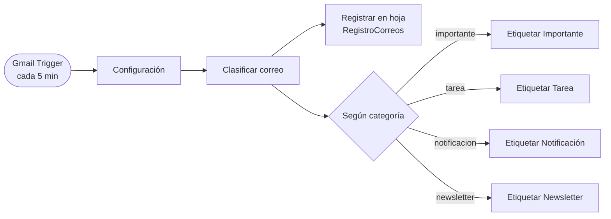

# Proyecto C — Smart Email Organizer

## 1. Nombre

- `email-organizer.json` — *Proyecto C - Smart Email Organizer* (workflow principal).
- `email-classifier-test.json` — *Proyecto C - Prueba del clasificador (sin Gmail)* (practica la lógica sin credenciales).

## 2. Objetivo

Clasificar automáticamente los correos nuevos en `importante`, `tarea`, `notificacion`, `newsletter` u `otros`, aplicar una etiqueta de Gmail y registrar el resultado en Google Sheets.

## 3. Dificultad

Intermediate. Trigger de sondeo, clasificación por reglas, ramas con Switch y escritura en dos servicios.

## 4. Tecnologías utilizadas

| Tecnología | Nodo | Uso |
| --- | --- | --- |
| Gmail API | Gmail Trigger, Gmail (Add Labels) | Leer correos nuevos y etiquetarlos |
| Google Sheets API | Google Sheets (Append) | Registro de clasificaciones |
| JavaScript | Code | Reglas de clasificación |

## 5. Diagrama del flujo



Los correos `otros` se registran pero no se etiquetan.

### Reglas de clasificación (en orden)

| Orden | Regla | Categoría |
| --- | --- | --- |
| 1 | El remitente está en `remitentesImportantes` | `importante` |
| 2 | Asunto o fragmento contienen *newsletter, boletín, darte de baja, unsubscribe...* | `newsletter` |
| 3 | El remitente es automático (*no-reply, noreply, notifications, alerts...*) | `notificacion` |
| 4 | Contienen *urgente, importante, fecha límite, vence hoy, acción requerida...* | `importante` |
| 5 | Contienen *notificación, alerta, confirmación, tu pedido, recibo, inicio de sesión...* | `notificacion` |
| 6 | Contienen *por favor, podrías, necesito que, pendiente, revisar...* | `tarea` |
| 7 | Ninguna de las anteriores | `otros` |

Las comparaciones ignoran mayúsculas y tildes. El campo `motivo` explica qué regla se aplicó.

## 6. Requisitos

- Credencial **Gmail OAuth2** ([guía](../../guides/gmail-setup.md)).
- Etiquetas `n8n/Importante`, `n8n/Tareas`, `n8n/Notificaciones`, `n8n/Newsletters` creadas en Gmail.
- Pestaña `RegistroCorreos` ([plantilla](../../templates/google-sheets/registro-correos.csv)) y credencial de Google Sheets.
- No necesita túnel HTTPS (el Gmail Trigger consulta periódicamente).

## 7. Preparación de credenciales

| Credencial | Nodos |
| --- | --- |
| Gmail OAuth2 API | `Gmail Trigger` y los 4 nodos `Etiquetar ...` |
| Google Sheets | `Registrar en hoja` |

## 8. Instrucciones de importación

1. Importa `email-classifier-test.json` y ejecútalo: no necesita nada y muestra cómo se clasifican 8 correos ficticios.
2. Importa `email-organizer.json`.
3. Asigna credenciales.
4. En cada nodo `Etiquetar ...`, elige la etiqueta en **Label Names or IDs**.
5. Rellena **Configuración** (`spreadsheetId`, `remitentesImportantes`).

## 9. Configuración nodo por nodo

| Nodo | Configuración clave |
| --- | --- |
| Gmail Trigger | *Poll Times*: cada 5 minutos. *Event*: Message Received. *Simplify*: activado (devuelve `From`, `Subject`, `snippet`, `id`; no el cuerpo completo, lo que reduce memoria y datos procesados). *Filters > Search*: `in:inbox`. |
| Configuración | `spreadsheetId`; `remitentesImportantes` (direcciones o dominios separados por comas). *Include Other Input Fields* activado para conservar los datos del correo. |
| Clasificar correo | Code. Devuelve `message_id`, `fecha_procesado`, `remitente`, `asunto`, `categoria`, `motivo`. |
| Registrar en hoja | Append en `RegistroCorreos`, mapeo automático. |
| Según categoría | Switch con 4 salidas. Sin salida *fallback*: `otros` no se etiqueta. |
| Etiquetar ... | Gmail > Message > Add Label. *Message ID*: `{{ $json.message_id }}`. |

## 10. Datos de prueba

[emails.json](../../templates/sample-data/emails.json): 8 correos ficticios y su resultado esperado.

Entrada (un item del Gmail Trigger simplificado):

```json
{ "id": "demo-0002", "From": "Soporte Proveedor <soporte@proveedor.example.com>", "Subject": "URGENTE: renovación del contrato vence hoy", "snippet": "Tu contrato ficticio vence hoy..." }
```

Salida de **Clasificar correo**:

```json
{ "message_id": "demo-0002", "fecha_procesado": "2026-11-17 08:05", "remitente": "soporte@proveedor.example.com", "asunto": "URGENTE: renovación del contrato vence hoy", "categoria": "importante", "motivo": "Contiene \"urgente\"" }
```

## 11. Ejecución paso a paso

1. Ejecuta `email-classifier-test.json` y comprueba que la distribución es: Importante 3, Tarea 1, Notificación 2, Newsletter 1, Otros 1.
2. En el workflow principal, envíate un correo de prueba y pulsa **Fetch Test Event** en el trigger.
3. Pulsa **Execute workflow** y revisa la etiqueta en Gmail y la fila en la hoja.
4. Pulsa **Publish**.

## 12. Resultado esperado

- Cada correo nuevo de la bandeja de entrada recibe como máximo una etiqueta `n8n/...`.
- La pestaña `RegistroCorreos` contiene una fila por correo con la categoría y el motivo.

## 13. Errores frecuentes

| Síntoma | Solución |
| --- | --- |
| `Label name or ID not found` | Selecciona la etiqueta en cada nodo `Etiquetar ...`. |
| Ningún correo en *Fetch Test Event* | Envía un correo nuevo; el trigger solo devuelve correos recientes que cumplan el filtro. |
| Clasificación incorrecta | Ajusta las listas de `REGLAS` en el nodo Code o añade el remitente a `remitentesImportantes`. |

## 14. Posibles mejoras

- Marcar como leídas las notificaciones (*Mark as Read*).
- Clasificar con IA los correos que caen en `otros` reutilizando el Proyecto E.
- Crear automáticamente una tarea del Proyecto A para cada correo `tarea`.

## 15. Consideraciones de seguridad

- La credencial de Gmail permite leer todo tu correo. Úsala solo en una instancia protegida.
- El registro no guarda el cuerpo de los correos.
- El workflow no borra, archiva ni envía correos.

## Estado de verificación

| Nivel | Resultado |
| --- | --- |
| Validación estática | Superada en ambos workflows. |
| Importación | Comprobada en n8n 2.48.4 (ambos). |
| Ejecución | `email-classifier-test.json`: comprobada en n8n 2.48.4 sin cambios. `email-organizer.json`: comprobada con Gmail y Google Sheets **simulados** usando los 8 correos de prueba. |
| Integración real | Pendiente: requiere tus credenciales. |
