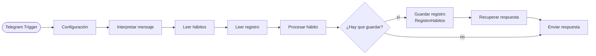
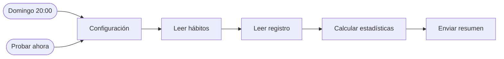

# Proyecto D — Habit Tracker

## 1. Nombre

- `habit-tracker-bot.json` — *Proyecto D - Habit Tracker (bot)*: registro y consultas desde Telegram.
- `habit-weekly-summary.json` — *Proyecto D - Resumen semanal de hábitos*: estadísticas cada domingo.

## 2. Objetivo

Registrar hábitos diarios desde Telegram, consultar el historial y medir el porcentaje de cumplimiento frente a una meta semanal.

## 3. Dificultad

Intermediate. Lectura de dos pestañas, deduplicación, cálculo de estadísticas y dos workflows que comparten datos.

## 4. Tecnologías utilizadas

| Tecnología | Nodo | Uso |
| --- | --- | --- |
| Telegram Bot API | Telegram Trigger, Telegram | Comandos y respuestas |
| Google Sheets API | Google Sheets (Get Rows, Append) | Catálogo de hábitos e historial |
| JavaScript | Code | Validación y estadísticas |

## 5. Diagrama del flujo

**Bot de hábitos:**



**Resumen semanal:**



### Cómo se calcula el cumplimiento

```text
objetivo   = redondeo(meta_semanal x días / 7)      (mínimo 1)
cumplidos  = días distintos con registro del hábito en el periodo
porcentaje = mínimo(100, cumplidos / objetivo x 100)
```

Ejemplo: `ejercicio` con meta 3 días/semana, registrado 2 días en los últimos 7: `2 / 3 = 67 %`.

## 6. Requisitos

- Pestañas `Habitos` ([plantilla](../../templates/google-sheets/habitos.csv)) y `RegistroHabitos` ([plantilla](../../templates/google-sheets/registro-habitos.csv)).
- Credenciales de Telegram y Google Sheets.
- Túnel HTTPS para el bot (no para el resumen semanal).

## 7. Preparación de credenciales

| Credencial | Nodos |
| --- | --- |
| Telegram API | `Telegram Trigger`, `Enviar respuesta`, `Enviar resumen` |
| Google Sheets | `Leer hábitos`, `Leer registro`, `Guardar registro` |

## 8. Instrucciones de importación

1. Importa los dos archivos.
2. Asigna credenciales.
3. Rellena **Configuración** en ambos (`spreadsheetId`; y `chatId` en el resumen semanal).
4. Edita la pestaña `Habitos` con tus propios hábitos.

## 9. Configuración nodo por nodo

| Nodo | Configuración clave |
| --- | --- |
| Interpretar mensaje | Comandos `/habito nombre [nota]`, `/habitos`, `/hoy`, `/stats [días]` (1 a 90), `/ayuda`. |
| Leer hábitos / Leer registro | Get Rows. *Execute Once* y *Always Output Data* activados. |
| Procesar hábito | Filtra hábitos activos (`activo = si`), busca el hábito por nombre exacto o prefijo único, evita registrar dos veces el mismo día y calcula estadísticas. Devuelve `guardar: true` y la fila cuando hay que escribir. |
| ¿Hay que guardar? | IF sobre `{{ $json.guardar }}`. |
| Guardar registro | Append en `RegistroHabitos`, mapeo automático (`fecha`, `habito`, `chat_id`, `nota`, `registrado_en`). |
| Recuperar respuesta | Recupera el texto calculado antes de guardar. |
| Domingo a las 20:00 | Schedule Trigger semanal, día 0 (domingo), hora 20. |
| Calcular estadísticas | Estadísticas de 7 días, hábito más constante y hábito a reforzar. |

## 10. Datos de prueba

Pestaña `Habitos`:

| habito | descripcion | meta_semanal | activo |
| --- | --- | --- | --- |
| leer | Leer al menos 20 minutos | 7 | si |
| ejercicio | Hacer 30 minutos de ejercicio | 3 | si |
| meditar | Meditar 10 minutos | 5 | no |

Salida de **Procesar hábito** para `/habito leer capítulo 2`:

```json
{
  "chatId": "111111111",
  "guardar": true,
  "fecha": "2026-11-17",
  "habito": "leer",
  "chat_id": "111111111",
  "nota": "capítulo 2",
  "registrado_en": "2026-11-17 22:10",
  "respuesta": "Registrado: leer (2026-11-17)\nÚltimos 7 días: 3/7 días, 43% de tu meta."
}
```

## 11. Ejecución paso a paso

1. Con el túnel activo, pulsa **Execute workflow** en el bot y envía `/habitos`.
2. Envía `/habito leer`. Comprueba la fila nueva en `RegistroHabitos`.
3. Envía otra vez `/habito leer`: debe responder que ya está registrado hoy.
4. Envía `/stats`.
5. En el resumen semanal pulsa **Execute workflow** (*Probar ahora*).
6. Publica ambos workflows.

## 12. Resultado esperado

`/stats`:

```text
Cumplimiento de los últimos 7 días

#######--- 67%  ejercicio (2/3 días)
###------- 29%  leer (2/7 días)
----------   0%  estudiar-n8n (0/5 días)

Media global: 32%
```

## 13. Errores frecuentes

| Síntoma | Solución |
| --- | --- |
| `No existe el hábito` | Revisa el nombre en `Habitos` y que `activo` sea `si`. |
| `coincide con varios hábitos` | Escribe más letras del nombre. |
| Estadísticas al 0 % con registros existentes | El `chat_id` de los registros no coincide con tu chat, o las fechas no tienen formato `AAAA-MM-DD`. |

## 14. Posibles mejoras

- Recordatorio a las 21:00 con los hábitos pendientes del día.
- Rachas (días consecutivos) por hábito.
- Gráfico semanal con un servicio de gráficos por URL.

## 15. Consideraciones de seguridad

- Los hábitos pueden revelar información de salud o rutinas. Guárdalos en una hoja privada.
- Restringe el bot a tu `chat_id`.

## Estado de verificación

| Nivel | Resultado |
| --- | --- |
| Validación estática | Superada (ambos). |
| Importación | Comprobada en n8n 2.48.4 (ambos). |
| Ejecución | Comprobada en n8n 2.48.4 con Telegram y Google Sheets **simulados** (12 escenarios: registro, duplicados, hábitos inactivos, prefijos, `/hoy`, `/stats`, errores y resumen semanal). |
| Integración real | Pendiente: requiere tus credenciales. |
