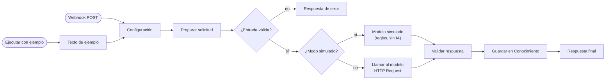

# Proyecto E — AI Knowledge Assistant

## 1. Nombre

`ai-knowledge-assistant.json` — *Proyecto E - AI Knowledge Assistant*

## 2. Objetivo

Transformar texto desordenado (notas, apuntes, ideas) en información estructurada: categoría, título, resumen, puntos clave y etiquetas, validada y guardada en Google Sheets.

## 3. Dificultad

Advanced. Llamada a una API de IA, tratamiento de la salida como dato no confiable, validación, modo simulado y doble entrada (webhook y manual).

## 4. Tecnologías utilizadas

| Tecnología | Nodo | Uso |
| --- | --- | --- |
| API compatible con OpenAI (Ollama, Groq, Gemini, OpenRouter, OpenAI...) | HTTP Request | Clasificación y resumen |
| Webhook | Webhook | Entrada desde otras aplicaciones |
| Google Sheets API | Google Sheets (Append) | Almacenamiento |
| JavaScript | Code | Preparación, simulación y validación |

## 5. Diagrama del flujo



## 6. Requisitos

- Pestaña `Conocimiento` ([plantilla](../../templates/google-sheets/conocimiento.csv)) y credencial de Google Sheets.
- Opcional: un proveedor de IA ([guía](../../guides/ai-provider-setup.md)). Sin él, el modo simulado permite completar el proyecto.

> [!IMPORTANT]
> **Costos.** Ollama es gratuito y local. Los proveedores en la nube pueden cobrar por uso o limitar su plan gratuito. Configura un límite de gasto antes de usar una API key.

## 7. Preparación de credenciales

| Credencial | Nodo | Cuándo |
| --- | --- | --- |
| Header Auth (`Authorization: Bearer ...`) | `Llamar al modelo` | Solo con `useMockModel = false` |
| Google Sheets | `Guardar en Conocimiento` | Siempre |

## 8. Instrucciones de importación

1. Importa el archivo.
2. Asigna la credencial de Google Sheets y rellena `spreadsheetId` en **Configuración**.
3. Ejecuta con `useMockModel = true`.
4. Cuando quieras usar IA real: configura el proveedor, la credencial Header Auth y pon `useMockModel = false`.

## 9. Configuración nodo por nodo

| Nodo | Configuración clave |
| --- | --- |
| Webhook | `POST /knowledge-assistant`. *Respond*: When Last Node Finishes (devuelve el JSON del último nodo). |
| Texto de ejemplo | Texto ficticio de una reunión y `fuente`. |
| Configuración | `useMockModel`, `apiBaseUrl`, `model`, `maxInputChars`, `categorias`, `spreadsheetId`. *Include Other Input Fields* activado. |
| Preparar solicitud | Acepta `body.texto` (webhook) o `texto` (manual). Exige al menos 20 caracteres, normaliza espacios, recorta a `maxInputChars` y construye `requestBody` con el [prompt del clasificador](../../templates/prompts/knowledge-classifier.md). |
| Modelo simulado | Reglas por palabras clave que imitan el formato `choices[0].message.content`. **No es IA**; el campo `modelo` queda como `simulado`. |
| Llamar al modelo | `POST {{apiBaseUrl}}/chat/completions`, *Authentication*: Generic > Header Auth, cuerpo JSON `{{ JSON.stringify($json.requestBody) }}`, *Timeout* 120 s, *Retry On Fail* 3 intentos cada 3 s. |
| Validar respuesta | Elimina bloques Markdown, extrae el JSON, comprueba categoría en lista cerrada, resumen y puntos clave; recorta longitudes. `estado` = `ok` o `revisar`. |
| Guardar en Conocimiento | Append con mapeo automático. |

## 10. Datos de prueba

Textos en [knowledge-inputs.json](../../templates/sample-data/knowledge-inputs.json).

Entrada por webhook:

```bash
curl -X POST http://localhost:5678/webhook-test/knowledge-assistant \
  -H "Content-Type: application/json" \
  -d '{"texto":"En n8n cada nodo recibe una lista de items. Las expresiones se escriben entre dobles llaves y permiten leer datos de nodos anteriores.","fuente":"apuntes"}'
```

Respuesta esperada (modo simulado):

```json
{
  "ok": true,
  "id": "K-M3X9ABCD",
  "estado": "ok",
  "categoria": "referencia",
  "titulo": "En n8n cada nodo recibe una lista de items.",
  "resumen": "En n8n cada nodo recibe una lista de items. Las expresiones se escriben entre dobles llaves y permiten leer datos de nodos anteriores.",
  "puntos_clave": ["En n8n cada nodo recibe una lista de items.", "Las expresiones se escriben entre dobles llaves y permiten leer datos de nodos anteriores."],
  "etiquetas": ["recibe", "expresiones", "escriben", "dobles"]
}
```

Con un modelo real los valores serán distintos y, normalmente, de mejor calidad.

Entrada no válida (`{"texto":"muy corto"}`):

```json
{ "ok": false, "error": "El campo \"texto\" es obligatorio y debe tener al menos 20 caracteres." }
```

## 11. Ejecución paso a paso

1. Pulsa **Execute workflow** (usa *Ejecutar con ejemplo*).
2. Revisa **Preparar solicitud**: `requestBody` contiene el prompt completo.
3. Revisa **Validar respuesta**: `valido: true`, `estado: ok`.
4. Comprueba la fila en `Conocimiento`.
5. Cambia a un proveedor real y compara los resultados.

## 12. Resultado esperado

Una fila por texto en `Conocimiento` con categoría de la lista, resumen breve, puntos clave separados por ` | ` y etiquetas.

## 13. Errores frecuentes

Ver la tabla de [errores del proveedor de IA](../../guides/ai-provider-setup.md#errores-frecuentes). Además:

| Síntoma | Solución |
| --- | --- |
| `estado: revisar` frecuente | Usa un modelo más capaz o baja la temperatura; revisa el campo `errores`. |
| El webhook responde vacío | Revisa que el último nodo ejecutado sea *Respuesta final* o *Respuesta de error*. |

## 14. Posibles mejoras

- Usar el nodo **Basic LLM Chain** con *Structured Output Parser* de n8n y comparar.
- Evitar duplicados calculando un hash del texto.
- Búsqueda posterior por etiquetas desde Telegram.

## 15. Consideraciones de seguridad

- Con proveedores en la nube, el texto sale de tu equipo.
- Protege el webhook con *Header Auth* si lo publicas en Internet: cualquiera podría consumir tu cuota.
- La salida del modelo se valida y se restringe antes de guardarla.

## Estado de verificación

| Nivel | Resultado |
| --- | --- |
| Validación estática | Superada. |
| Importación | Comprobada en n8n 2.48.4. |
| Ejecución | Comprobada en n8n 2.48.4: modo simulado completo, entrada no válida y dos respuestas de modelo simuladas (JSON dentro de un bloque Markdown y texto sin JSON). Google Sheets **simulado**. |
| Integración real | Pendiente: requiere un proveedor de IA y tus credenciales. No se ha comprobado la llamada a ningún proveedor real. |
