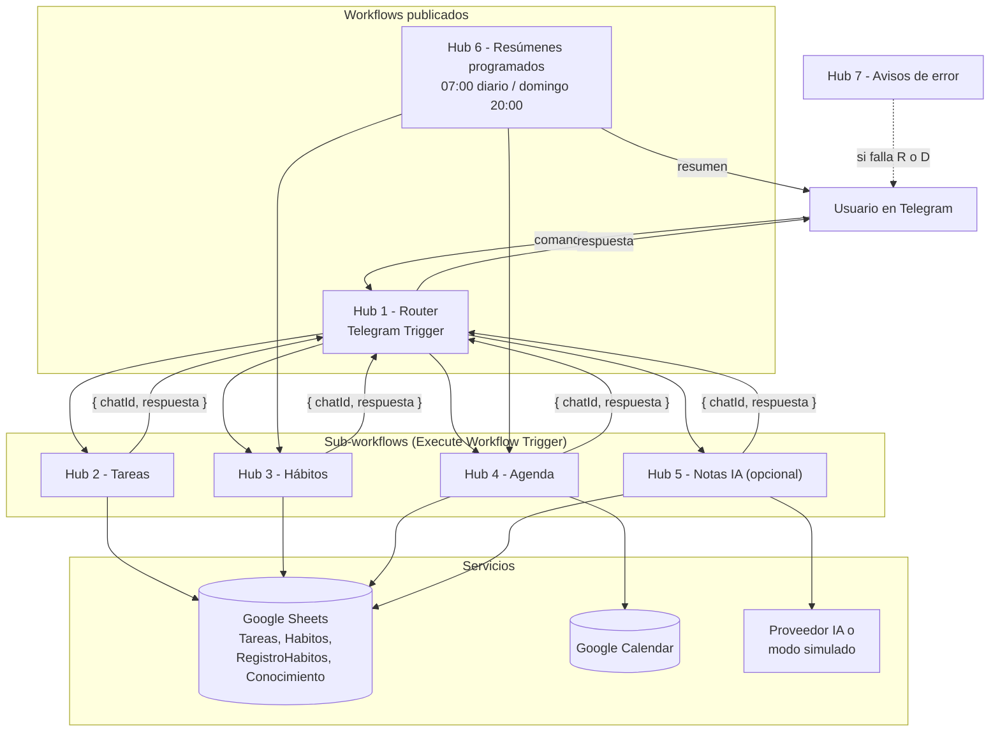

# Proyecto final — Personal Productivity Hub

## 1. Nombre

Sistema de 7 workflows independientes:

| Archivo | Workflow | Tipo |
| --- | --- | --- |
| [hub-01-router.json](hub-01-router.json) | Hub 1 - Router principal (Telegram) | Principal, se publica |
| [hub-02-tasks.json](hub-02-tasks.json) | Hub 2 - Módulo de tareas | Sub-workflow |
| [hub-03-habits.json](hub-03-habits.json) | Hub 3 - Módulo de hábitos | Sub-workflow |
| [hub-04-agenda.json](hub-04-agenda.json) | Hub 4 - Módulo de agenda | Sub-workflow |
| [hub-05-ai-notes.json](hub-05-ai-notes.json) | Hub 5 - Módulo de notas con IA (opcional) | Sub-workflow |
| [hub-06-scheduled-digests.json](hub-06-scheduled-digests.json) | Hub 6 - Resúmenes programados | Principal, se publica |
| [hub-07-error-notifier.json](hub-07-error-notifier.json) | Hub 7 - Avisos de error | Error workflow |

## 2. Objetivo

Un asistente centralizado en un único bot de Telegram que integra las automatizaciones del taller: tareas, hábitos, agenda, resúmenes programados, notas clasificadas con IA (opcional) y avisos de error.

## 3. Dificultad

Advanced. Arquitectura con sub-workflows, router de comandos, configuración centralizada, control de acceso y workflow de errores.

## 4. Tecnologías utilizadas

Telegram Bot API, Google Sheets API, Google Calendar API, API compatible con OpenAI (opcional) y los nodos Execute Workflow / Execute Workflow Trigger de n8n.

## 5. Diagrama del flujo

### Arquitectura



### Contrato entre router y módulos

Entrada que reciben los sub-workflows:

```json
{
  "chatId": "111111111",
  "texto": "/tareas",
  "modulo": "tareas",
  "comando": "/tareas",
  "argumentos": "",
  "config": {
    "spreadsheetId": "...",
    "calendarId": "primary",
    "incluirTareas": true,
    "inicioJornada": "08:00",
    "finJornada": "20:00",
    "aiEnabled": false,
    "useMockModel": true,
    "apiBaseUrl": "http://host.docker.internal:11434/v1",
    "model": "llama3.2",
    "maxInputChars": 6000,
    "categorias": "trabajo,estudio,personal,finanzas,salud,ideas,referencia"
  }
}
```

Salida que devuelven (el router la envía a Telegram):

```json
{ "chatId": "111111111", "respuesta": "Texto para el usuario" }
```

### Decisiones de arquitectura

| Decisión | Motivo |
| --- | --- |
| Un router y varios sub-workflows | Cada módulo se prueba y modifica por separado; el router queda pequeño. |
| Configuración solo en el router (y en Hub 6) | Un único lugar para IDs y opciones. Los módulos la reciben en `config`. |
| Contrato `{ chatId, respuesta }` | Cualquier módulo nuevo se integra sin cambiar el envío a Telegram. |
| IA desactivada por defecto (`aiEnabled = false`) | El sistema funciona completo sin servicios de pago. |
| Control de acceso por `chatIdAutorizado` | El bot ignora a cualquier otro usuario. |
| Workflow de errores separado | Los fallos en producción se notifican sin depender del flujo que falló. |

## 6. Requisitos

Todos los de los proyectos A, B y D, y opcionalmente E. Una sola hoja `Productivity Workshop` con las pestañas `Tareas`, `Habitos`, `RegistroHabitos` y `Conocimiento`. Túnel HTTPS para el router.

## 7. Preparación de credenciales

| Credencial | Workflows y nodos |
| --- | --- |
| Telegram API | Hub 1 (`Telegram Trigger`, `Enviar respuesta`), Hub 6 (`Enviar resumen`), Hub 7 (`Enviar aviso`) |
| Google Sheets | Hub 2 (4 nodos), Hub 3 (3 nodos), Hub 4 (`Tareas pendientes`), Hub 5 (`Guardar en Conocimiento`) |
| Google Calendar OAuth2 | Hub 4 (`Eventos de hoy`) |
| Header Auth (opcional) | Hub 5 (`Llamar al modelo`) |

> [!IMPORTANT]
> Usa **un bot distinto** al de los proyectos A y D, o despublica esos workflows. Telegram solo admite un webhook por bot.

## 8. Instrucciones de importación

El orden importa porque el router y Hub 6 necesitan los IDs de los sub-workflows.

1. Importa Hub 2, Hub 3, Hub 4 y Hub 5. Asigna sus credenciales y guarda cada uno.
2. Importa Hub 7. Rellena `chatId` y la credencial de Telegram. Guarda.
3. Importa Hub 1 (router):
   1. En cada nodo `Módulo de ...`, en **Workflow**, cambia a **From list** y elige el sub-workflow correspondiente (el valor `REEMPLAZAR_ID_...` es solo un marcador).
   2. Rellena **Configuración**.
   3. En *Settings* del workflow, elige *Hub 7 - Avisos de error* como **Error workflow**.
4. Importa Hub 6: selecciona los sub-workflows en sus dos nodos `Módulo de ...`, edita `chatId` y el objeto `config` del nodo **Configuración**, y asigna Hub 7 como *Error workflow*.
5. Publica **Hub 1** y **Hub 6**. Los sub-workflows y Hub 7 no necesitan publicarse.

## 9. Configuración nodo por nodo

### Hub 1 - Router

| Nodo | Configuración clave |
| --- | --- |
| Configuración | `chatIdAutorizado`, `spreadsheetId`, `calendarId`, `incluirTareas`, `inicioJornada`, `finJornada`, `aiEnabled`, `useMockModel`, `apiBaseUrl`, `model`, `maxInputChars`, `categorias`. |
| Interpretar comando | Control de acceso, solo texto, tabla de rutas por comando. Texto sin comando va a tareas. `/nota` con IA desactivada devuelve un aviso. |
| Según el módulo | Switch: `tareas`, `habitos`, `agenda`, `nota` y *fallback* `Respuesta directa`. |
| Módulo de ... | Execute Workflow, *Source*: Database, *Mode*: Run once with all items, *Wait for Sub-Workflow Completion*: activado. |
| Enviar respuesta | Telegram con `{{ $json.chatId }}` y `{{ $json.respuesta }}`. |

### Hub 2 a Hub 5

Empiezan con **Entrada del router** (Execute Workflow Trigger, *Input data mode*: Accept all data) y reutilizan la lógica de los proyectos A, D, B y E. Leen la configuración con `$('Entrada del router').first().json.config`.

### Hub 6 - Resúmenes programados

Dos triggers (diario 07:00 y domingo 20:00) generan una solicitud (`/agenda` o `/stats 7`), se añade la configuración y se delega en el módulo correspondiente.

### Hub 7 - Avisos de error

Error Trigger, formatea workflow, nodo, mensaje (máximo 300 caracteres) y enlace a la ejecución, y lo envía por Telegram.

## 10. Datos de prueba

Comandos de [telegram-messages.json](../../templates/sample-data/telegram-messages.json). Para probar un sub-workflow aislado, fija (*pin*) en **Entrada del router** un JSON como el del contrato de arriba.

## 11. Ejecución paso a paso

1. Abre Hub 2 y fija en *Entrada del router* `{ "chatId": "TU_CHAT", "texto": "/tareas", "config": { "spreadsheetId": "TU_HOJA" } }`. Ejecuta.
2. Repite con Hub 3 (`/habitos`) y Hub 4 (`/agenda`, con `calendarId` en `config`).
3. Con el túnel activo, ejecuta Hub 1 y envía `/ayuda`, `/tareas`, `/hoy`, `/agenda`.
4. Ejecuta Hub 6 manualmente: abre el nodo *Cada día a las 07:00* y pulsa **Execute step**, y luego *Execute workflow*.
5. Publica Hub 1 y Hub 6.
6. Opcional: pon `aiEnabled = true` y envía `/nota ...`.

## 12. Resultado esperado

| Mensaje | Módulo | Respuesta |
| --- | --- | --- |
| `/ayuda` | Router | Lista de comandos por módulo |
| `Comprar pan` | Tareas | `Tarea creada ...` |
| `/tareas` | Tareas | Listado de pendientes |
| `/habito leer` | Hábitos | `Registrado: leer ...` |
| `/stats 30` | Hábitos | Porcentajes de 30 días |
| `/agenda` | Agenda | Resumen del día |
| `/nota ...` | Notas IA | `Nota guardada ...` o aviso de IA desactivada |
| Mensaje desde otro chat | Router | `Este bot es privado.` |

## 13. Errores frecuentes

| Síntoma | Causa | Solución |
| --- | --- | --- |
| `Workflow does not exist` en un nodo `Módulo de ...` | Sigue el marcador `REEMPLAZAR_ID_...` | Selecciona el sub-workflow en la lista. |
| El módulo responde pero Telegram no recibe nada | El sub-workflow no termina en un nodo con `chatId` y `respuesta` | Revisa que la última rama ejecutada llegue a `Salida`. |
| `Este bot es privado` para ti | `chatIdAutorizado` incorrecto | Copia tu `chat_id` real. |
| No llegan avisos de error | Hub 7 no asignado como *Error workflow* | Revisa *Settings* de Hub 1 y Hub 6. Solo se notifican errores de ejecuciones de producción. |

## 14. Posibles mejoras

- Módulo de correo: `/correos` con el resumen de `RegistroCorreos` del día.
- Comandos con botones (*inline keyboard*) y *callback_query*.
- Sustituir Google Sheets por PostgreSQL (ya incluido en `docker-compose.yml`) cuando el volumen de datos crezca.
- Cola de mensajes fallidos para reintentos.

## 15. Consideraciones de seguridad

- Configura `chatIdAutorizado`: el router rechaza cualquier otro chat.
- El aviso de error no incluye datos de la ejecución, solo el mensaje recortado y el enlace (accesible solo con tu usuario de n8n).
- La IA está desactivada por defecto. Al activarla con un proveedor en la nube, el texto de `/nota` sale de tu equipo.

## Estado de verificación

| Nivel | Resultado |
| --- | --- |
| Validación estática | Superada (7 workflows). |
| Importación | Comprobada en n8n 2.48.4 (7 workflows). |
| Ejecución | Comprobada en n8n 2.48.4 **por separado** para cada workflow, con Telegram, Google y las llamadas a sub-workflows **simuladas** (18 escenarios: enrutado de cada comando, control de acceso, IA activada y desactivada, cada sub-workflow, los dos resúmenes programados y el aviso de error). |
| Integración entre workflows | No comprobada de extremo a extremo: requiere seleccionar los sub-workflows tras importarlos en tu instancia. |
| Integración real | Pendiente: requiere tus credenciales. |
